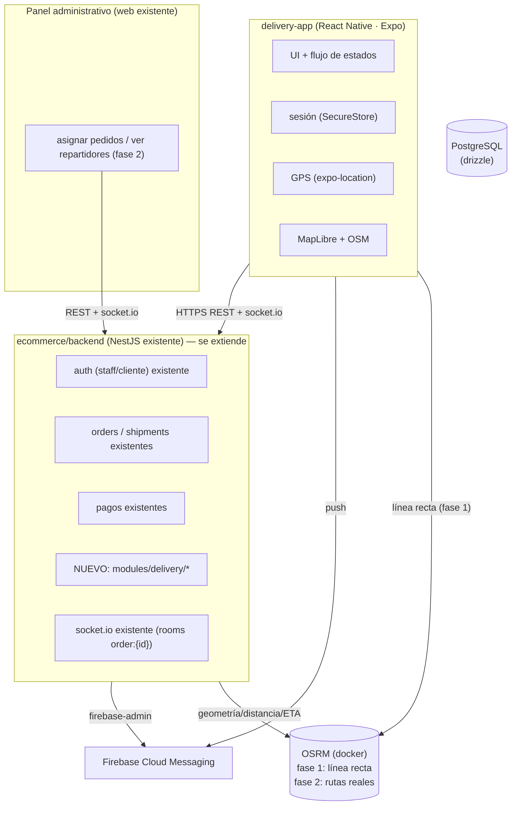
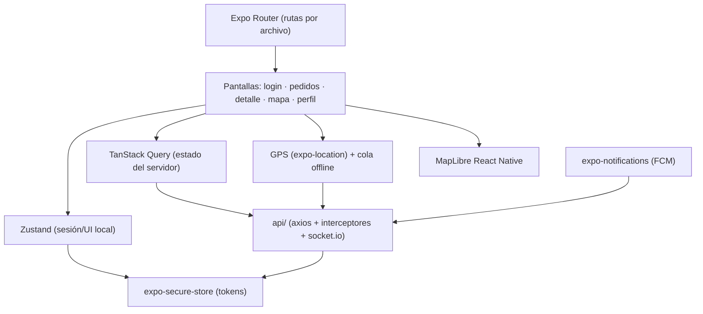
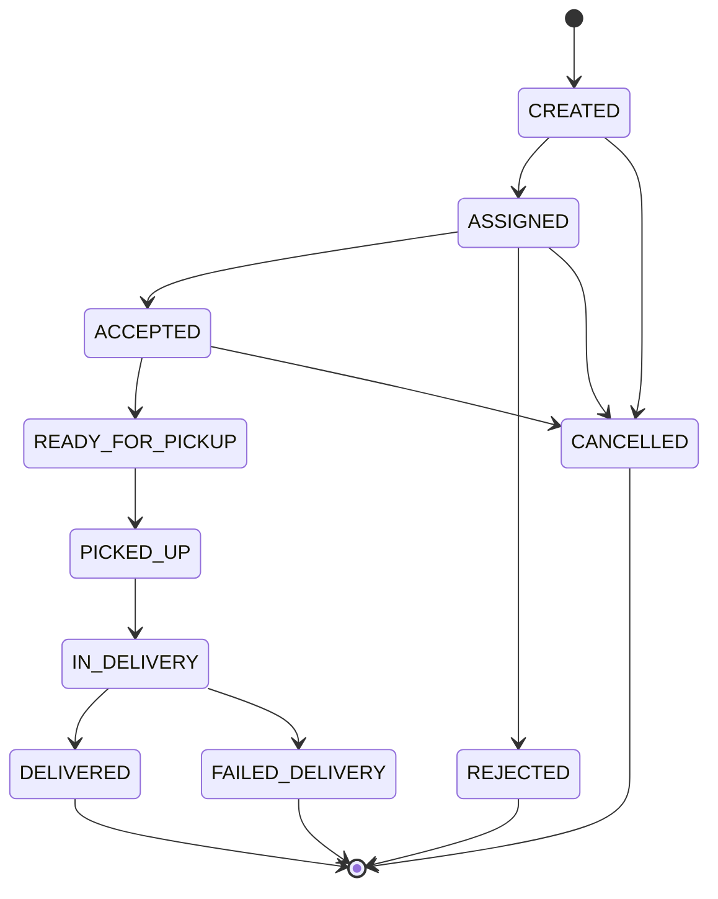
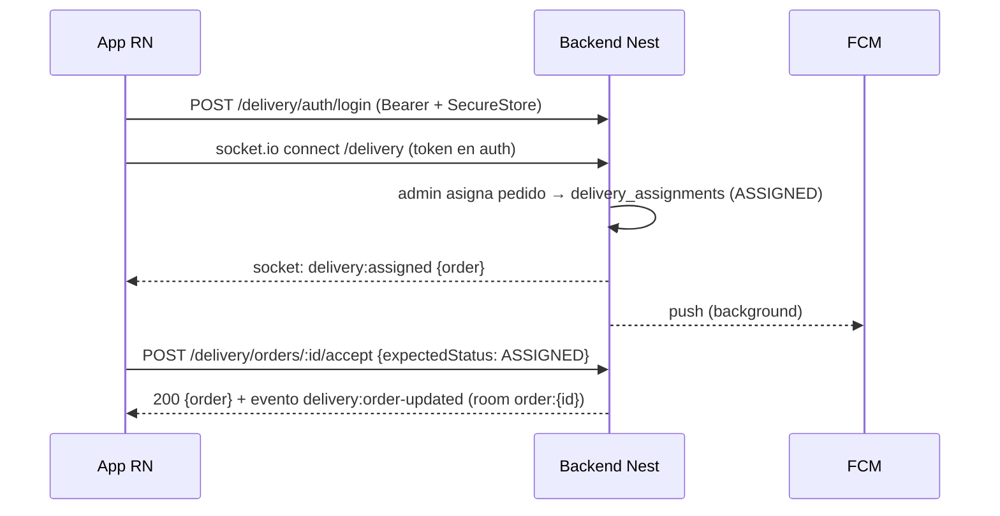
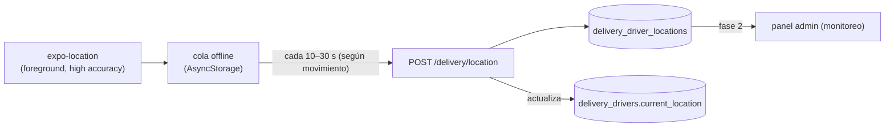

# Arquitectura — Delivery App (análisis técnico)

Análisis y decisiones justificadas para el MVP de la app de repartidores.
Regla rectora: **no sobrearquitecturar**. Todo lo que el backend del ecommerce
ya tiene, se reutiliza; solo se construye lo que el MVP necesita, dejando
puntos de extensión claros para las fases 2 y 3.

---

## 1. Arquitectura completa del sistema



**Decisión**: un solo backend (el existente). Razones: (a) el pedido nace y
vive ahí (`orders`, `shipments`, pagos); (b) ya tiene socket.io y el modelo de
delivery parcial; (c) un servicio nuevo añade red, sincronización de estados y
dos fuentes de verdad — innecesario a esta escala. Si mañana la plataforma
crece a multi-cliente, se extrae el módulo `delivery` como servicio con
contrato claro (ya quedará aislado como módulo Nest).

---

## 2. Arquitectura de la aplicación React Native



**Decisiones (justificadas)**:

| Decisión | Alternativa evaluada | Por qué esta |
|---|---|---|
| **Expo (dev builds)** | React Native CLI | Iteración más rápida, `expo-location/notifications/task-manager` mantenidos, OTA posible. Los dev builds son necesarios porque Expo Go no soporta push ni background location |
| **Expo Router** | React Navigation | Rutas por archivo + deep links gratis (necesarios para "recuperar contraseña") |
| **TanStack Query** | Redux/SWR | Cache, retries, refetch al reconectar; encaja con el flujo por pedidos. Es la pieza de más valor del MVP |
| **Zustand** | Context/Redux | Estado local mínimo (sesión, disponibilidad). Redux Toolkit es útil solo si el estado se vuelve muy complejo |
| **TypeScript** | JS | Sin discusión en este proyecto |

El dominio se separa por features (auth, orders, delivery, maps, tracking,
notifications, profile) como propusiste, cada feature con su carpeta en
`src/`. La máquina de estados del pedido en el cliente es **solo de UI**
(qué botón mostrar según `order.status`); la verdad está en el backend.

---

## 3. Arquitectura del backend

Extensión del backend existente (NestJS 11 + drizzle + socket.io):

```text
src/modules/delivery/
├── delivery.module.ts        # agrupa e importa sub-módulos
├── auth/                     # login/refresh/me/logout/forgot/reset
│   └── driver.repository.ts  # implementa AuthUserRepository (@dsi/auth-nest)
├── orders/
│   ├── orders.controller.ts  # GET asignados · GET :id · GET historial
│   ├── orders.service.ts     # proyección pedido→DTO del repartidor
│   └── state-machine.ts      # transiciones permitidas (única fuente de verdad)
├── delivery/                 # acciones del repartidor (aceptar, recoger…)
│   ├── delivery.controller.ts
│   └── delivery.service.ts   # valida transición + escribe delivery_events
├── drivers/
│   ├── drivers.controller.ts # perfil, disponibilidad, push-token
│   └── drivers.service.ts
├── location/
│   └── location.controller.ts# POST /delivery/location (ping GPS)
├── routing/
│   └── routing.service.ts    # fase 2: OSRM → {geometry, distanceM, durationS}
├── gateway/
│   └── delivery.gateway.ts   # namespace /delivery, rooms driver:{id}
└── push/
    └── push.service.ts       # firebase-admin → FCM
```

**Decisiones**:

- **Autenticación de repartidores con `@dsi/auth-nest`** (el paquete compartido
  que ya construimos): implementando `AuthUserRepository` sobre
  `delivery_drivers`. Evita reescribir login/lockout/refresh/guards; solo se
  escribe el adaptador a la tabla. Los roles de repartidor son `driver`.
- **Máquina de estados en el servicio**, no en el controlador: transiciones
  validables, testeables y auditable vía `delivery_events`.
- **Gateway socket.io propio** (`/delivery`) con rooms `driver:{id}` para
  eventos dirigidos; se reutiliza el patrón ya existente de
  `orders.gateway.ts` (`order:{id}`).
- Los DTOs del repartidor **no exponen** datos sensibles del cliente
  (solo nombre, teléfono, dirección y lo necesario para entregar).

---

## 4. Entidades y modelo de base de datos

→ Detalle completo en [modelo-de-datos.md](modelo-de-datos.md).

Resumen: el esquema ya contiene `delivery_drivers`, `delivery_assignments`
(con índice único *1 pedido activo por repartidor*), `delivery_events`,
`delivery_driver_locations`, `shipments` (1:1 con `orders`, incluye dirección y
`location` GeoJSON). **Faltan para el MVP**:

1. Campos de auth en `delivery_drivers`: `username`, `password_hash` (+
   `failed_attempts`, `locked_until`, `last_login` para el motor
   `@dsi/auth-nest`).
2. Nuevos valores del estado: `ACCEPTED`, `READY_FOR_PICKUP`, `IN_DELIVERY`,
   `REJECTED`, `FAILED_DELIVERY` (migración de enums + backfill
   `IN_TRANSIT → IN_DELIVERY`).
3. `delivery_driver_push_tokens` (FCM).
4. `delivery_proofs` (fase 3: foto/firma/OTP/ubicación — se crea la tabla o se
   diseña el JSON, pero no se implementa).

---

## 5. Estados y ciclo de vida del pedido

→ Máquina completa con tabla de transiciones en
[maquina-de-estados.md](maquina-de-estados.md).



**Decisiones**: los estados viven en `delivery_assignments.status` (enum
extendido). `shipments.status` (estado comercial: PENDING/PREPARING/…) se
sincroniza por el backend para no romper el ecommerce. Cada transición valida
**quién** la pide (`driver` dueño de la asignación, o `admin/tienda` para
cancelar/crear) y escribe un evento en `delivery_events` con timestamp,
ubicación opcional y actor. Transiciones idempotentes: el cliente envía
`expectedStatus` y el backend rechaza si ya cambió (evita doble-tap).

---

## 6. Comunicación frontend ↔ backend



**Decisiones**:

- **REST** para operaciones (idempotentes, cacheables con TanStack Query).
- **socket.io** para eventos en tiempo real con la app abierta (ya está en el
  backend; mismo patrón que `orders.gateway`).
- **Push FCM** para app cerrada; también funciona como respaldo si el socket
  cae (al recibir push, la app re-sincroniza con `GET /delivery/orders`).
- Los eventos NO reemplazan datos: siempre llevan el `id` y la app hace refetch
  de la proyección REST (evita estados divergentes).

API del MVP (resumen; detalle en maquina-de-estados.md):

```text
POST /delivery/auth/login|refresh|logout|forgot-password|reset-password
GET  /delivery/auth/me
GET  /delivery/orders               # asignados activos
GET  /delivery/orders/:id           # detalle (cliente, items, pago, notas, coords)
GET  /delivery/history              # paginado (hoy/ayer/…)
POST /delivery/orders/:id/accept|arrived|pickup|start|deliver|reject
POST /delivery/location             # ping GPS {lat,lng,speed,heading,timestamp}
PUT  /delivery/profile/push-token
PUT  /delivery/profile/availability # fase 2
GET  /delivery/orders/:id/route     # fase 2 (OSRM): {geometry,distanceM,durationS}
```

---

## 7. Estrategia de autenticación

| Aspecto | Decisión |
|---|---|
| Mecanismo | JWT **Bearer**: access (1 h) + refresh (30 días) con rotación y revocación en BD (patrón idéntico al backend actual, vía `@dsi/auth-nest`) |
| Almacenamiento | `expo-secure-store` (Keychain/Keystore). Nunca AsyncStorage para tokens |
| Sesión persistente | refresh token en SecureStore + arranque con `GET /auth/me`; si falla → login |
| Recuperación | `POST /auth/forgot-password` (genera token estilo `customerTokens` existente, envía por correo con **RESEND** ya integrado) → deep link `deliveryapp://reset?token=…` → formulario nueva contraseña |
| Roles | claim `role: "driver"`; backend protege con `@Roles('driver')` (guards compartidos) |
| Logout | revoca refresh en BD + borra SecureStore + borra push token |

Compatibilidad con `@dsi/auth` (front): el `AuthProvider` web usa
`localStorage`; para RN se inyecta un adaptador de almacenamiento
(`SecureStore`) — refactor pequeño ya previsto en el paquete. Si se prefiere
cero fricción en el MVP, se puede empezar con un `auth.context` local en la
app que replique el contrato y migrar al paquete en cuanto exista el adaptador.

---

## 8. Notificaciones push

- **FCM** con `expo-notifications` (client) y `firebase-admin` (backend,
  servicio `push.service`).
- El backend guarda el token por dispositivo en `delivery_driver_push_tokens`
  (se refresca en cada login; se invalida en logout).
- Disparos: `ASSIGNED` (pedido nuevo), cambios relevantes (cancelación,
  instrucciones), y como fallback ante pérdida de socket.
- **Dato importante**: Expo Go no recibe push desde SDK 53 → se requiere **dev
  build** o build de producción con `google-services.json` configurado. En
  Android, FCM llega con la app cerrada; en iOS se requiere APNs (mismo
  servicio, configuración Apple).

---

## 9. GPS y tracking



**Decisiones**:

- **Fase 1 (MVP)**: tracking en **foreground**, solo cuando hay asignación en
  estados de entrega activa (`ACCEPTED`→`IN_DELIVERY`). Fuera de ahí: cero
  batería, cero datos (privacidad + consumo).
- Frecuencia: 10–30 s según movimiento (si `speed≈0`, baja a 60 s o hasta
  detenerse); envía también `heading` y `speed` (el esquema ya los tiene).
- **Fase 2**: `expo-task-manager` para background + permisos
  `ACCESS_FINE_LOCATION` + `ACCESS_BACKGROUND_LOCATION`, con geofencing de la
  tienda para auto-iniciar/detener. Android exige notificación persistente en
  background; iOS limita el background location — se documentará en la app.
- Cola offline: si no hay red, los pings se acumulan en AsyncStorage y se
  reenvían (últimos N + compactación). Los pings viejos no se reenvían todos
  (solo importan los recientes).

---

## 10. Mapas · 11. Cálculo de rutas · 12. Navegación

| Necesidad | MVP (fase 1) | Después |
|---|---|---|
| Mostrar mapa | **MapLibre React Native** (`@maplibre/maplibre-react-native`) con tiles **OSM** (gratis, sin key; en producción evaluar tiles propios/Carto para límites de uso) | Tiles offline (MBTiles), mapas internos de tienda |
| Posición repartidor | `expo-location` (punto azul) | — |
| Ubicación cliente | marcador desde `shipment.location` (GeoJSON) | — |
| Ruta | línea recta entre los 2 puntos (MapLibre LineLayer) | **OSRM self-hosted** (docker, extracto regional ~500 MB) consumido por el backend: `GET /delivery/orders/:id/route` → polyline + `distanceM` + `durationS` (ETA). Alternativa sin infra: OpenRouteService (free tier 2k req/día) |
| Navegación | botón **"Abrir navegación"**: deep links `geo:` / `google.navigation:` / `waze://` / Apple Maps (el SO elige) | Navegación giro a giro (fase 3): SDKs de Mapbox/MapTiler o integración OSMDroid-like; alto costo — decidir con datos de uso |

¿Por qué MapLibre y no `react-native-maps`? Sin API key de Google (requisito de
tecnologías libres), vector tiles, soporte offline futuro y una sola librería
para mostrar + dibujar ruta. El costo: curva de setup de tiles/estilos.

¿Por qué OSRM y no GraphHopper/Valhalla/ORS? Para "distancia + ETA + polyline"
en una región, OSRM es el más liviano (un contenedor, sin JVM, sin servicios
web propios). Si después necesitas optimización multi-parada, Valhalla o
GraphHopper entran en fase 3 sin tocar la app (cambia solo el backend).

---

## 13. Funcionamiento offline

- **Lectura**: TanStack Query cachea pedidos/detalle (persistencia opcional con
  MMKV); la app sigue mostrando el último estado conocido y marca "sin conexión".
- **Acciones de estado**: cola de mutaciones pendientes (Zustand +
  AsyncStorage): si `accept` falla por red, queda pendiente y se reintenta con
  backoff al reconectar; el `expectedStatus` garantiza que no se duplique.
- **Socket**: reconexión automática (socket.io) + refetch global al reconectar
  (`queryClient.refetchQueries` + listener de `NetInfo`).
- **GPS**: cola de pings (sección 9).
- **Mapa**: tiles cacheadas por MapLibre (full offline = fase 2 con MBTiles).
- Regla: **nunca** transicionar estado localmente; si no hay red, la acción
  queda pendiente (botón "reintentar"). La entrega confirmada sin red no se
  puede marcar como hecha en el cliente.

---

## 14. Manejo de errores y pérdida de conexión

- Errores del backend estandarizados (ya existe `HttpExceptionFilter` + Sentry
  en el backend): la app mapea `message` a toasts/estados de pantalla.
- Códigos clave: `401` → refrescar token (1 reintento) o logout; `409` con
  `expectedStatus` → refetch del pedido (alguien cambió el estado); `404`
  pedido ya no existe → quitar de la lista.
- `NetInfo` + banner global de conectividad; botones de acción deshabilitados
  si hay mutación pendiente.
- Crash reporting: **Sentry React Native** (Sentry ya está integrado en el
  backend — coherencia total).
- Telemetría del flujo: log de eventos clave (aceptó, recogió, entregó) con
  tiempos — permite detectar cuellos sin sobre-instrumentar.

---

## 15. Seguridad

| Riesgo | Mitigación |
|---|---|
| Credenciales/tokens | SecureStore; refresh con rotación; revocación al logout |
| Intercepción de red | HTTPS obligatorio (pinning opcional después) |
| Repartidor accede a pedido ajeno | Toda consulta filtra por `assignment.driverId == user.sub` (guard/autorización en servicio) |
| Cambio de estado indebido | Máquina de estados server-side + roles + `expectedStatus` |
| Abuso de login/ubicación | Rate limiting (Throttler ya presente en backend) |
| Privacidad de ubicación | Solo pings durante entrega activa; retención de `delivery_driver_locations` con purge (p. ej. 30 días); el cliente del ecommerce solo ve ETA/estado, no posición exacta (fase 2 define vista del panel) |
| Push tokens huérfanos | Invalidación en logout y en errores `NotRegistered` de FCM |
| Datos del cliente | DTO del repartidor: nombre, teléfono, dirección, notas. Nada de email/IP/método de pago más allá de "pagado/contraentrega" |
| Deep links (reset password) | Token de un solo uso con expiración corta |

---

## 16. Escalabilidad

- **Ahora (MVP)**: una instancia NestJS + PostgreSQL + socket.io en memoria:
  suficiente (el backend ya corre así con el ecommerce).
- **Al crecer**, en orden: (1) adapter Redis para socket.io (multi-instancia),
  (2) cola (BullMQ) para push/eventos, (3) OSRM en instancia dedicada con
  cache de rutas, (4) `delivery_driver_locations` como serie temporal
  (Timescale) o bulk-write, (5) rebalanceo de la BD si el volumen de pings
  crece mucho (solo pings; lo demás es transaccional y crece lento).
- El **cuello real** a vigilar son los pings GPS y los broadcasts del panel:
  ambos ya quedan aislados en tablas/módulos propios para extraerlos después
  sin tocar el núcleo.

---

## 17. Tecnologías recomendadas (resumen)

| Capa | Tecnología |
|---|---|
| App | React Native 0.7x + **Expo SDK 53** (dev builds), TypeScript, Expo Router, TanStack Query, Zustand, axios, expo-location, expo-secure-store, expo-notifications, MapLibre RN, socket.io-client, Sentry RN |
| Backend | NestJS 11 (existente), drizzle + PostgreSQL (existente), `@dsi/auth-nest`, socket.io (existente), firebase-admin (nuevo), OSRM docker (fase 2) |
| Mapas | OSM + MapLibre; OSRM para rutas |
| Push | FCM (Android/iOS) vía firebase-admin |
| Observabilidad | Sentry (backend ya lo usa) + logs estructurados |

---

## 18. Alcance: MVP vs después

### Dentro del MVP (fase 1)

- Login + sesión persistente + logout + recuperación de contraseña.
- Lista de pedidos asignados + detalle completo (cliente, teléfono, dirección,
  coordenadas, ítems, valor, pago pagado/contraentrega, observaciones).
- Máquina de estados completa del repartidor (aceptar → recoger → iniciar →
  confirmar) con `REJECTED`/`FAILED_DELIVERY` soportados en backend.
- Mapa con posición actual + cliente + línea recta + botón abrir navegación
  externa (Google Maps/Waze/Apple Maps).
- Confirmación de entrega simple (estado + timestamp; la estructura deja
  espacio para prueba de entrega).
- Historial (hoy/ayer/anterior) con paginación.
- Push notifications: asignación, cancelación, instrucciones (app abierta y
  cerrada).
- GPS en foreground solo durante la entrega (ping 10–30 s).

### Fuera del MVP

- Fase 2: disponibilidad on/off, background tracking, panel de monitoreo,
  ruta real (OSRM) + ETA, fotos de entrega básicas.
- Fase 3: navegación integrada, multi-pedido/multi-parada, optimización de
  rutas, firma/OTP como prueba, estadísticas, liquidación.

### Qué NO construir nunca dentro de la app

- Cálculo de estados en el cliente (solo UI).
- Pagos/cobros al repartidor en el MVP (contraentrega = lo gestiona el
  ecommerce; liquidación es fase 3).
- Lógica de asignación automática compleja (fase 2+, y en backend).
