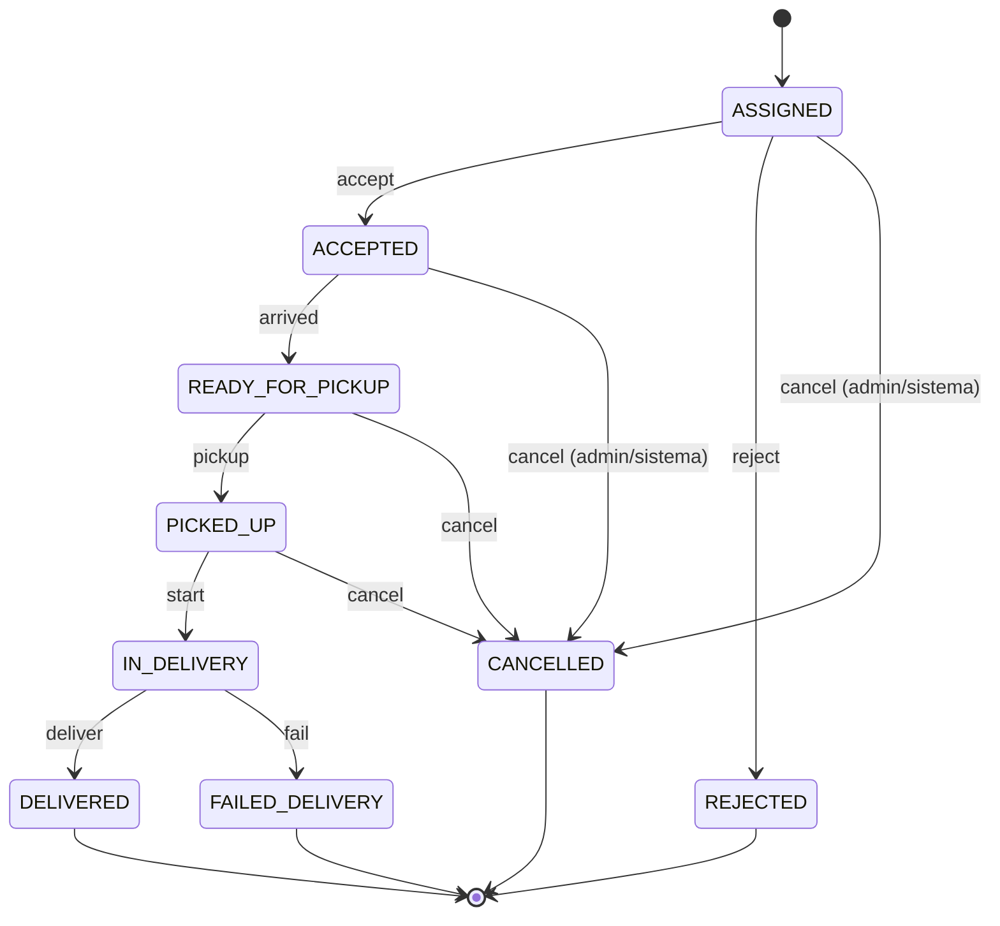

# Máquina de estados del pedido (delivery)

La verdad del estado vive en `delivery_assignments.status`. El backend es el
único que valida y ejecuta transiciones; la app solo muestra la acción
disponible y la envía. Cada transición exitosa escribe un evento en
`delivery_events` (bitácora inmutable con actor, timestamp y ubicación
opcional).

## Estados

| Estado | Significado | Quién lo pone |
|---|---|---|
| `ASSIGNED` | Pedido asignado al repartidor (aún no aceptado) | Admin/tienda |
| `ACCEPTED` | Repartidor aceptó el pedido | Repartidor |
| `READY_FOR_PICKUP` | Repartidor llegó a la tienda / pedido listo para recoger | Repartidor (`arrived`) o picking |
| `PICKED_UP` | Repartidor recogió el pedido en la tienda | Repartidor |
| `IN_DELIVERY` | En camino al cliente | Repartidor |
| `DELIVERED` | Entregado al cliente | Repartidor |
| `REJECTED` | Repartidor rechazó la asignación | Repartidor |
| `FAILED_DELIVERY` | No se pudo entregar (cliente ausente, dirección mala…) | Repartidor |
| `CANCELLED` | Cancelado por la tienda/cliente/sistema | Admin/sistema |

(`CREATED` existe a nivel de `orders`/`shipments`, no de asignación: una
asignación nace en `ASSIGNED`.)

## Diagrama de transiciones

## Tabla de transiciones

| Desde | Hasta | Endpoint | Actor | Precondiciones | Efectos (además del evento) |
|---|---|---|---|---|---|
| `ASSIGNED` | `ACCEPTED` | `POST /delivery/orders/:id/accept` | driver dueño | estado actual == `ASSIGNED` | `accepted_at = now()`; socket `delivery:order-updated`; push a admin |
| `ASSIGNED` | `REJECTED` | `POST /delivery/orders/:id/reject` `{reason}` | driver dueño | estado actual == `ASSIGNED` | `rejected_at`, `reject_reason`; queda libre para reasignar (M4) |
| `ACCEPTED` | `READY_FOR_PICKUP` | `POST /delivery/orders/:id/arrived` | driver dueño | estado actual == `ACCEPTED` | `arrived_at = now()` |
| `READY_FOR_PICKUP` | `PICKED_UP` | `POST /delivery/orders/:id/pickup` | driver dueño | estado actual == `READY_FOR_PICKUP`; `orders.pickerId` puede exigir picking completado | `picked_up_at` (assignment) + `orders.pickedAt` (sync) |
| `PICKED_UP` | `IN_DELIVERY` | `POST /delivery/orders/:id/start` | driver dueño | estado actual == `PICKED_UP` | `started_at`; arranca el ping GPS de la app |
| `IN_DELIVERY` | `DELIVERED` | `POST /delivery/orders/:id/deliver` `{lat,lng,note?}` | driver dueño | estado actual == `IN_DELIVERY` | `completed_at`; `orders.status='delivered'` (sync); detiene GPS; pasa a historial |
| `IN_DELIVERY` | `FAILED_DELIVERY` | `POST /delivery/orders/:id/fail` `{reason}` | driver dueño | estado actual == `IN_DELIVERY` | `failed_at`, `failure_reason`; notifica admin |
| `ASSIGNED/ACCEPTED/…` | `CANCELLED` | interno / admin | admin/sistema | pedido cancelado en el ecommerce | `cancelled_at`, `cancel_reason`; push al repartidor |

Reglas transversales:

- **Autorización**: la asignación debe pertenecer al `driverId` del token
  (`@Roles('driver')` + chequeo de propiedad en servicio). Admin/tienda actúan
  con su propio rol en endpoints separados.
- **Idempotencia**: toda acción envía `expectedStatus`; si el estado actual
  difiere → `409 CONFLICT` con el estado real, la app hace refetch. Cero
  doble-tap, cero carreras.
- **Sincronización con el ecommerce**: `delivery_assignments.status` →
  `shipments.status` por tabla de mapeo (`IN_DELIVERY→IN_TRANSIT`,
  `DELIVERED→DELIVERED`, `FAILED_DELIVERY→FAILED`, `CANCELLED→CANCELLED`, …).
  El estado comercial sigue siendo fuente del ecommerce; el de delivery es de
  la entrega.
- **Bitácora**: cada transición ⇒ fila en `delivery_events`
  (`eventType`, `location` si aplica, `createdBy`, `createdAt`). El
  `timeline` del DTO se construye de ahí.

## Qué botón muestra la app por estado

| Estado | Acción principal | Secundaria |
|---|---|---|
| `ASSIGNED` | `ACEPTAR PEDIDO` | `Rechazar` (con motivo) |
| `ACCEPTED` | `LLEGUÉ A LA TIENDA` | — |
| `READY_FOR_PICKUP` | `RECOGÍ EL PEDIDO` | — |
| `PICKED_UP` | `INICIAR ENTREGA` | — |
| `IN_DELIVERY` | `CONFIRMAR ENTREGA` | `No se pudo entregar` (motivo) + `Abrir navegación` |
| `DELIVERED` | — (historial) | — |

## Eventos socket.io (namespace `/delivery`)

| Evento | Room | Payload |
|---|---|---|
| `delivery:assigned` | `driver:{id}` | `{ orderId, assignmentId }` (la app refetchea) |
| `delivery:order-updated` | `driver:{id}` + `order:{orderId}` | `{ orderId, status, actor }` |
| `delivery:cancelled` | `driver:{id}` | `{ orderId, reason }` |
| `delivery:proof-required` *(fase 3)* | `driver:{id}` | `{ orderId, kind }` |

Autenticación del socket: token JWT en `auth` (handshake) o `Authorization`
header — mismo patrón que el gateway existente.

## Reglas del ping GPS ligado al estado

| Estado | Ping |
|---|---|
| `ASSIGNED` / `REJECTED` / `DELIVERED` / `CANCELLED` | No |
| `ACCEPTED` / `READY_FOR_PICKUP` | Opcional (cada 60 s, fase 2) |
| `PICKED_UP` / `IN_DELIVERY` | Sí: 10–30 s según movimiento |

## Validación y pruebas (criterios del MVP)

1. Transición inválida (p. ej. `deliver` desde `ASSIGNED`) → `409` con estado
   real, sin eventos escritos.
2. Doble envío de `accept` → uno solo efectivo (segundo `409`).
3. Repartidor B intenta transicionar pedido de A → `403`.
4. Cancelación de tienda durante `IN_DELIVERY` → evento/push al repartidor y
   el pedido desaparece de su lista activa.
5. `DELIVERED` aparece en historial con fecha/hora y duración
   (`assigned_at → completed_at`).
