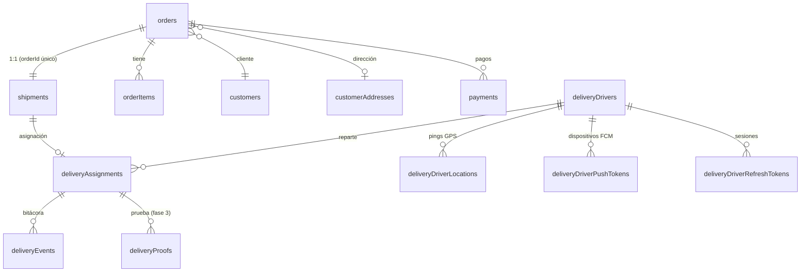

# Modelo de datos — Delivery

El backend del ecommerce (PostgreSQL + drizzle) **ya contiene** la mayor parte
del modelo de delivery. Este documento lista lo existente, lo que se agrega y
las migraciones necesarias. Convención: se extiende, no se duplica.

## Diagrama de entidades



## Lo que ya existe (no tocar salvo lo indicado)

| Tabla | Campos relevantes | Uso |
|---|---|---|
| `orders` | `referenceCode`, `customerId`, `branchId`, `deliveryZoneId`, `customerAddressId`, `status`, `grandTotal`, `customerName/Phone` (snapshot), `notes`, `internalNotes`, `pickerId`, `pickedAt` | Fuente del pedido; el repartidor lee una **proyección** (no la tabla directa) |
| `shipments` | `orderId` (único), `addressLine1/2`, `city`, `location` (texto GeoJSON), `status` (`shipmentStatusEnum`), `deliveryTimeSlotId` | Destino y estado comercial del envío |
| `deliveryDrivers` | `fullName`, `phone`, `email`, `vehicleType/Plate/Brand/Model/Color`, `isAvailable`, `isActive`, `currentLocation`, `lastLocationAt` | Repartidor. **Falta auth** (abajo) |
| `deliveryAssignments` | `shipmentId` (único), `driverId`, `status` (`deliveryAssignmentStatusEnum`), `assignedAt`, `estimatedArrival`, `pickedUpAt`, `completedAt`, `cancelledAt`, `cancelReason` + índice parcial **"1 asignación activa por repartidor"** | Estado de la entrega |
| `deliveryEvents` | `assignmentId`, `eventType` (`deliveryEventTypeEnum`), `location`, `description`, `createdBy`, `createdAt` | Bitácora/auditoría de la máquina de estados |
| `deliveryDriverLocations` | `driverId`, `location`, `speedKmh`, `headingDegrees`, `recordedAt` | Serie temporal de pings |
| `payments` / `paymentIntents` | `paymentMethod` (CARD/PSE/CASH/NEQUI/…) | Deriva "Pagado / Contraentrega" (CASH ⇒ contraentrega) |

## Migraciones necesarias

### M1 · Auth en `delivery_drivers`

Para poder usar el motor `@dsi/auth-nest` (mismo contrato que el resto del
backend):

```sql
ALTER TABLE delivery_drivers
  ADD COLUMN username       citext UNIQUE,
  ADD COLUMN password_hash  varchar(255),
  ADD COLUMN failed_attempts integer NOT NULL DEFAULT 0,
  ADD COLUMN locked_until   timestamptz,
  ADD COLUMN last_login     timestamptz;
```

> `username` como `citext` (case-insensitive, patrón que ya usan las tablas con
> `TODO: failed to parse database type 'citext'`). Backfill: `username = email`
> o `phone` para drivers existentes; los seeds crean la contraseña.

### M2 · Extensión de estados

`deliveryAssignmentStatusEnum` actual:
`ASSIGNED, PICKED_UP, IN_TRANSIT, DELIVERED, FAILED, CANCELLED`.

Canónico nuevo (maquina-de-estados.md):

```sql
ALTER TYPE delivery_assignment_status_enum
  ADD VALUE IF NOT EXISTS 'ACCEPTED' AFTER 'ASSIGNED';
ALTER TYPE delivery_assignment_status_enum
  ADD VALUE IF NOT EXISTS 'READY_FOR_PICKUP' AFTER 'ACCEPTED';
ALTER TYPE delivery_assignment_status_enum
  ADD VALUE IF NOT EXISTS 'IN_DELIVERY' AFTER 'PICKED_UP';
ALTER TYPE delivery_assignment_status_enum
  ADD VALUE IF NOT EXISTS 'REJECTED' AFTER 'CANCELLED';
ALTER TYPE delivery_assignment_status_enum
  ADD VALUE IF NOT EXISTS 'FAILED_DELIVERY' AFTER 'IN_DELIVERY';

UPDATE delivery_assignments SET status = 'IN_DELIVERY'    WHERE status = 'IN_TRANSIT';
UPDATE delivery_assignments SET status = 'FAILED_DELIVERY' WHERE status = 'FAILED';
```

`deliveryEventTypeEnum` también crece:

```sql
ALTER TYPE delivery_event_type_enum
  ADD VALUE IF NOT EXISTS 'ACCEPTED' AFTER 'ASSIGNED';
ALTER TYPE delivery_event_type_enum
  ADD VALUE IF NOT EXISTS 'READY_FOR_PICKUP' AFTER 'ARRIVED';
ALTER TYPE delivery_event_type_enum
  ADD VALUE IF NOT EXISTS 'IN_DELIVERY' AFTER 'PICKED_UP';
ALTER TYPE delivery_event_type_enum
  ADD VALUE IF NOT EXISTS 'REJECTED' AFTER 'CANCELLED';
ALTER TYPE delivery_event_type_enum
  ADD VALUE IF NOT EXISTS 'FAILED_DELIVERY' AFTER 'CANCELLED';
```

> Nota drizzle: los enums se regeneran con `pnpm db:generate` tras editar el
> `pgEnum` en `schema.ts` (los `ADD VALUE` los produce la migración generada).

### M3 · Timestamps faltantes en `deliveryAssignments`

```sql
ALTER TABLE delivery_assignments
  ADD COLUMN accepted_at      timestamptz,
  ADD COLUMN arrived_at       timestamptz,
  ADD COLUMN rejected_at      timestamptz,
  ADD COLUMN reject_reason    text,
  ADD COLUMN started_at       timestamptz,
  ADD COLUMN failed_at        timestamptz,
  ADD COLUMN failure_reason   text;
```

### M4 · Reasignación tras rechazo

`idx_delivery_assignment_order` es `unique(shipmentId)` → impide reasignar un
pedido rechazado. Sustituir por un único **activo**:

```sql
DROP INDEX idx_delivery_assignment_order;
CREATE UNIQUE INDEX idx_delivery_assignment_active
  ON delivery_assignments (shipment_id)
  WHERE status NOT IN ('DELIVERED','FAILED_DELIVERY','REJECTED','CANCELLED');
```

### M5 · Sesiones (refresh tokens) de repartidores

El repositorio de `@dsi/auth-nest` exige persistencia de refresh tokens:

```sql
CREATE TABLE delivery_driver_refresh_tokens (
  id          bigserial PRIMARY KEY,
  driver_id   bigint NOT NULL REFERENCES delivery_drivers(id) ON DELETE CASCADE,
  token       varchar(255) NOT NULL UNIQUE,
  expires_at  timestamptz NOT NULL,
  revoked_at  timestamptz,
  created_at  timestamptz NOT NULL DEFAULT now()
);
CREATE INDEX idx_driver_refresh_driver ON delivery_driver_refresh_tokens(driver_id);
```

### M6 · Dispositivos push (FCM)

```sql
CREATE TABLE delivery_driver_push_tokens (
  id          bigserial PRIMARY KEY,
  driver_id   bigint NOT NULL REFERENCES delivery_drivers(id) ON DELETE CASCADE,
  device_id   varchar(100) NOT NULL,
  platform    varchar(20) NOT NULL,            -- android | ios
  token       varchar(512) NOT NULL,
  last_seen_at timestamptz NOT NULL DEFAULT now(),
  UNIQUE (driver_id, device_id)
);
```

### M7 · Recuperación de contraseña

Patrón existente (`customerTokens`): token de un solo uso con propósito.

```sql
CREATE TABLE delivery_driver_tokens (
  id          bigserial PRIMARY KEY,
  driver_id   bigint NOT NULL REFERENCES delivery_drivers(id) ON DELETE CASCADE,
  token       uuid NOT NULL DEFAULT uuid_generate_v4(),
  purpose     varchar(40) NOT NULL,            -- PASSWORD_RESET
  consumed_at timestamptz,
  expires_at  timestamptz NOT NULL,
  created_at  timestamptz NOT NULL DEFAULT now()
);
```

### M8 (fase 3) · Prueba de entrega

Se diseña ahora, se implementa en fase 3 (la confirmación del MVP deja
`delivery_proofs` vacío):

```sql
CREATE TABLE delivery_proofs (
  id            bigserial PRIMARY KEY,
  assignment_id bigint NOT NULL REFERENCES delivery_assignments(id) ON DELETE CASCADE,
  kind          varchar(20) NOT NULL,          -- PHOTO | SIGNATURE | OTP | GPS
  value_json    jsonb,                         -- {url} | {dataUrl} | {otpHash}
  location      text,                          -- GeoJSON del momento de entrega
  created_at    timestamptz NOT NULL DEFAULT now()
);
```

> Las fotos/firmas se suben a **Cloudinary** (ya integrado en el backend) y aquí
> solo queda la URL — mantiene la BD liviana y reutiliza infraestructura.

## Proyección: DTO del pedido para el repartidor

`GET /delivery/orders/:id` devuelve **solo** lo necesario para entregar:

```jsonc
{
  "id": 1234,
  "referenceCode": "MA-1234",
  "status": "ASSIGNED",                 // estado del delivery_assignments
  "customer": { "name": "Juan Pérez", "phone": "3001234567" },
  "address": {
    "line1": "Carrera 12 # 34-56", "line2": "Apto 302",
    "city": "Bogotá", "notes": "Llamar al llegar"
  },
  "destination": { "lat": 4.7109, "lng": -74.0721 },
  "items": [ { "name": "Producto A", "quantity": 2, "image": "https://…/producto-a.jpg" }, … ],
  "totals": { "value": 45000, "currency": "COP", "shipping": 6000 },
  "payment": { "method": "CASH", "label": "Contraentrega" },
  "pickup": { "branch": { "name": "MercAldas Norte", "address": "…", "lat": …, "lng": … } },
  "timeline": [ { "event": "ASSIGNED", "at": "…" }, … ]
}
```

Notas:

- `destination` sale de `shipments.location` (GeoJSON); si no existe, fallback a
  `customerAddresses` + geocodificación (fase 2).
- `timeline` se arma desde `delivery_events` (la app no calcula nada).
- Pago: `CASH` ⇒ "Contraentrega"; cualquier otro método ⇒ "Pagado" (sin
  exponer datos de tarjeta/transacción).
