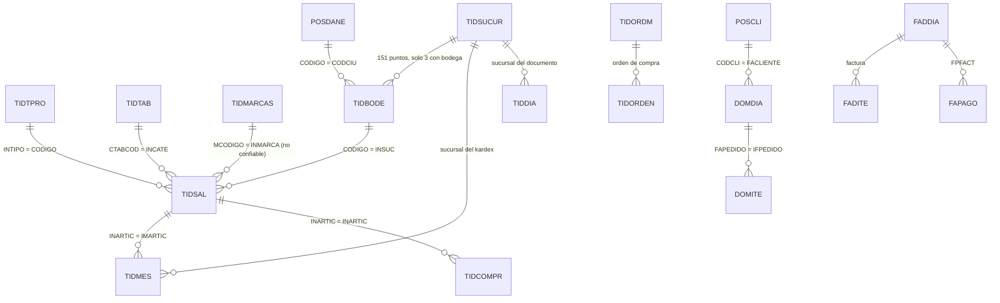

# Diccionario de datos — base real del ERP (`/ADD_FORTUNER`)

Generado leyendo el catalogo del servidor Advantage (`system.tables` y `system.columns`) de `C:\ADD_FORTUNER\PUBLIDATA.add` en `dsi-vps`. No usa copias locales: los tipos, longitudes y nulos son los de la base en produccion.

Generado: 2026-10-23. Regenerar con `node scripts-agent/erp/dict-fortuner-ads.mjs` (en el servidor); `patch-table-metadata.mjs` reaplica nombres y descripciones sin volver a leer la base.

**111 tablas · 3378 columnas.** Confianza: 686 alta, 593 media, 2099 baja.

## Tablas

| Tabla | Nombre completo | Registros | Campos | Clave | Descripcion |
|---|---|---:|---:|---|---|
| [__CATALOGO2](__CATALOGO2-diccionario-datos.json) | Catalogo de replicacion de Advantage (tabla de sistema) | — | 17 | — | Tabla interna del motor Advantage para replicar cambios entre bases (EntryID, TxnID, CRC, RecordData). No es del negocio: no debe leerse ni escribirse desde la integracion. |
| [__P_A_100_50](__P_A_100_50-diccionario-datos.json) | Catalogo de replicacion de Advantage (particion 100/50) | — | 17 | — | Particion interna del catalogo de replicacion de Advantage. Misma estructura que __CATALOGO2; no es del negocio. |
| [__P_A_102_50](__P_A_102_50-diccionario-datos.json) | Catalogo de replicacion de Advantage (particion 102/50) | — | 17 | — | Particion interna del catalogo de replicacion de Advantage. Misma estructura que __CATALOGO2; no es del negocio. |
| [CADEMP](CADEMP-diccionario-datos.json) | Catalogo corto de empresas | 19 | 3 | — | Lista minima de empresas/razones sociales configuradas (codigo, nombre e indicador SALE) para elegir la empresa activa en los modulos. 19 filas. |
| [COCENTRO](COCENTRO-diccionario-datos.json) | Centros de costo contables | — | 43 | — | Define cada centro de costo (compañia, codigo, NIT, nombre) con las cuentas debito/credito DEB00..CRE11 que se afectan en cada mes. |
| [CONCECOS](CONCECOS-diccionario-datos.json) | Conceptos de centros de costo | — | 14 | — | Conceptos de distribucion de gastos por centro de costo: porcentaje, valor resultante, cuenta, concepto y estado. |
| [CONCTR](CONCTR-diccionario-datos.json) | Parametros generales de contabilidad | — | 79 | — | Configuracion del modulo contable: empresa, NIT, ciudad, periodo inicial y final, claves, resoluciones de facturacion, centros de costo, numeracion de documentos y orden de visualizacion de meses. |
| [CONDOCUM](CONDOCUM-diccionario-datos.json) | Documentos y consecutivos contables | — | 12 | — | Configuracion de los documentos contables (DDOCUM/DDOCUMI): tipo de documento, fecha, detalle, valor y modulo de origen. |
| [CONEMP](CONEMP-diccionario-datos.json) | Empresas contables | — | 7 | — | Maestro de empresas del modulo contable con NIT y clave de acceso. |
| [CONINF1](CONINF1-diccionario-datos.json) | Niveles de informe y presupuesto | — | 7 | — | Define nivel de la cuenta, nombre, tipo, valor de presupuesto y valor base por empresa; lo usan los informes y el presupuesto contable. |
| [CONIVA](CONIVA-diccionario-datos.json) | Saldos de IVA por tercero | 61791 | 52 | — | Acumulados mensuales de IVA por codigo y NIT: base y valor de cada mes (BASE01/VALOR01..BASE12/VALOR12, con columnas C). 61.791 filas. |
| [CONLOTES](CONLOTES-diccionario-datos.json) | Lineas de lote contable | 1200 | 17 | — | Movimientos contables agrupados por lote: cuenta, tercero, debito, credito, base, concepto, comprobante, tipo y fecha del documento. |
| [CONMAE](CONMAE-diccionario-datos.json) | Maestro de cuentas contables | — | 74 | — | Plan de cuentas con nombre, saldo y acumulados mensuales debito/credito (MACMDEB01..MACMCRE12), manejo de centros de costo, retencion, IVA y centros de pago. |
| [CONMAG1](CONMAG1-diccionario-datos.json) | Formatos contables — encabezado | — | 20 | — | Plantilla de los "formatos magicos" de documentos contables: forma, elemento, concepto, tipo de documento, tercero, encabezado y valores fijos. |
| [CONMAG2](CONMAG2-diccionario-datos.json) | Formatos contables — conceptos | — | 13 | — | Conceptos y montos que componen cada formato contable (FORMATO + CONCEPTO). |
| [CONMAG3](CONMAG3-diccionario-datos.json) | Formatos contables — cuentas | — | 24 | — | Cuentas que afecta cada formato/concepto, con tipo de movimiento, cuentas por pagar y columnas de valor/base. |
| [CONMAGDT](CONMAGDT-diccionario-datos.json) | Formatos contables — detalle por tercero | — | 22 | — | Valores por tercero y cuenta de cada renglon del formato contable (VALOR1..VALOR11). |
| [CONMAGIT](CONMAGIT-diccionario-datos.json) | Formatos contables — movimientos generados | — | 18 | — | Movimientos contables producidos al aplicar un formato: tercero, fecha, comprobante, documento y valor. |
| [CONMOVI](CONMOVI-diccionario-datos.json) | Control de lotes contables | — | 16 | — | Cabecera y estado de los lotes de movimiento: mes, estado, usuario que abre y cierra, fecha, hora y totales de debito, credito e items. |
| [CONPUC](CONPUC-diccionario-datos.json) | Plan Unico de Cuentas (PUC) | 2633 | 3 | — | Catalogo de cuentas contables colombiano (codigo, nombre y marca MFLAG). 2.633 filas. |
| [CONREITE](CONREITE-diccionario-datos.json) | Detalle de relacion de costos | 18 | 8 | — | Detalle por tercero y centro de costo de un lote de relacion (RILOTE): fecha, concepto y valor. Uso contable interno. |
| [CONREMAE](CONREMAE-diccionario-datos.json) | Encabezado de relacion de costos | — | 9 | — | Cabecera del lote de relacion (RMLOTE) con concepto, fecha, valor total y documento de origen. Uso contable interno. |
| [CONRET](CONRET-diccionario-datos.json) | Saldos de retencion por tercero | 345 | 79 | — | Acumulados mensuales de retenciones por codigo y NIT: base y valor de cada mes. 345 filas. |
| [CONTERCE](CONTERCE-diccionario-datos.json) | Maestro de terceros contables | 765759 | 31 | — | Terceros (clientes, proveedores, empleados) con NIT, nombre, saldo y acumulados mensuales de debitos y creditos. 765.759 filas. |
| [CONTICOM](CONTICOM-diccionario-datos.json) | Tipos de comprobante contable | — | 6 | — | Catalogo de tipos de comprobante (codigo, nombre y descripcion). |
| [CONTIIVA](CONTIIVA-diccionario-datos.json) | Tipos de IVA contable | — | 5 | — | Catalogo de tipos de IVA con su porcentaje (VLRPOR). |
| [CONTIRET](CONTIRET-diccionario-datos.json) | Tipos de retencion contable | — | 5 | — | Catalogo de tipos de retencion con su porcentaje (VLRPOR). |
| [COTDIA](COTDIA-diccionario-datos.json) | Documento diario de cotizaciones | 29 | 44 | — | Encabezado de las cotizaciones: cliente, NIT, ciudad, documentos, totales (bruto, descuentos, IVA, impoconsumo), vendedor y estado. 29 filas. |
| [COTITE](COTITE-diccionario-datos.json) | Items de cotizaciones | 209 | 44 | — | Lineas de la cotizacion: articulo, cantidad, precio, descuentos, impuestos y estado. 209 filas. |
| [CTRCOMPR](CTRCOMPR-diccionario-datos.json) | Parametros y control de compras | — | 34 | — | Configuracion del modulo de compras: analisis de consumo, sugeridos, comparacion con el año anterior, rutas/carpetas de reposicion y ponderaciones de rotacion. |
| [DOMDIA](DOMDIA-diccionario-datos.json) | Documento diario de pedidos de domicilio | 52498 | 56 | — | Cabecera de los pedidos de domicilio (web/telefono) que el ERP factura: cliente, NIT, ciudad, tipo de persona, numero de pedido, factura y totales. Una fila por pedido. 52.498 filas. |
| [DOMITE](DOMITE-diccionario-datos.json) | Items de pedidos de domicilio | 240635 | 43 | — | Lineas de los pedidos de domicilio: articulo, EAN, cantidad, precio, descuentos e impuestos. 240.635 filas. |
| [ENCUENC](ENCUENC-diccionario-datos.json) | Encabezado de encuestas | 1 | 6 | — | Define una encuesta: nombre, si es obligatoria, fecha inicial/final y observaciones. |
| [ENCUITE](ENCUITE-diccionario-datos.json) | Preguntas de encuesta | 3 | 5 | — | Preguntas de una encuesta con tipo de respuesta y si es obligatoria. |
| [FADCLI](FADCLI-diccionario-datos.json) | Maestro de clientes de facturacion | — | 102 | — | Clientes del modulo de facturacion (102 campos): identificacion, nombres, direccion, ciudad, correo, cupo, zona, vendedor y datos de entrega. |
| [FADCON](FADCON-diccionario-datos.json) | Parametros de facturacion por sucursal | — | 145 | — | Configuracion del modulo de facturacion/POS (145 campos): empresa, caja, prefijos y resoluciones, listas de precios, domicilios, parqueadero, redondeo, UVT y opciones de integracion. |
| [FADDIA](FADDIA-diccionario-datos.json) | Documento diario de facturas | 1167637 | 85 | — | Cabecera de las facturas de venta: sucursal, numero, estado, fechas de factura y vencimiento, cliente, vendedor y totales. Una fila por factura. 1.167.637 filas. |
| [FADEVIDE](FADEVIDE-diccionario-datos.json) | Evidencias de entrega | 2 | 11 | — | Evidencias de entrega (foto/GPS) asociadas a una visita: fecha, hora, estado, latitud, longitud y app que la registro. |
| [FADFREEN](FADFREEN-diccionario-datos.json) | Catalogo de frecuencias | — | 2 | — | Codigos de frecuencia de visita/entrega (FRECOD) con su descripcion (FREDES). |
| [FADISPO](FADISPO-diccionario-datos.json) | Dispositivos autorizados de facturacion | 9 | 14 | — | Terminales/dispositivos autorizados: serial, vendedor, empresa, sucursal, ruta, recaudo, pedidos y si manejan precio con IVA o precio variable. |
| [FADITE](FADITE-diccionario-datos.json) | Items de facturas | — | 63 | — | Detalle de las facturas: articulo, cantidad, costo, precio, descuentos, IVA, impoconsumo y valor neto. Tabla de ~5,7 GB; solo se usa para verificacion puntual. |
| [FADLINEA](FADLINEA-diccionario-datos.json) | Leyendas por linea de factura | 3 | 44 | — | Configuracion de mensajes y leyendas (WTIPO/WMENSA por linea) que se imprimen en la factura segun la sucursal. |
| [FADVISIT](FADVISIT-diccionario-datos.json) | Visitas a clientes con GPS | 13 | 33 | — | Registro de visitas: ruta, usuario, fecha y hora de inicio y fin, duracion, vehiculo, cliente y coordenadas GPS. |
| [FAPAGO](FAPAGO-diccionario-datos.json) | Pagos de facturas | 2141129 | 20 | — | Recibos y pagos aplicados a facturas: sucursal, año, mes, caja, cajero, factura, medio de pago, valor e IVA. 2.141.129 filas. |
| [FCONTA](FCONTA-diccionario-datos.json) | Cuentas contables de facturacion | — | 23 | — | Mapeo de lineas e impuestos de facturacion a cuentas contables (FIMPUESTO, FLINEA, DEB01..CRE12). |
| [MOV00](MOV00-diccionario-datos.json) | Movimientos contables (libro diario) | 2017444 | 31 | — | Movimientos contables con cuenta, tercero, fecha, comprobante, tipo de documento y valor. 2.017.444 filas; equivale a mov01. |
| [mov01](mov01-diccionario-datos.json) | Movimientos contables (particion 01) | 13131965 | 31 | — | Segunda generacion/particion de los movimientos contables; misma estructura que MOV00. 13.131.965 filas. |
| [NOMCALEN](NOMCALEN-diccionario-datos.json) | Calendario de dias | 2557 | 9 | — | Calendario con nombre del dia, festivo, cierre, promedio, semana y observaciones. 2.557 filas. |
| [PAGO01](PAGO01-diccionario-datos.json) | Pagos de facturas (version anterior) | 0 | 15 | — | Version anterior de FAPAGO. En la base de produccion esta vacia (0 filas). |
| [PEDDIA](PEDDIA-diccionario-datos.json) | Documento diario de pedidos | 6 | 50 | — | Cabecera de pedidos del ERP, previa a la factura. 6 filas. |
| [PEDITE](PEDITE-diccionario-datos.json) | Items de pedidos | 5 | 53 | — | Lineas de los pedidos del ERP. 5 filas. |
| [PEDITERE](PEDITERE-diccionario-datos.json) | Datos de entrega del pedido | 308 | 20 | — | Datos de contacto y entrega asociados al pedido: direccion, telefono, correo y campos libres. 308 filas. |
| [PEDRESER](PEDRESER-diccionario-datos.json) | Parametro de reserva de pedidos | — | 1 | — | Tabla de una sola columna (GENERAL) y una fila: bandera global de reserva de pedidos. Uso interno; proposito no confirmado con el negocio. |
| [POSACTI](POSACTI-diccionario-datos.json) | Actividades e inactividades de articulos | — | 5 | — | Periodos en que un articulo se bloquea o se activa en el POS (codigo, descripcion, fecha inicial/final y cantidad). |
| [POSACTIV](POSACTIV-diccionario-datos.json) | Actividades promocionales | 1 | 34 | — | Promociones por actividad: proveedor, porcentajes, vigencias, monto, tipo, tarjeta y horario. |
| [POSALTER](POSALTER-diccionario-datos.json) | Codigos alternos del POS | 11 | 5 | — | Codigos internos alternos por articulo (PLU alterno) con nombre, marca e historico. 11 filas. |
| [POSANIV](POSANIV-diccionario-datos.json) | Promocion de aniversario | 1 | 30 | — | Configuracion de la promocion de aniversario del POS: dos bloques (A/B) con fechas, horas, cantidad, porcentaje y valor. |
| [POSARDC2](POSARDC2-diccionario-datos.json) | Archivo de descuentos 2 | 3 | 16 | — | Reglas de descuento por codigo, nombre y porcentaje, con vigencia y segundo bloque horario. 3 filas. |
| [POSARDCT](POSARDCT-diccionario-datos.json) | Archivo de descuentos | 7 | 15 | — | Reglas de descuento por codigo y porcentaje con fechas, horarios y hasta tres porcentajes. 7 filas. |
| [POSCAJA](POSCAJA-diccionario-datos.json) | Cajas del POS | 44 | 30 | — | Cajas por sucursal: cajero, estado, prefijos de factura y consecutivo, topes, resoluciones DIAN y ultima factura. 44 filas. |
| [POSCAMBIO](POSCAMBIO-diccionario-datos.json) | Historico de cambios de precio en caja | 22 | 10 | — | Registro de cambios de precio de articulos en caja: valor anterior y nuevo, fecha, hora, operador y caja. 22 filas. |
| [POSCLI](POSCLI-diccionario-datos.json) | Maestro de clientes del POS | 146371 | 89 | — | Clientes del ERP: codigo de 13 posiciones, nombre, documento, direccion, ciudad y contacto. 146.371 filas; se sincroniza desde `customers`. |
| [POSCONSE](POSCONSE-diccionario-datos.json) | Conceptos contables del POS | 47 | 34 | — | Conceptos que usa el POS (descuentos, recargos, propinas) con cuentas debito/credito, centro de costo y tratamiento de inventario. 47 filas. |
| [POSCOPAG](POSCOPAG-diccionario-datos.json) | Convenios y copagos | 8 | 12 | — | Convenios con terceros: descuentos aplicables (CODDCTO1/2), tipo, lista de precios y fraccion. 8 filas. |
| [POSDANE](POSDANE-diccionario-datos.json) | Catalogo DANE de departamentos y municipios | 1647 | 2 | — | Division politico-administrativa de Colombia; se usa en direcciones y codigos de ciudad (CODIGO es texto). |
| [POSDCTO2](POSDCTO2-diccionario-datos.json) | Descuentos del POS (variante 2) | 4664 | 32 | — | Reglas de descuento por proveedor, porcentaje, vigencia, monto, tarjeta y horario. 4.664 filas. |
| [POSDCTO3](POSDCTO3-diccionario-datos.json) | Descuentos por talonario | 4 | 37 | — | Descuentos por cantidad/talonario: precio, puntos, multiplicadores, tallas y vigencia. 4 filas. |
| [POSDCTO5](POSDCTO5-diccionario-datos.json) | Descuentos de domicilio | 13296 | 11 | — | Descuentos aplicables a pedidos de domicilio: codigo, porcentaje, vigencias y consecutivo. 13.296 filas. |
| [POSDCTOS](POSDCTOS-diccionario-datos.json) | Descuentos del POS | 5566 | 40 | — | Maestro principal de descuentos del POS: codigo, proveedor, nombre, porcentajes, vigencia, monto y tarjeta. 5.566 filas. |
| [POSMENU](POSMENU-diccionario-datos.json) | Menu de opciones del POS | 251 | 5 | — | Arbol de opciones del menu por usuario y nivel. 251 filas. |
| [POSPAGO](POSPAGO-diccionario-datos.json) | Medios de pago del POS | 129 | 50 | — | Medios de pago configurados (efectivo, tarjetas, creditos, bonos) con comisiones, retenciones y cuentas contables. |
| [POSPAGO2](POSPAGO2-diccionario-datos.json) | Medios de pago por sucursal (version 2) | 123 | 43 | — | Segunda version de los medios de pago: rangos de valor, retenciones, comisiones, cuentas y datos de tarjeta por sucursal. 123 filas. |
| [POSPOPER](POSPOPER-diccionario-datos.json) | Operadores de POS | 21 | 11 | — | Usuarios/operadores de caja con clave, vigencia, permiso de autorizacion y datos personales. 21 filas. |
| [POSPRUTA](POSPRUTA-diccionario-datos.json) | Permisos de opciones por usuario | 1214 | 5 | — | Asignacion de las opciones del menu a cada usuario (perfil de permisos). 1.214 filas. |
| [REGIS01](REGIS01-diccionario-datos.json) | Registro de items vendidos en el POS | — | 61 | — | Detalle transaccional del POS: una fila por item con factura, cliente, cajero, costo, precio, descuentos, impuestos y devoluciones. |
| [RUTAENC](RUTAENC-diccionario-datos.json) | Encabezado de rutas de reparto | 5 | 3 | — | Maestro de rutas de reparto (nombre y observaciones). 5 filas. |
| [RUTAITEM](RUTAITEM-diccionario-datos.json) | Paradas de ruta | 35 | 6 | — | Clientes/paradas que componen cada ruta por dia, con estado. 35 filas. |
| [TIDBODE](TIDBODE-diccionario-datos.json) | Bodegas y sucursales | 3 | 103 | — | Bodegas/sucursales del ERP con parametros de inventario, series mensuales de movimiento, puntos de reorden y datos contables. 3 registros: sucursales 1, 2 y 11. |
| [TIDCATE](TIDCATE-diccionario-datos.json) | Categorias de articulos | 174 | 13 | — | Arbol de categorias de 3 niveles (CATE1..CATE3) con caracteristicas libres e imagen. |
| [TIDCOMPR](TIDCOMPR-diccionario-datos.json) | Historico de compras por articulo | 59872 | 15 | — | Compras registradas por articulo: fecha, cantidad, valor, IVA, descuentos, documento, proveedor y sucursal. 59.872 filas. |
| [TIDCON](TIDCON-diccionario-datos.json) | Parametros del modulo de inventarios (TID) | 1 | 46 | — | Configuracion del modulo TID: manejo de costos, generacion contable, bodega de compras, redondeo, retenciones, claves y carpetas de trabajo. |
| [TIDDIA](TIDDIA-diccionario-datos.json) | Documento diario de inventario | 50066 | 42 | — | Cabecera de movimientos de inventario por sucursal/bodega/mes: documento, proveedor, fecha, valor, descuentos, IVA, fletes, retenciones y vencimiento. 50.066 filas. |
| [TIDEAN](TIDEAN-diccionario-datos.json) | Codigos de barras alternos (sin uso real) | 5 | 6 | — | Codigos de barras alternos por articulo. Solo tiene 5 filas, todas apuntando al mismo articulo con EAN de prueba (111, 11111, 22222, 1121212, 362514), asi que NO es la fuente de codigos de barras: el EAN real esta en TIDSAL.INEAN / INEANC. |
| [TIDGON](TIDGON-diccionario-datos.json) | Gondolas y ubicaciones de exhibicion | 15 | 5 | — | Codigos de gondola con dos descripciones, indicador SALE y bandera. 15 filas. |
| [TIDLISTA](TIDLISTA-diccionario-datos.json) | Lista de precios y descuentos por proveedor y articulo | 68017 | 24 | — | Valores y descuentos que fija cada proveedor para cada articulo: valor de lista, valores alternos (costo con descuento), hasta seis descuentos escalonados y vigencia. 1.587 proveedores, 60.826 articulos, 68.017 filas. OJO: no es la lista de precios de venta del catalogo; esos precios viven en TIDSAL.INVRVENTA1..INVRVENTA0. |
| [TIDMARCAS](TIDMARCAS-diccionario-datos.json) | Marcas de articulos | 2175 | 2 | — | Maestro de marcas (codigo y nombre) que referencia TIDSAL.INMARCA. 2.175 filas. |
| [TIDMES](TIDMES-diccionario-datos.json) | Movimientos de inventario por articulo (kardex) | 5018993 | 47 | — | Detalle de movimientos de inventario: articulo, cantidad, costo, precio, IVA, impuestos adicionales y saldo por sucursal, bodega y mes. Es el kardex historico del ERP. |
| [TIDOBSER](TIDOBSER-diccionario-datos.json) | Observaciones por articulo | 1281 | 8 | — | Siete textos de observacion libres por articulo. 1.281 filas. |
| [TIDORDEN](TIDORDEN-diccionario-datos.json) | Items de ordenes de compra | 203841 | 33 | — | Detalle de las ordenes de compra/pedido a proveedor: articulo, cantidad, costo, descuentos, impuestos y estado. 203.841 filas. |
| [TIDORDM](TIDORDM-diccionario-datos.json) | Ordenes de compra (cabecera) | 9244 | 28 | — | Cabecera de ordenes de compra a proveedor: fecha, fecha de entrega, estado, totales y descuentos. 9.244 filas. |
| [TIDPRECI](TIDPRECI-diccionario-datos.json) | Valores por articulo del proveedor "Uno a Uno" (historico) | 225 | 7 | — | 225 filas, todas con INTIPO = "Uno a Uno", con dos valores por articulo (INVALOR e INVALORN), fecha, hora y usuario. Parece un historico/ajuste de valores de compra de ese proveedor (189 de 225 filas tienen INVALOR > INVALORN). NO contiene los precios de venta del catalogo: esos estan en TIDSAL.INVRVENTA1..INVRVENTA0. Proposito exacto pendiente de confirmar. |
| [TIDPRENW](TIDPRENW-diccionario-datos.json) | Articulos nuevos informados por proveedor | 58 | 8 | — | Novedades/articulos nuevos que informa el proveedor: fecha, valor, documento, marca y cantidad. 58 filas. |
| [TIDSAL](TIDSAL-diccionario-datos.json) | Maestro de articulos por sucursal y bodega (TID) | 51938 | 304 | — | Maestro de articulos con 304 campos: nombre, EAN, unidad, proveedor, tipo, precios (INVRVENTA1..INVRVENTA0), impuestos, existencias, costos y ubicacion. Llave INSUC + INBODEGA + INARTIC. 51.938 filas; es la tabla que alimenta el catalogo del ecommerce. |
| [TIDSUCUR](TIDSUCUR-diccionario-datos.json) | Sucursales y puntos de venta | 151 | 12 | — | Maestro de sucursales/puntos de venta con 151 registros (S.MERCALDAS CENTRO, F.MERCALDAS CENTRO, C.MERCALDAS CENTRO, MERCALDAS ELECTROD...): codigo de 3 posiciones, nombre, direccion, carpeta de red de traslados y pedidos. OJO: no son las bodegas de inventario; esas son TIDBODE (3 registros: 1, 2 y 11). |
| [TIDTAB](TIDTAB-diccionario-datos.json) | Tabla parametrica maestra | 231 | 65 | — | Tabla de tablas: lineas, conceptos y escalas de precio que otros modulos referencian por CTABCOD (p. ej. INCATE del articulo). |
| [TIDTIPOS](TIDTIPOS-diccionario-datos.json) | Tipos por clase (impuestos y tarifas) | 56 | 14 | — | Tipos identificados por la pareja CLASE + TIPO: tarifas de impuestos, bases y valores asociados. |
| [TIDTPRO](TIDTPRO-diccionario-datos.json) | Tipos de producto | 363 | 12 | — | Clasificacion comercial del articulo; el codigo es el que usa TIDSAL.INTIPO. |
| [USUSUCUR](USUSUCUR-diccionario-datos.json) | Usuarios por sucursal | 28 | 3 | — | Asignacion usuario-sucursal con indicador de habilitacion. 28 filas. |
| [VEDCOM](VEDCOM-diccionario-datos.json) | Comisiones de vendedores | — | 11 | — | Comision liquidada por vendedor y documento: factura, recibo, cliente, base, porcentaje y valor. |
| [VEDCUOTA](VEDCUOTA-diccionario-datos.json) | Cuotas y metas de vendedores | — | 29 | — | Cuota/meta de venta por vendedor y mes, con valores por articulo y cumplimiento. |
| [VEDTAB](VEDTAB-diccionario-datos.json) | Tablas de comision de ventas | — | 14 | — | Parametros de comision por grupo: porcentaje, dias y rangos de edad, y maximo descuento permitido. |
| [VEDVEN](VEDVEN-diccionario-datos.json) | Vendedores | — | 54 | — | Maestro de vendedores (54 campos): codigo, cedula, nombre, direccion, porcentajes de comision, rutas, precios y ejes por mes. |
| [VISAUDI](VISAUDI-diccionario-datos.json) | Auditoria de usuarios | — | 7 | — | Bitacora de acciones por usuario: hora, modulo, documento, motivo, tipo y fecha. |
| [VISBODE](VISBODE-diccionario-datos.json) | Bodegas del modulo VIS | — | 12 | — | Configuracion de bodegas/centros de costo para el modulo VIS: saldos, costos, promedio y afectacion de inventario. |
| [VISDOCUM](VISDOCUM-diccionario-datos.json) | Documentos del modulo VIS | — | 88 | — | Configuracion de documentos del modulo VIS: consecutivos, cuentas contables, impuestos, retenciones y opciones de impresion. |
| [VISION](VISION-diccionario-datos.json) | Configuracion general del modulo VIS | — | 91 | — | Parametros generales del modulo VIS (contabilidad/facturacion): empresa, NIT, claves, niveles, documentos, rutas de archivos y opciones de red. |
| [VISUSU](VISUSU-diccionario-datos.json) | Usuarios del modulo VIS | — | 11 | — | Usuarios del modulo VIS con clave, cedula, contacto, vencimiento y vigencia. |
| [VTADIA](VTADIA-diccionario-datos.json) | Resumen diario de ventas | 825 | 12 | — | Totales de venta por sucursal, año, mes y fecha: bruto, descuentos, IVA, impoconsumo, otros impuestos y neto. |
| [VTAITE](VTAITE-diccionario-datos.json) | Detalle diario de ventas por articulo | 2008435 | 25 | — | Ventas agregadas por articulo y periodo: cantidad, costo, precio, descuentos, IVA, impoconsumo y neto. |
| [VTAPAGO](VTAPAGO-diccionario-datos.json) | Pagos del resumen diario de ventas | 8555 | 7 | — | Pagos por sucursal, año, mes, fecha y medio de pago del resumen diario de ventas. |
| [XADMOVI](XADMOVI-diccionario-datos.json) | Movimientos auxiliares de facturacion (integracion) | — | 32 | — | Espejo/auxiliar de movimientos de facturacion con articulo, valores, descuentos, IVA, retenciones y fecha; lo usan procesos externos o de exportacion. |

## Relaciones clave

## Convenciones

- **TIDSAL** usa `INSUC` + `INBODEGA` + `INARTIC`: un registro por articulo y sucursal/bodega.
- **Precios**: los del catalogo estan en `TIDSAL.INVRVENTA1` (lista 1), `INVRVENTA0` (precio "antes") e `INVRVENTA2..9` (listas alternas). `TIDLISTA` (68k) es la lista por proveedor y `TIDPRECI` (225 filas, "Uno a Uno") es un historico de valores: ninguno de los dos es la fuente de precio de venta.
- **Series mensuales**: `VTA01..13`, `ENT01..12`, `SAL01..12`, `VENTAS01..13`.
- **Documentos**: `DOMDIA`/`DOMITE` = pedidos de domicilio; `FADDIA`/`FADITE` = facturas y su detalle; `PEDDIA`/`PEDITE` = pedidos; `COTDIA`/`COTITE` = cotizaciones.
- **Inventario**: `TIDDIA` = documento diario (valores e impuestos); `TIDMES` = kardex por articulo.
- **Compras**: `TIDORDM` = orden (cabecera), `TIDORDEN` = items, `TIDCOMPR` = historico de compras.
- **Clientes**: `POSCLI` (maestro, `CODCLI` de 13 posiciones) y `FADCLI` (clientes de facturacion).
- **Sucursales**: `TIDSUCUR` (151 puntos de venta) y `TIDBODE` (3 bodegas de inventario). `TIDSAL.INSUC` usa el codigo de bodega, no el de punto de venta.
- **Codigos de barras**: el EAN real esta en `TIDSAL.INEAN`/`INEANC`; `TIDEAN` solo tiene 5 filas de prueba.
- **Marcas**: `TIDSAL.INMARCA` no coincide con `TIDMARCAS.MCODIGO`; el nombre real esta en `INMARCAP`.
- **Tablas `__*`**: replicacion interna de Advantage, ajenas al negocio.

## Cobertura

Los significados de **alta** confianza son los usados por la integracion (productos, precios, stock, categorias, marcas, tipos, clientes y pedidos). Los de confianza **baja** son nombres cripticos o sin uso observado: se iran corrigiendo con el diccionario oficial del ERP.

