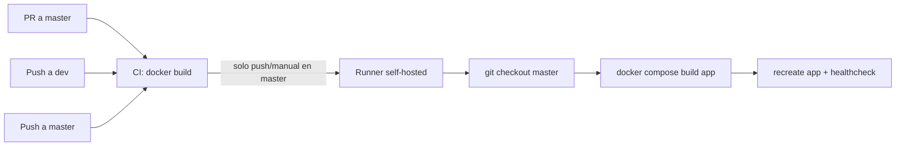

# CI/CD — `master` → VPS (Docker + WSL)

Pipeline único en `.github/workflows/ci-cd.yml`:



- **CI** (`ubuntu-latest`): construye la imagen completa (`docker/Dockerfile`:
  backend, bot y las 4 interfaces). No publica nada.
- **Deploy** (runner self-hosted en el VPS): solo se ejecuta si CI pasó, el ref
  es `master` y el evento es `push` o `workflow_dispatch`. No corre en PRs.
- El runner corre **dentro de WSL Ubuntu**, donde vive el motor Docker. El
  checkout de producción está en
  `/mnt/c/Users/Desarrolo4/Documents/ecommerce`.
- `deploy/deploy.sh` hace `fetch` + `checkout -f master`, reconstruye **solo**
  `app`, la recrea y espera `healthy`. **No toca** `docker/.env`, la BD, OSRM
  ni los volúmenes.

## 1. Requisitos en GitHub (una vez)

1. **Rama por defecto:** `master` (Settings → General → Default branch).
2. **Ruleset de `master`:** hoy exige Pull Request. El push directo a `master`
   queda bloqueado (`GH013`). Dos opciones:
   - Mantener la regla y **mergear siempre por PR** (`dev` → `master`), o
   - Settings → Rules → Rulesets → regla de `master` → permitir *bypass* al
     administrador del repositorio.
3. **Runner:** Settings → Actions → Runners → **New self-hosted runner**
   (Linux, x64) → copia el token de registro.

> El token de registro es temporal (~1 h), no es un secret del workflow.

## 2. Instalar el runner en el VPS (una vez)

```powershell
ssh dsi-vps
wsl -d Ubuntu -u root
cd /mnt/c/Users/Desarrolo4/Documents/ecommerce
bash deploy/install-runner.sh <REGISTRATION_TOKEN>
```

El script:

- descarga la última release de `actions/runner`;
- crea el usuario de servicio `ghrunner` y lo añade al grupo `docker`;
- registra el runner con labels `mercaldas,linux`;
- instala y arranca el servicio **systemd** (`actions.runner.*`).

Verificación:

```bash
systemctl status 'actions.runner.*'
su -s /bin/bash ghrunner -c 'docker info >/dev/null && echo docker-ok'
```

En GitHub → Settings → Actions → Runners debe aparecer **Idle**.

> La distro WSL debe seguir viva para que el servicio exista. La tarea de
> Windows `MercaldasDockerEngine` (`wsl ... sleep infinity`) ya cumple eso; ver
> `docs/VPS-WINDOWS.md`. Si el runner no vuelve tras reiniciar Windows, revisa
> esa tarea.

### Clave SSH para el `git fetch`

El `.git/config` del checkout del VPS quedó apuntando al `ssh.exe` de Git para
Windows, que no existe dentro de WSL. `deploy/deploy.sh` usa una clave propia
solo para su proceso (no cambia la config de Windows):

```bash
install -d -m 755 /etc/mercaldas
install -m 600 -o ghrunner -g ghrunner \
  /mnt/c/Users/Desarrolo4/.ssh/id_ed25519_deploy \
  /etc/mercaldas/deploy_key
```

Puedes sobreescribir la ruta con `GIT_SSH_KEY=/otra/clave`.

## 3. Primera promoción a `master`

La ruleset actual impide el push directo. Desde GitHub:

1. **Pull requests → New pull request**: `dev` → `master`.
2. Espera el check **CI / Build de la imagen**.
3. **Merge pull request**.

El merge dispara el job de deploy. El runner cambia el checkout del VPS a
`master` y despliega el commit mergeado.

Si prefieres no usar PR, primero ajusta la ruleset (ver punto 1) y luego:

```bash
git push origin master
```

## 4. Despliegue manual / reintento

Desde GitHub: **Actions → CI/CD → Run workflow** (rama `master`).

Desde el VPS, sin esperar a GitHub:

```bash
wsl -d Ubuntu -u root
cd /mnt/c/Users/Desarrolo4/Documents/ecommerce
bash deploy/deploy.sh            # origin/master
bash deploy/deploy.sh <sha>      # un commit concreto
```

## 5. Qué NO debe cambiarse

- **No** pongas el job de deploy en `pull_request`: un PR de un fork podría
  ejecutar código en el servidor.
- **No** añadas secretos de despliegue al workflow: el runner ya tiene acceso
  al checkout y a `docker/.env`.
- **No** edites `docker/.env` desde el CI. Dominios, JWT, API keys y
  credenciales se configuran en el servidor. `prod.js` sigue siendo la vía para
  sincronizar dominios/puertos desde `prod.config.json`.
- El checkout de producción **se fuerza** a `master`; no dejes cambios locales
  versionados allí (usa `.env` o un archivo ignorado para lo local).

## 6. Seguridad

- El runner es self-hosted y pertenece al grupo `docker` (equivalente a root en
  el host). Cualquiera con permiso de escritura sobre el repo o de aprobar un
  PR a `master` puede ejecutar código en el VPS. Mantén la ruleset de PR y
  revisa los cambios antes de mergear.
- El workflow de CI usa runners de GitHub; el de deploy solo corre tras un
  merge/push a `master`.
- No se expone SSH ni ningún puerto nuevo; el runner **sale** hacia GitHub.
- `deploy.sh` no hace `docker system prune` ni borra volúmenes.
- Los logs de Docker siguen rotando (`10m × 5`).

## 7. Problemas comunes

| Síntoma | Causa / arreglo |
|---|---|
| El job queda en *Waiting for a runner* | Runner offline: `systemctl status 'actions.runner.*'`. |
| `permission denied` sobre `/mnt/c/...` | El usuario `ghrunner` no puede escribir el checkout. Revisa permisos de WSL/DrvFs o instala el runner como root. |
| `docker: permission denied` | `usermod -aG docker ghrunner` y `systemctl restart 'actions.runner.*'`. |
| `GH013: Changes must be made through a pull request` | Ruleset de `master`: usa PR o habilita bypass. |
| Healthcheck falla | `docker logs --tail 200 mercaldas_app`; el script imprime las últimas 120 líneas. |
| El deploy no actualiza dominios/API keys | `.env` es persistente y no se toca; edítalo en el VPS y ejecuta `bash deploy/deploy.sh`. |
| WSL se reinicia y no hay runner | Revisa la tarea `MercaldasDockerEngine` y reinicia el servicio del runner. |
