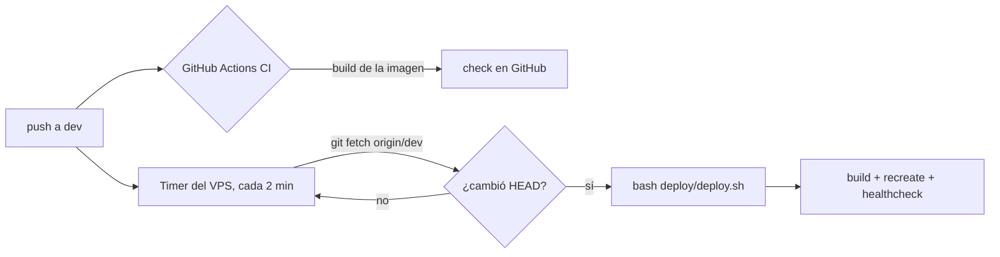

# CI/CD — `dev` → VPS (Debian 12 + Docker)

Hay **dos caminos** para llevar `dev` al servidor, y ambos usan el mismo
`deploy/deploy.sh`:



- **CI (GitHub, `ubuntu-latest`)**: en cada push a `dev`/`master` construye la
  imagen de producción. Es la verificación temprana; no despliega nada.
- **Despliegue automático (VPS)**: un *timer* de systemd sondea `origin/dev`
  cada 2 minutos y llama a `deploy.sh` solo si el checkout quedó atrás. No
  necesita runners, tokens ni abrir puertos: el servidor **sale** hacia GitHub.
- **Despliegue manual**: `bash deploy/deploy.sh` en el servidor, cuando se
  quiera desplegar un commit concreto sin esperar al timer.

El job `deploy` de `.github/workflows/ci-cd.yml` sigue existiendo para quien
prefiera runners self-hosted (ver §5), pero **no es necesario** para que
producción se actualice.

## 1. El checkout de producción

Cada proyecto es un **clon git real** en el servidor, en `dev`:

| Proyecto | Ruta | Repo |
|---|---|---|
| ecommerce | `/home/deploy/ecommerce` | `jctrejosi/ecommerce` |
| crm | `/home/deploy/crm` | `jctrejosi/crm` |
| whatsapp-bot-platform | `/home/deploy/whatsapp-bot-platform` | `AlejandraPachonVargas/whatsapp-bot-platform` |
| restaurants | `/home/deploy/restaurants` | `jctrejosi/restaurants` |
| Astaroth | `/home/deploy/Astaroth` | `jctrejosi/Astaroth` |
| Paimon | `/home/deploy/Paimon` | `jctrejosi/Paimon` |
| Haures | `/home/deploy/haures` | `jctrejosi/Haures` |

Todos los archivos pertenecen al usuario `deploy`, que está en el grupo
`docker` y **no** tiene sudo.

### Clave SSH del servidor

El `git fetch` usa `/home/deploy/.ssh/id_github` (sin passphrase), autorizada en
GitHub a nivel de cuenta. Está declarada en `/home/deploy/.ssh/config`:

```
Host github.com
  IdentityFile ~/.ssh/id_github
  IdentitiesOnly yes
  StrictHostKeyChecking accept-new
```

Comprobación:

```bash
sudo -u deploy ssh -T git@github.com   # "Hi jctrejosi! You've successfully authenticated"
```

Si se rota: `ssh-keygen -t ed25519 -f /home/deploy/.ssh/id_github -N ''` y se
pega el `.pub` en GitHub → Settings → SSH and GPG keys.

## 2. Auto-despliegue por sondeo

Instalado en el VPS:

| Pieza | Ruta |
|---|---|
| Script | `/home/deploy/ci-tools/autodeploy.sh` |
| Unit | `/etc/systemd/system/jcti-autodeploy.service` |
| Timer | `/etc/systemd/system/jcti-autodeploy.timer` |

Copias versionadas en `deploy/ci/` (junto con `install-runner.sh` y
`adopt-checkout.sh`).

Comportamiento:

- compara `HEAD` con `origin/dev`; si son iguales, no hace nada;
- si cambió, ejecuta `deploy/deploy.sh origin/dev`;
- un proyecto roto **no** bloquea a los demás;
- si el build falla, `deploy.sh` aborta antes de recrear: el servicio sigue con
  la versión anterior;
- `flock` evita que dos pasadas se solapen mientras una imagen compila.

Operación:

```bash
# ver próximo sondeo y estado
systemctl list-timers jcti-autodeploy.timer

# forzar una pasada ahora
sudo systemctl start jcti-autodeploy.service

# logs
journalctl -u jcti-autodeploy.service -f

# desactivar / reactivar
sudo systemctl disable --now jcti-autodeploy.timer
sudo systemctl enable --now jcti-autodeploy.timer
```

`AUTODEPLOY_PROJECTS="crm restaurants"` permite limitar la pasada a ciertos
proyectos (útil para depurar uno solo).

### Estado y fallos

`/home/deploy/.autodeploy/<proyecto>.ok` guarda el SHA que quedó desplegado. Se
usa en vez de `git rev-parse HEAD` porque `deploy.sh` hace el checkout **antes**
de construir: si el build falla, `HEAD` ya apunta al commit nuevo y el sondeo no
volvería a intentarlo nunca.

Un commit que falla se anota en `<proyecto>.failed` y **no** se reintenta en
bucle (sería un build cada 2 minutos): se espera a un push nuevo o a un
despliegue manual con `deploy.sh`. Tras un despliegue manual correcto, borra el
archivo `.failed` (o deja que el siguiente push lo haga).

> El script que corre una pasada ya está en memoria cuando `deploy.sh` cambia de
> versión: los cambios en el propio `deploy.sh` aplican a partir del siguiente
> despliegue, no en el que los introduce.

## 3. Despliegue manual / reintento

```bash
cd /home/deploy/<proyecto>
sudo -u deploy bash deploy/deploy.sh              # origin/dev
sudo -u deploy bash deploy/deploy.sh <sha|ref>    # un commit concreto
```

`deploy.sh` hace `fetch` + `checkout -f -B dev`, valida `docker compose config`,
construye y recrea **solo** los contenedores del proyecto, y espera los
healthchecks. **No toca** `.env`, la BD ni los volúmenes.

## 4. Qué NO debe cambiarse

- **No** edites archivos versionados en el servidor: el siguiente despliegue los
  descarta (`checkout -f`). Los cambios van al repo.
- **No** pongas el job de deploy en `pull_request`: un PR podría ejecutar código
  en el servidor.
- **No** añadas secretos de despliegue al workflow: el servidor ya tiene el
  checkout y el `.env`.
- **No** edites `docker/.env` desde el CI. Dominios, JWT, API keys y
  credenciales se configuran en el servidor (`prod.config.json` para
  puertos/dominios del ecommerce).
- La configuración del **edge** (`docker/edge/Caddyfile`) sí vive en el repo: al
  cambiar, `deploy.sh` reinicia `edge_caddy` porque es un bind mount de archivo.

## 5. Opcional: runner self-hosted

Si en algún momento se quiere que GitHub dispare el despliegue en vez del
sondeo, `deploy/ci/install-runner.sh` instala un runner por repositorio como
servicio systemd (usuario `deploy`, labels `linux,mercaldas`). Requiere un token
de registro por repo (Settings → Actions → Runners → *New self-hosted runner*,
caduca en ~1 h):

```bash
sudo bash deploy/ci/install-runner.sh ecommerce https://github.com/jctrejosi/ecommerce <TOKEN>
```

Con el runner activo, el job `deploy` del workflow funciona tal cual
(`runs-on: [self-hosted, linux, mercaldas]`); el sondeo puede desactivarse para
no duplicar trabajo.

## 6. Seguridad

- El servidor no expone SSH ni puertos nuevos para el CI: todo el tráfico de
  despliegue sale del VPS hacia GitHub.
- La clave de despliegue es de **solo lectura** en la práctica (no se usa para
  push) y sin passphrase; vive en `/home/deploy/.ssh/` con permisos `600`.
- `deploy.sh` no hace `docker system prune` ni borra volúmenes.
- Los logs de Docker rotan (`10m × 5`).
- `adopt-checkout.sh` fue el script de migración (carpetas desplegadas a mano →
  clones). No se usa en operación normal; queda como referencia.

## 7. Problemas comunes

| Síntoma | Causa / arreglo |
|---|---|
| El push no llega a producción en ~2 min | `systemctl list-timers jcti-autodeploy.timer`; revisa `journalctl -u jcti-autodeploy.service`. |
| `fallo el fetch (¿red o clave SSH?)` | `sudo -u deploy ssh -T git@github.com`; revisa `/home/deploy/.ssh/id_github`. |
| `dubious ownership` al usar git como root | Ejecuta como `deploy` (`sudo -u deploy git ...`) o añade `safe.directory`. |
| `Healthcheck falla` | `docker logs --tail 200 <contenedor>`; el script imprime las últimas líneas. |
| Un proyecto no se despliega nunca | ¿Tiene `deploy/deploy.sh` ejecutable y está en `AUTODEPLOY_PROJECTS`? |
| El deploy no actualiza dominios/API keys | `.env` es persistente y no se toca: edítalo en el servidor. |
| Cambios del edge no aplican | El Caddyfile es bind mount de archivo: reinicia `edge_caddy` (lo hace `deploy.sh`). |
