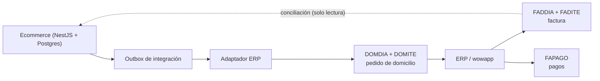

# Integración con el ERP Advantage (`db/ADD_ANALITICA`)

> Este documento es el **anexo de descubrimiento/contexto**. Para el plan
> accionable (asociación de campos, protocolo de comunicación y transacciones
> entre las dos bases) ver **`docs/PLAN-INTEGRACION-ERP.md`**.

> Estado: **propuesta**. Documento de contexto + plan para escribir las
> transacciones del ecommerce en la base Advantage del ERP.
> Generado el 2026-10-08 a partir de la copia `db/ADD_ANALITICA/`.

## 1. Resumen ejecutivo

- `db/ADD_ANALITICA/` es una **copia de la base operativa del ERP** (tablas
  Advantage / ADS: `.adt` datos, `.adi` índices, `.adm` memo).
- El ERP **ya factura por sucursales 1, 2 y 11** y **ya tuvo canal web**
  (`POSCLI.ORIGENW = 'W'` en 30.042 clientes) → probablemente existe una
  integración previa ("wowapp") que conviene reutilizar en vez de reinventar.
- El objetivo del ecommerce es: **guardar el pedido en `DOMDIA` + `DOMITE`**
  para que el ERP lo **facture** (`FADDIA` + `FADITE`, nº de factura y CUFE los
  genera el ERP/POS, nunca nosotros).
- Antes de escribir una sola fila hay **3 decisiones bloqueantes** (§7):
  vía de acceso, quién genera consecutivos/factura, y confirmación del
  circuito de domicilios (la copia de `DOMDIA`/`DOMITE` que tenemos es vieja).

## 2. Qué hay en la copia (contexto)

### 2.1 Tablas relevantes

| Tabla | Registros | Rol | Recencia de los datos |
|---|---:|---|---|
| `TIDSAL` | 51.938 | Artículos por sucursal (catálogo + precio + saldo) | 2026-09-22 ✅ |
| `TIDCATE` | 174 | Categorías (`CTABCOD`, `CTABDES`, `CATE1..3`, `CARAC1..6`, `IMAGEN`, `HABILITA`) | — |
| `TIDTPRO` | 363 | Tipos de producto (`CODIGO`, `NOMBRE`, `HABILITA`, `OCULTA`…) | — |
| `TIDMARCAS` | 2.176 | Marcas (`MCODIGO`, `MNOMBRE`) | — |
| `POSCLI` | 146.372 | Clientes de POS/web (89 campos) | 2025-04 ✅ |
| `FADCLI` | 122.190 | Clientes de facturación (102 campos) | 2026-10-01 ✅ |
| `DOMDIA` | 52.496 | **Cabecera del pedido de domicilio** (56 campos) | **2023-12-13 ⚠️** |
| `DOMITE` | 240.621 | **Ítems del pedido de domicilio** (43 campos) | **2023-12-13 ⚠️** |
| `FADDIA` | 1.167.637 | Facturas (cabecera, 85 campos) — **solo año 2026** | 2026-09-30 ✅ |
| `FADITE` | 7.175.029 | Facturas (detalle, 63 campos, 5,5 GB) | 2026-09-30 ✅ |
| `FAPAGO` | 2.141.129 | Pagos de facturas | 2026-09-30 ✅ |
| `POSCONSE` | 47 | Consecutivos / conceptos contables por código | — |
| `TIDBODE` | 29 | Bodegas por sucursal | — |

### 2.2 Hallazgos que condicionan el diseño

1. **Servidor Advantage identificado**: los pedidos viejos guardan
   `DOMDIA.DIRIP = "\VISADS"`. Ese es el nombre del servidor ADS del ERP.
2. **El ERP ya tiene clientes web**: `POSCLI.ORIGENW = 'W'` (30.042 registros),
   `NEWWEB = 'N'` (11.751), `CLAWEB` (4 caracteres, p. ej. `6892`),
   `SUCURSAL` poblada. Los `CODCLI` son de 13 dígitos empezando en `2`.
   → *Hay un flujo web previo que hay que descubrir antes de crear uno nuevo.*
3. **`DOMDIA`/`DOMITE` de la copia son viejos** (2015 → 2023-12-13; casi todo
   `FASUCUR = "14"`). Pero las facturas de **2026 sí** referencian pedidos de
   domicilio: `FADDIA.FADOMICIL = "DO0000004340"` y `FADOMITIPO`
   (`01/02/03/05/10/11/15`) en 16.624 facturas.
   → *El circuito de domicilios está vivo, pero **su tabla maestra no es la que
   tenemos**. Necesitamos una copia fresca o confirmación del proveedor.*
4. **Sucursales live = 1, 2 y 11** (igual que nuestro `branches`:
   `TID Sucursal 1/2/11`, ids 9/10/11). En `FADDIA` son numéricas (`1`,`11`,`2`);
   en `DOMDIA` son texto de 2 dígitos (`"01"`,`"02"`,`"11"`).
5. **`TIDSAL` es por sucursal**: 51.938 filas = 19.252 (suc 1) + 18.544 (suc 11)
   + 14.142 (suc 2). Nuestro `branch_products` e `inventory` tienen exactamente
   **51.938 filas**: ya modelamos ese grano.
6. **Los códigos de artículo encajan**: `FADITE.IFARTIC` / `DOMITE.IFARTIC` son
   de 15 dígitos, igual que `products.external_id` y `product_variants.sku`
   (21.611 de 21.613 productos los tienen; 21.189 con `barcode` EAN).
7. **Montos**: en `FADITE`/`DOMITE`, `IFVLRUNI` es **precio con IVA**,
   `IFVLRBRU` la **base gravable**, `IFPORIVA` el %, `IFVLRIVA` el impuesto y
   `IFVLRNET` el **total de la línea**. Cabecera = suma de líneas (`FAVLRNET`).
8. **Campos vacíos**: en Advantage un numérico vacío se lee como
   `-2147483648` (int32) o `-1.6e-322` (double). Hay que respetar esa
   convención al escribir.
9. **`FADITE`/`FADDIA`/`FAPAGO` solo traen 2026** (el resto está archivado).
10. **`FADITE.IFDOMICIL` / `FADDIA.FADOMICIL` (12) e `IFDOMITIPO`/`FADOMITIPO` (2)**
    son el puente factura ↔ pedido de domicilio.

### 2.3 Diccionarios de campos

Volcados completos en `scripts-agent/.scratch/adt-fields/<TABLA>.json`
(generados con `node scripts-agent/adt-fields.mjs`).
Herramientas: `adt-fields.mjs`, `adt-sample.mjs`, `adt-stats.mjs`.

## 3. Flujo objetivo



Regla de oro: **nosotros creamos el pedido; el ERP emite la factura**.
El número de factura, prefijo, resolución DIAN y CUFE son del ERP/POS.

## 4. Mapa de datos propuesto

### 4.1 Cliente → `POSCLI`

| Nuestro campo | Campo Advantage | Notas |
|---|---|---|
| `customers.id` (interno) | — | se guardará el `CODCLI` de retorno |
| — | `CODCLI` (13) | **Lo asigna el ERP** (patrón `2…`); guardar en `customers.provider_id` |
| `first_name` + `last_name` | `NOMCLI` (40) / `NOMBRE`,`NOMBRE2`,`APELLIDO`,`APELLIDO2` | ambos formatos coexisten |
| `document_number` | `CEDCLI` (10) | |
| `document_type` | `TIPODOC` (2) | `13` = cédula en los datos vistos |
| `phone` | `TELCELU` (12) / `TELCLI1` (10) | |
| `email` | `EMAIL` (50) | |
| dirección | `DIRCLI1` (60), `BARRIO1`, `CIUCLI` (20), `CIUDAD` (5, código DANE) | `POSDANE` tiene los códigos |
| — | `SUCURSAL` (3) | sucursal de la que es cliente |
| — | `ORIGENW='W'`, `NEWWEB`, `CLAWEB` | marcas del canal web existente |

> Pendiente: pedir al proveedor el significado exacto de `CLAWEB`/`NEWWEB`
> (parece clave de acceso web) y el algoritmo de `CODCLI`.

### 4.2 Pedido → `DOMDIA` (cabecera, 56 campos)

| Campo | Tipo | Propuesta de origen |
|---|---|---|
| `FASUCUR` | char(3) | `branches.code` con cero a la izquierda (`"01"`,`"02"`,`"11"`) |
| `FAFACTURA` | char(12) | **vacío al crear** (lo llena el ERP al facturar) |
| `FAPEDIDO` | char(12) | nº de pedido ecommerce (ver §7) |
| `FACODIGO` | char(13) | `POSCLI.CODCLI` del cliente |
| `FANOMBRE` | char(45) | `orders.customer_name` |
| `FADIREC` | char(60) | dirección de `customer_addresses` |
| `FATELEF` / `FACELU` | char(15) | teléfono del cliente |
| `FANIT` | char(15) | `customers.document_number` |
| `FAFCHFAC` | int32 | fecha `YYYYMMDD` |
| `FATIME` | char(8) | hora `HH:MM:SS` |
| `FAVLRBRU` | double | Σ base gravable de ítems |
| `FAVLRDES` | double | Σ descuentos |
| `FAVLRIVA` | double | Σ IVA |
| `FAVLRNET` | double | **total del pedido** |
| `FAPAG01..03` + `FAVLR01..03` | char(2)+double | medio de pago y valor (efectivo/tarjeta/transferencia) |
| `FATIPODOM` | char(2) | tipo de domicilio (definir con el ERP: `01/02/03`…) |
| `FAOBSER` | char(250) | notas del cliente |
| `FAHORAD` / `FAHORAE` | char(8) | franja horaria (`delivery_time_slots`) |
| `FAEMAIL` | char(50) | correo |
| `FACONTROL` | char(36) | GUID para **idempotencia** (nuestro `orders.reference_code`) |
| `FADOCPAGO`, `FAPEDINT`, `FAPTOFAC`, `FAVTEX` | char | por definir con el proveedor |

### 4.3 Ítems → `DOMITE` (43 campos)

| Campo | Tipo | Origen |
|---|---|---|
| `IFFACT` | char(12) | igual que `DOMDIA.FAFACTURA` (vínculo cabecera-detalle) |
| `IFPEDIDO` | char(9) | nº de pedido (ver §7) |
| `IFCLIENTE` | char(13) | `POSCLI.CODCLI` |
| `IFARTIC` | char(19) | `product_variants.sku` (15 díg.) |
| `IFNOMBRE` | char(60) | `order_items.product_name` |
| `IFCANT` | double | `order_items.quantity` |
| `IFVLRUNI` | double | `unit_price_gross` |
| `IFVLRBRU` | double | base = `unit_price_net` × cantidad |
| `IFPORIVA` | double | `tax_rate` |
| `IFVLRIVA` | double | `tax_amount` |
| `IFVLRNET` | double | `order_items.total` |
| `IFPROVEE` | char(10) | `suppliers.code` |
| `IFTPRO` | char(3) | tipo de producto TID |
| `IFSUCUR` | char(3) | sucursal |
| `IFFECHA` | int32 | `YYYYMMDD` |
| `IFESTADO` | bin(2) | estado (por confirmar; en la copia `32768` domina) |
| `IFOBSER` | char(100) | observaciones |

### 4.4 Lo que **no** escribimos

`FADDIA`, `FADITE`, `FAPAGO`: los genera el ERP al facturar. Nuestro rol es
**leerlos** para conciliar (estado del pedido, número de factura, pagos) usando
`FADOMICIL`/`IFDOMICIL` y `FADOMITIPO`/`IFDOMITIPO`.

### 4.5 Cambios en nuestra base (Postgres)

1. `customers.provider_id` ya existe → guardar ahí el `CODCLI`.
2. `orders` → agregar `erp_document_ref` (varchar) y `erp_sync_status`.
3. Nueva tabla **`erp_outbox`**: `id`, `entity` (`customer`|`order`), `payload`
   (jsonb), `status` (`pending`|`sent`|`ack`|`error`), `attempts`,
   `last_error`, `idempotency_key` (único), `created_at`, `sent_at`.
4. Nueva tabla **`erp_ledger`**: espejo de lo enviado (para conciliación y
   reintentos), con el `CODCLI`/`FAPEDIDO` devuelto por el ERP.

## 5. Vías de acceso técnico

| Opción | Cómo | Pros | Contras |
|---|---|---|---|
| **A. Puente en Windows** (recomendada) | Microservicio en el servidor del ERP (o un PC de la red) que expone HTTP en LAN y escribe con el driver .NET/ODBC de Advantage | No expone credenciales; respeta locks; un solo punto con el driver; fácil idempotencia y logs | Hay que desplegar/operar software en el Windows del ERP |
| **B. Driver remoto desde Linux** | JDBC/ODBC de Advantage hacia `\\VISADS` (TCP 6262) | Sin tocar el servidor | Driver orientado a Windows/Java, EOL; latencia; conexiones remotas a menudo deshabilitadas |
| **C. Archivo puente** | Dejamos un CSV/DBF en carpeta compartida y un job del ERP lo carga | Simple, sin drivers | Depende de un job del proveedor; sin acks ni errores finos |
| **D. Reutilizar "wowapp"** | Usar el canal existente que ya creó 30k clientes web | Cero desarrollo de drivers; el proveedor ya lo conoce | Necesitamos documentación/permiso del proveedor |

> Antes de decidir: **averiguar cómo funciona "wowapp"** (`FADITE - wowapp`,
> `ORIGENW='W'`). Si ya escribe pedidos al ERP, lo natural es apuntar ahí.

## 6. Diseño propuesto (si se implementa A o B)

1. **Outbox transaccional** en Postgres: la orden se guarda junto al evento
   `erp_outbox` en la misma transacción (nunca se pierde ni se duplica).
2. **Worker** en el backend que toma pendientes en orden, con
   `idempotency_key` = `reference_code` y backoff exponencial.
3. **Adaptador ERP** aislado detrás de una interfaz
   (`createCustomer`, `createOrder`, `getOrderStatus`), con dos
   implementaciones: `advantage-bridge` y `noop` (dev).
4. **Idempotencia**: `FACONTROL` (GUID) + tabla `erp_ledger`; antes de escribir,
   buscar por `FAPEDIDO`/`FACONTROL`.
5. **Consecutivos**: los asigna el ERP (evitar colisiones con el POS). Si el ERP
   exige que el pedido llegue numerado, coordinar el rango con el proveedor.
6. **Conciliación**: job de solo lectura que cruza
   `orders.reference_code ↔ FADDIA.FADOMICIL` y actualiza estados/pagos.
7. **Auditoría**: log de cada escritura con payload y respuesta; nada de
   borrados; anulaciones se registran como eventos nuevos.
8. **Entornos**: primero contra la **copia** (`db/ADD_ANALITICA`, modo archivo),
   luego contra un **tenant de pruebas** del ERP, y solo al final producción.

## 7. Preguntas bloqueantes (para Juan / proveedor del ERP)

1. **Vía de acceso**: ¿el ERP expone un servicio/SQL de integración (como el de
   "wowapp"), o debemos escribir en las tablas? ¿Hay ADS server accesible
   (`\\VISADS`) o los procesos corren con las tablas bloqueadas?
2. **Domicilios**: ¿cómo se crea hoy un pedido de domicilio? ¿Qué tabla usa el
   flujo web actual (`FADOMICIL = "DO…"`)? ¿Nos pueden dar una **copia fresca
   de `DOMDIA`/`DOMITE`**? (la nuestra termina en 2023).
3. **Consecutivos**: ¿quién asigna `FAPEDIDO`/`FAFACTURA`? ¿Prefijos por caja
   (`PE06`) y resolución DIAN? ¿Nos permiten un rango propio para el canal web?
4. **Cliente**: al registrar un cliente web, ¿creamos `POSCLI` o hay un servicio
   de registro? ¿Qué son `CLAWEB` y `NEWWEB`?
5. **Escritura de catálogo**: ¿debe ser el ERP el dueño de `TIDSAL` (nosotros
   solo leemos) o esperan que el ecommerce alimente productos?
6. **Sucursal del pedido web**: ¿qué `FASUCUR`/`FATIPODOM` debe llevar un pedido
   de ecommerce (la sucursal de despacho o una sucursal "virtual" tipo la 14)?

## 8. Fases sugeridas

1. **Descubrimiento** (esta semana): responder §7 con el proveedor; pedir copia
   fresca de `DOMDIA`/`DOMITE` y del diccionario de estados.
2. **Especificación de mapeo**: cerrar el mapa §4 campo por campo con el
   proveedor (incluye estados, pagos y tipo de domicilio).
3. **Prototipo contra copia**: escribir `DOMDIA`+`DOMITE` en una copia local
   (modo archivo) y validar lecturas.
4. **Sandbox del ERP**: enviar 5 pedidos de prueba al ERP real y verificar la
   factura generada (`FADDIA`/`FADITE`/`FAPAGO`).
5. **Producción gradual**: outbox + conciliación + alertas, con rollout por
   sucursal.

---

## 9. Sincronización bidireccional: opciones

El objetivo es **coherencia en los dos sentidos**:

- **Postgres → ERP**: pedidos/clientes nuevos (transacciones).
- **ERP → Postgres**: catálogo, precios, stock y estado de facturación.

### 9.1 Matriz de propiedad (quién manda en cada dato)

Sin esto, cualquier sincronización termina pisando datos. La regla propuesta:

| Dato | Dueño | Dirección |
|---|---|---|
| Productos, categorías, tipos, marcas, impuestos, proveedores | **ERP** | ERP → Postgres (réplica) |
| Precios y listas | **ERP** | ERP → Postgres |
| Stock por sucursal | **ERP** | ERP → Postgres |
| Fotos, descripciones ricas, SEO, atributos de ficha | **Ecommerce** | solo local (campos que el ERP no tiene) |
| Clientes web | **Ecommerce** crea, **ERP** numera | ida y vuelta |
| Pedidos / carrito | **Ecommerce** | Postgres → ERP (`DOMDIA`/`DOMITE`) |
| Facturas, pagos, estados | **ERP** | ERP → Postgres (conciliación) |
| Banners, campañas, contenido | **Ecommerce** | solo local |

### 9.2 El problema técnico: no hay CDC

Advantage **no tiene replicación lógica ni log de cambios**. Para saber “qué
cambió allá” solo hay estas vías:

1. **Marca de fecha** `TIDSAL.INFECHA` (int32 `YYYYMMDD`) — se re-lee una
   ventana (hoy + ayer) y se hace *upsert*. Barato, pero **granularidad de día**
   y hay que verificar que *toda* edición la actualice.
2. **Diff completo + hash**: leer las 51.938 filas (133 MB), calcular un hash
   por `(INARTIC, INSUC, INBODEGA)` de las columnas que nos importan y comparar
   contra una foto guardada en Postgres. Detecta **todo**, sin confiar en marcas.
3. **Watch del archivo** (`mtime`/tamaño de `.adt`/`.adi`): dispara el diff solo
   cuando algo se tocó. Barato y robusto como “aviso de que hay cambios”.
4. **Triggers ADS / AEP**: el propio motor avisa al cambiar una fila. Es lo más
   inmediato, pero hay que habilitarlo en el ERP (permiso del proveedor).
5. **Que el ERP publique**: el proveedor expone un servicio o deja un archivo
   cuando cambia algo. Lo ideal, si existe.

Recomendación: **2 + 3** (hash + watch) como base, con **1** como atajo cuando
la ventana es corta, y **4** solo si el proveedor lo habilita.

### 9.3 Opciones de arquitectura

| # | Opción | Latencia | Esfuerzo | Riesgo | Cuándo elegirla |
|---|---|---|---|---|---|
| 1 | **Doble ETL por lotes**: poller de catálogo/precios/stock + outbox de pedidos | minutos | bajo | bajo | Primer paso, siempre válido como línea base |
| 2 | **Puente Windows** con watcher + outbox (agente en el server del ERP) | segundos | medio | medio | Si se puede desplegar un servicio en el Windows del ERP |
| 3 | **Triggers ADS → cola** (event-driven nativo) | ~inmediato | alto | alto | Solo si el proveedor lo habilita y certifica |
| 4 | **Reusar “wowapp”** para escritura + ETL para lectura | según canal | bajo | bajo | Si el canal web existente ya escribe pedidos al ERP |

Detalle:

- **Opción 1 — lotes.** Dos jobs en el backend:
  `sync-catalog` (lee `TIDSAL`/`TIDCATE`/`TIDTPRO`/`TIDMARCAS`/`POSCLI`/`FADCLI`
  y hace *upsert*) y `push-orders` (drena `erp_outbox` hacia `DOMDIA`/`DOMITE`).
  Reutiliza lo que ya existe (`import-tidsal.mjs` como referencia).
  *Pros*: no toca el ERP, tolera caídas, fácil de auditar.
  *Contras*: latencia de minutos y no hay “aviso” de cambios.
- **Opción 2 — puente.** Un servicio en Windows que (a) escribe pedidos que le
  llegan del outbox y (b) vigila los `.adt` y publica el diff a una API del
  backend. Un solo componente con el driver; el backend nunca ve credenciales.
  *Pros*: casi en vivo, respeta locks, punto único de integración.
  *Contras*: hay que operar software en el servidor del ERP.
- **Opción 3 — triggers.** Máxima inmediatez y cero *polling*.
  *Contras*: invade el ERP (rendimiento del POS, versiones, mantenimiento) y
  depende 100% del proveedor.
- **Opción 4 — wowapp.** Si ya existe el canal, es el camino más corto:
  nosotros publicamos el pedido donde corresponda y el ERP lo factura igual que
  hoy. A confirmar con el proveedor (§7).

### 9.4 Combinación recomendada

```
ERP → Postgres   : Opción 1 (hash + watch) ahora; Opción 2/3 después si hace falta inmediatez
Postgres → ERP   : outbox + (Opción 2 si hay puente, si no Opción 1/4)
Conciliación     : job nocturno que re-lee todo y reporta diferencias
```

Componentes en nuestro lado:

- `erp_outbox` (ya propuesto en §4.5) para escrituras idempotentes.
- `erp_snapshot`: `(artic, sucursal, bodega)` → `hash` de las columnas
  sincronizadas + `erp_updated_at`; sirve para el diff y para saber qué cambió.
- `erp_sync_runs`: bitácora por corrida (leídos, insertados, actualizados,
  errores) para poder responder “¿por qué este precio no cuadra?”.
- **No borrar nunca** por sincronización: si un artículo desaparece del ERP se
  marca `is_active = false` y se reporta.

### 9.5 Lo que hay que confirmar antes de implementar

1. ¿`INFECHA` se actualiza en **toda** edición de precio/stock? ¿Hay cambios que
   no la toquen (`INSUBEPRE`, actualizaciones masivas del proveedor)?
2. ¿Cuál de las 10 listas (`INVRVENTA1..0`) usan como precio de venta al público
   y cuál como “antes”? (hoy tomamos `INVRVENTA1`).
3. ¿El stock que quieren reflejar en la web es `INSALDO00` de la sucursal, o
   `INSALDOWEB`?
4. ¿Hay ventana de mantenimiento o procesos que bloqueen las tablas?
5. ¿Podemos conectarnos por ADS remoto o solo copiar archivos? ¿Con qué
   frecuencia se puede copiar `TIDSAL` (133 MB) sin afectar al POS?

---

## 10. Cómo lograr que los dos esquemas “se entiendan”

El ERP habla en códigos de 2 caracteres, `char(n)` con relleno, `double` con
centinelas y fechas `YYYYMMDD` en un `int32`. Postgres habla en tablas
relacionales con `numeric`, `date` y enums. Para que la sincronización sea
entendible y auditable se necesitan **cuatro piezas**: eventos, capa cruda,
diccionarios de códigos e identidad compartida.

### 10.1 Los cuatro artefactos

```
ADS/ERP                     Agente (Windows)              Postgres
────────                    ────────────────              ────────
TIDSAL ──trigger──┐                                        erp_events   (log crudo)
TIDCATE ─trigger──┤        1. lee DSI_EVENTO               erp_raw.*    (espejo 1:1)
POSCLI ─trigger───┼──────▶ 2. lee la fila por clave ─────▶ erp_code_map (diccionarios)
DOMDIA ─trigger───┤        3. POST por lotes              erp_ref      (identidad)
FADDIA ─trigger───┘                                        public.*     (dominio)
                                                          erp_outbox   (salida)
```

1. **Eventos**: el trigger escribe en una cola dentro del propio ADS.
2. **Capa cruda** (`erp_raw`): espejo 1:1 de las tablas del ERP, tal cual,
   para poder **auditar y reproyectar** sin volver a leer el ERP.
3. **Diccionarios** (`erp_code_map`): cada código del ERP con su significado.
4. **Identidad** (`erp_ref`): qué fila de qué lado corresponde a qué.

### 10.2 En el ERP: cola de eventos + triggers

> ⚠️ **Verificar primero**: en Advantage los triggers **solo existen en tablas
> que pertenecen a un diccionario de base de datos (`.add`)**. En la copia que
> tenemos, las tablas del ERP son *free tables* (el único `.add` es
> `PUBLIDATA`). Si en producción es igual hay que decidir: crear un diccionario
> y registrar las tablas (obliga a que **todos** los clientes, incluido el ERP,
> abran por el diccionario) o usar el plan B (§10.7).

Cola a crear en el ERP:

```sql
CREATE TABLE DSI_EVENTO (
  EV_ID     AUTOINC,
  EV_TABLA  CHAR(10),      -- 'TIDSAL', 'POSCLI', 'DOMDIA'...
  EV_OP     CHAR(1),       -- I / U / D
  EV_CLAVE  CHAR(80),      -- PK serializada: '100001010000005|01|'
  EV_FECHA  TIMESTAMP,
  EV_ESTADO CHAR(1) DEFAULT 'N',   -- N=nuevo P=procesado E=error
  PRIMARY KEY (EV_ID)
);
```

Trigger por tabla (esquema; la sintaxis exacta depende de la versión de ADS):

```sql
CREATE TRIGGER TR_TIDSAL_AIU AFTER INSERT, UPDATE, DELETE ON TIDSAL
BEGIN
  INSERT INTO DSI_EVENTO (EV_TABLA, EV_OP, EV_CLAVE, EV_FECHA, EV_ESTADO)
  VALUES ('TIDSAL', 'U', INARTIC + '|' + INSUC + '|' + INBODEGA, NOW(), 'N');
END;
```

Reglas para que los triggers no degraden el POS:

- **Baratos**: solo `INSERT` en la cola, sin cálculos, sin red, sin llamar a
  servicios externos.
- **Sin disparar en `FADITE`** (7,1 M filas) ni `FAPAGO` (2,1 M): se disparan en
  las cabeceras (`FADDIA`) y el detalle se lee bajo demanda por `IFFACT`.
- Para actualizaciones masivas (cambio de precios de 50 k filas) la cola crece;
  el agente procesa por lotes y el ERP purga las filas `P` viejas.

### 10.3 El contrato de evento (envelope)

Todo lo que viaja del ERP al backend va en un sobre versionado:

```json
{
  "v": 1,
  "event_id": 918273,
  "table": "TIDSAL",
  "op": "U",
  "key": { "INARTIC": "100001010000005", "INSUC": "01" },
  "row": { "INVRVENTA1": 4300, "INSALDO00": 42, "INACTIVO": "A", "INFECHA": 20261007 },
  "ts": "2026-10-08T15:22:31-05:00",
  "txn": 55231
}
```

Y en sentido contrario (pedido):

```json
{
  "v": 1,
  "type": "order",
  "reference": "8f2c…",
  "branch": "01",
  "customer_erp_code": "2000011273491",
  "items": [{ "sku": "101270100088057", "qty": 2, "unit_gross": 7400, "tax_rate": 19 }],
  "payment": { "erp_code": "EF", "amount": 14800 },
  "idempotency_key": "order:8f2c…"
}
```

`v` permite **evolucionar sin romper**: si el ERP agrega campos, sube la versión
solo cuando cambia la semántica.

### 10.4 Reglas de conversión (codecs)

| Origen (ADS) | Regla | Destino (Postgres) |
|---|---|---|
| `char(n)` | latin1 → utf8, quitar relleno/`\0` | `text` |
| `double` vacío | `-1.6e-322` (o `\|v\| < 1e-300`) → `NULL` | `numeric` |
| `int32` vacío | `-2147483648` → `NULL` | `integer` |
| fecha `int32` | `0`/centinela → `NULL`; si no, `YYYYMMDD` → `date` | `date` |
| hora `char(8)` | `HH:MM:SS` | `time` |
| `logical` | `T`/`1` → `true` | `boolean` |
| códigos (`INSUC`, `IFARTIC`) | **siempre string**, con ceros a la izquierda y longitud fija | `text` |
| montos | `double` → redondeo *half-up* a 2 decimales | `numeric(12,2)` |
| cantidades | `double` (hay artículos por peso) | `numeric(12,3)` |

Errores típicos a evitar: comparar `"01" = 1`, perder ceros a la izquierda al
pasar códigos por `Number()`, y sumar montos en `double` (acumular en `numeric`).

### 10.5 Diccionarios de códigos (`erp_code_map`)

```sql
CREATE TABLE erp_code_map (
  domain     text NOT NULL,      -- 'payment_method' | 'invoice_type' | ...
  erp_value  text NOT NULL,      -- 'EF', '01', 'FA'
  canonical  text NOT NULL,      -- 'CASH', 'HOME_DELIVERY', 'INVOICE'
  label      text,
  meta       jsonb,
  PRIMARY KEY (domain, erp_value)
);
```

Fuentes para poblarlos (¡ya las tenemos en la copia!):

| Dominio | Tabla ERP | Notas |
|---|---|---|
| Medios de pago | **`POSPAGO`** (`SUCUR`,`CODIGO`,`NOMBRE`,`NOMBRE2`) | Trae `PERMIDSI` y **`VALIDAWEB`**: son los medios habilitados para nuestro canal |
| Tipo de factura | `FADDIA.FATIPO` | `FA` factura, `CO` cotización, `RE`, `AN` anulación, `IN` |
| Estado de factura | `FADDIA.FAESTADO` | `1` vigente, `2` … |
| Tipo de línea | `FADITE.IFTIPO` | `E`, `I`, `C`, `J`, `D` |
| Tipo de domicilio | `FADOMITIPO` / `IFDOMITIPO` | `01`,`02`,`03`,`05`,`10`,`11`,`15` |
| Estado de pedido/ítem de domicilio | `DOMDIA.FAESTADO` / `DOMITE.IFESTADO` | ver §10.8 (incluye `32768`) |
| Impuestos | `TIDTIPOS` (`CLASE`,`TIPO`,`IMPUESTO`,`BASE`) | tarifa por clase |
| Tipo de documento | `POSCLI.TIPODOC` | `13` = cédula en los datos vistos |
| Ciudad | `POSDANE` (`CODIGO`,`NOMBRE`) | 1.647 códigos |
| Sucursal / bodega | `TIDSAL.INSUC`, `TIDBODE` | |
| Marca / tipo / categoría | `TIDMARCAS`, `TIDTPRO`, `TIDCATE`/`TIDTAB` | ya mapeados en el catálogo |

> **Regla de oro**: ningún código del ERP se interpreta con un `if` en el
> código. Todo pasa por `erp_code_map`; si falta un código, el evento va a
> cuarentena (§10.8) en vez de inventar un valor.

### 10.6 Identidad compartida (`erp_ref`)

```sql
CREATE TABLE erp_ref (
  entity     text NOT NULL,     -- 'product' | 'variant' | 'customer' | 'order' …
  local_id   bigint NOT NULL,
  erp_table  text NOT NULL,
  erp_key    text NOT NULL,     -- '100001010000005|01'
  created_at timestamptz DEFAULT now(),
  PRIMARY KEY (entity, local_id, erp_table),
  UNIQUE (erp_table, erp_key)
);
```

Equivalencias base del proyecto:

| Concepto | ERP | Ecommerce |
|---|---|---|
| Artículo | `INARTIC` / `IFARTIC` (15) | `products.external_id`, `product_variants.sku` |
| EAN | `INEAN` | `product_variants.barcode` |
| Sucursal | `INSUC` / `FASUCUR` (`"01"`, num `1`) | `branches.code` (`'1'`, `'2'`, `'11'`) |
| Cliente | `POSCLI.CODCLI` (13) | `customers.provider_id` |
| Pedido | `DOMDIA.FAPEDIDO` + **`FACONTROL`** (36) | `orders.reference_code` (UUID en `FACONTROL`) |
| Factura | `FADDIA.FAFACTURA` | `orders.erp_document_ref` |
| Pago | `FAPAGO.FPFACT` / `FPNUMERO` | `payments` |

**`FACONTROL` es la pieza clave**: ya existe en `DOMDIA` (char 36) y es
suficiente para un UUID. Si escribimos ahí nuestro `orders.reference_code`, los
dos lados pueden correlacionar sin ambigüedad, incluso si el ERP renumera el
pedido.

### 10.7 Plan B si no se pueden usar triggers

Mismo contrato, otra captura: el agente hace **diff con hash** contra
`erp_snapshot` (ver §9.2). Los eventos que produce son idénticos a los del
trigger (`op=I/U/D`, `key`, `row`), así que **nada del lado Postgres cambia**.
Esa es la ventaja de separar “captura” de “contrato”.

### 10.8 Estados que todavía hay que descifrar

Con el ERP propio esto se resuelve en una sentada, pero hay que documentarlo:

- `DOMDIA.FAESTADO`: `9` (50.758), `32768` (1.302), `5` (389), `0` (47).
- `DOMITE.IFESTADO`: `32768` (239.361), `5` (1.250), `0` (10).
- `FADDIA.FAESTADO`: `1` / `2`.
- `POSCLI.FECHABAJA = 20240415` en 146.316 de 146.372 clientes (¿es una baja
  masiva real o un campo reutilizado?).

Mientras no estén claros: eventos con esos valores → cuarentena y reporte.

### 10.9 Checklist de implementación

**Lado ERP (tuyo)**
- [ ] Confirmar si las tablas están en diccionario (requisito para triggers).
- [ ] Crear `DSI_EVENTO` + triggers en `TIDSAL`, `TIDCATE`, `TIDTPRO`,
      `TIDMARCAS`, `POSCLI`, `DOMDIA`, `DOMITE`, `FADDIA` (no en `FADITE`/`FAPAGO`).
- [ ] Job de purga de eventos procesados.

**Lado agente (Windows)**
- [ ] Leer `DSI_EVENTO` pendiente → leer la fila por clave → POST por lotes.
- [ ] Recibir pedidos del backend → escribir `DOMDIA`+`DOMITE` en **una
transacción** → marcar `FACONTROL` → responder `FAPEDIDO`.
- [ ] Reintentos con backoff y log local.

**Lado Postgres/backend**
- [ ] Tablas: `erp_events`, `erp_raw.*`, `erp_code_map`, `erp_ref`,
      `erp_outbox`, `erp_sync_cursor`, `erp_dlq`.
- [ ] Codecs (§10.4) y *projectors* idempotentes por entidad.
- [ ] Endpoints `POST /erp/events` (lote) y `POST /erp/orders` (cola de salida).
- [ ] Poblar `erp_code_map` desde `POSPAGO`, `TIDTIPOS`, `POSDANE`, `FADDIA`,…
- [ ] Conciliación diaria (conteos + hashes) y panel de estado.

### 10.10 Nota sobre “ADS en Linux”

Ya se intentó (`db/ads/`): el plan de correr el **servidor oficial** ADS en Docker
quedó **bloqueado** porque el instalador `adslinux-11.10.0.24.tar.gz` no es
público (SAP descontinuó el producto). **Resuelto** con **OpenADS**
(reimplementación open-source): ver `docs/OPENADS-VALIDACION.md`. En resumen,
ya monta nuestras tablas `.adt` en Docker y escribe de forma byte-compatible;
los triggers requieren diccionario y las *free tables* se capturan por diff.

---

### Anexo — herramientas usadas

```bash
node scripts-agent/adt-fields.mjs            # diccionario de campos -> .scratch/adt-fields/
node scripts-agent/adt-sample.mjs <tabla> --last=2 --fields=A,B
node scripts-agent/adt-stats.mjs <tabla> --fields=A,B --prefix=C:2
```
