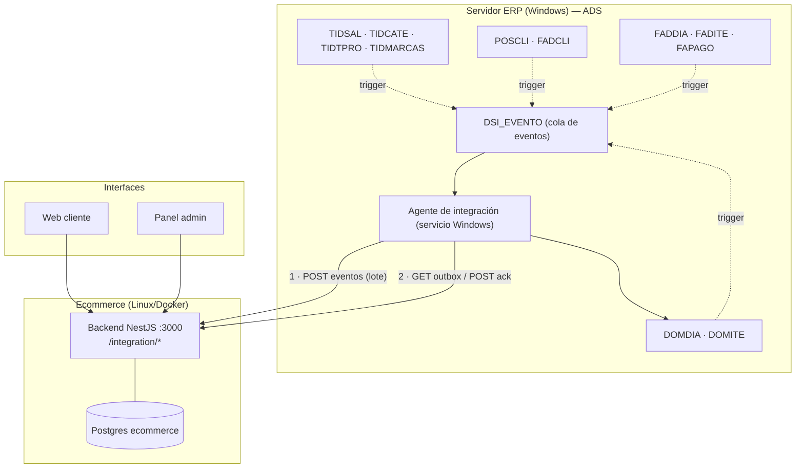
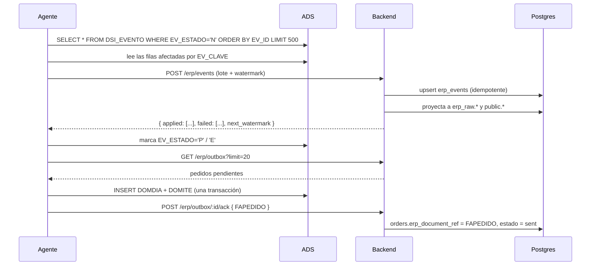
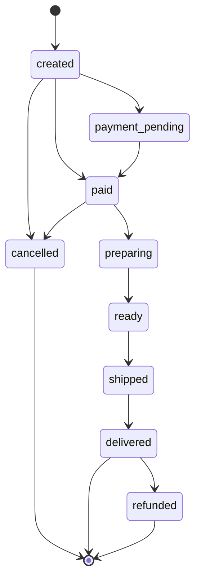
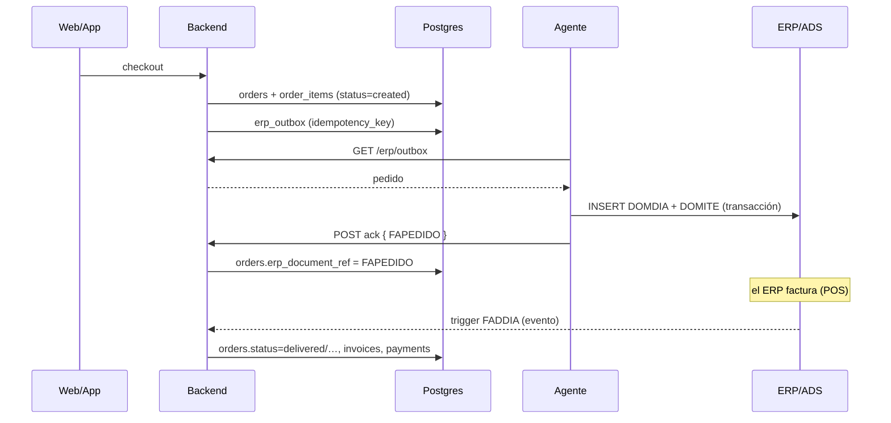
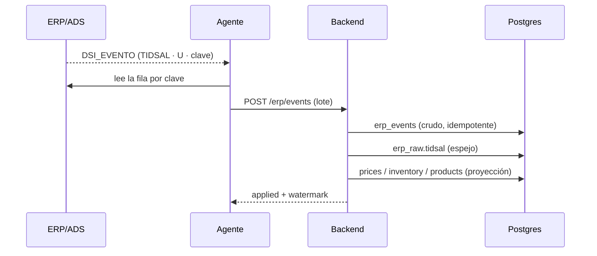

# Plan de integración Ecommerce ⇄ ERP Advantage

> **Estado**: propuesta para revisión.
> **Alcance**: sincronización bidireccional entre la base Postgres del ecommerce
> y la base Advantage (ADS) del ERP de Mercaldas.
> **Documentos relacionados**:
> - `docs/PLAN-SINCRONIZACION-ERP.md` — **roadmap para producción** (objetivo
>   operativo, qué se sincroniza y qué no, fases A–D).
> - `docs/INTEGRACION-ERP-ADVANTAGE.md` — descubrimiento y contexto de la copia
>   `db/ADD_ANALITICA/` (tablas, hallazgos, opciones, preguntas abiertas).
> - `docs/DATABASE.md` — modelo actual del ecommerce (Postgres).
> - `docs/TIDSAL-diccionario-datos.json` / `TIDSAL-significados.json` — diccionario
>   del catálogo TID.
>
> **Última actualización**: 2026-10-08.
>
> **Estado de implementación (piloto con la copia `db/ADD_ANALITICA`)**:
> - ✅ **Fase 2** — migración `db/sql/19_erp_integration.sql` aplicada;
>   `erp_code_map` poblado (`scripts-agent/erp/sync-codes.mjs`).
> - ✅ **Fase 3** — **entrada ERP → Postgres**: catálogo (`sync-catalog.mjs`),
>   clientes (`sync-customers.mjs`) y facturación (`sync-invoices.mjs` →
>   `erp_invoices`/`erp_payments`), con diff por huella / `row_hash`, idempotentes
>   y con merge no destructivo. Detalle: `docs/OPENADS-VALIDACION.md` §8.
>   Falta la conciliación pedido↔factura y el detalle de línea (`FADITE`).
> - ✅ **Fase 4** (piloto) — **salida Postgres → ERP** con
>   `scripts-agent/erp/push-orders.mjs` (`orders`/`order_items` → `DOMDIA`/`DOMITE`,
>   idempotente por `FACONTROL`). Lote del piloto enviado: **87 pedidos** (`80` en
>   la última corrida, `0` fallidos); los `cancelled`/`refunded` se excluyen.
>   Falta confirmar con el ERP la numeración (`FAPEDIDO`), estados
>   (`FAESTADO`/`IFESTADO`), tipo de domicilio y el trato del envío (`FAVARIOS`).
> - ⏳ **Fase 5** — triggers `DSI_EVENTO` en el ERP **pendiente** (o plan B,
>   que es el diff por huella ya implementado).

---

## 1. Objetivo y principios

### 1.1 Objetivo

Que **las dos bases queden coherentes**: las transacciones del ecommerce se
registran en el ERP (para poder facturarlas) y los cambios del ERP (precios,
stock, catálogo, estado de facturación) se reflejan en Postgres.

### 1.2 Principios (no negociables)

1. **Un solo dueño por dato.** Cada campo tiene una base fuente; el otro lado
   solo lo replica. Se prohíben las escrituras bidireccionales sobre el mismo campo.
2. **El ERP factura, nosotros pedimos.** Números de factura, prefijos, resolución
   DIAN y CUFE son del ERP/POS. Nunca los generamos ni los inventamos.
3. **Idempotencia total.** Todo mensaje lleva una clave de idempotencia; reprocesar
   no duplica.
4. **Nunca borrar por sincronización.** Si algo desaparece del ERP se marca
   inactivo y se reporta; jamás se elimina.
5. **Nada de códigos mágicos en el código.** Todo código del ERP se traduce por
   diccionario (`erp_code_map`); si falta, va a cuarentena.
6. **Trazabilidad completa.** Se guarda el payload crudo recibido y el enviado:
   cualquier estado se puede auditar y reproyectar.
7. **Sin red dentro del ERP.** Los triggers no calculan ni llaman servicios: solo
   escriben en una cola local.

---

## 2. Arquitectura general



**Componentes y responsabilidades**

| Componente | Corre en | Hace |
|---|---|---|
| Triggers ADS | Servidor ERP | Notifican cambios en la cola `DSI_EVENTO` (barato, local) |
| **Agente de integración** | Servidor ERP (Windows) | Lee la cola, lee las filas afectadas, las envía al backend; y escribe los pedidos que el backend encola. Único componente con driver Advantage y credenciales del ERP. |
| Backend NestJS | Linux/Docker | Recibe eventos, proyecta a Postgres, encola pedidos, expone la API |
| Postgres | Linux/Docker | Dominio del ecommerce + tablas de integración |

**Ventajas de esta forma**: solo el agente abre conexiones hacia el backend
(nada entra al Windows del ERP); las credenciales del ERP no salen de su máquina;
y el backend no necesita driver ADS (recuerda: el servidor ADS para Linux quedó
**bloqueado** por el instalador, ver `db/ads/`).

---

## 3. Comunicación con las bases de datos

### 3.1 Acceso al ERP (Advantage)

| Aspecto | Definición |
|---|---|
| Motor | Advantage Database Server (ADS) sobre Windows |
| Servidor | `\\VISADS` (visto en `DOMDIA.DIRIP`) |
| Modo de acceso del agente | **Local Server** si corre en la misma máquina (más simple y rápido), o **remoto** por TCP 6262 |
| Driver | Advantage .NET Data Provider / ODBC de Advantage |
| Tablas | *free tables* por defecto; los triggers requieren **diccionario** (`.add`) → **verificar** (§11) |
| Lectura alternativa | Copia de archivos por SMB (ya existe `db/adt-reader/upload-addt.py`) para *backfill* y conciliación |
| **Linux/Docker (validado)** | **OpenADS** (`db/ads/openads/`) monta las `.adt` de una réplica y las sirve por API/SQL. Ver `docs/OPENADS-VALIDACION.md` |
| Escritura | Solo el agente, en transacciones; nunca desde Linux |

### 3.2 Captura de cambios en el ERP

**Vía A — triggers + cola (preferida, si el diccionario lo permite)**

```sql
-- Cola en el propio ERP
CREATE TABLE DSI_EVENTO (
  EV_ID     AUTOINC,
  EV_TABLA  CHAR(10),               -- 'TIDSAL', 'POSCLI', 'DOMDIA', 'FADDIA'...
  EV_OP     CHAR(1),                -- I / U / D
  EV_CLAVE  CHAR(80),               -- clave primaria serializada
  EV_FECHA  TIMESTAMP,
  EV_ESTADO CHAR(1) DEFAULT 'N',    -- N nuevo · P procesado · E error
  PRIMARY KEY (EV_ID)
);

-- Un trigger por tabla (esquema; validar sintaxis según versión de ADS)
CREATE TRIGGER TR_TIDSAL_AIU AFTER INSERT, UPDATE, DELETE ON TIDSAL
BEGIN
  INSERT INTO DSI_EVENTO (EV_TABLA, EV_OP, EV_CLAVE, EV_FECHA, EV_ESTADO)
  VALUES ('TIDSAL','U', INARTIC + '|' + INSUC + '|' + INBODEGA, NOW(), 'N');
END;
```

Tablas con trigger: `TIDSAL`, `TIDCATE`, `TIDTAB`, `TIDTPRO`, `TIDMARCAS`,
`TIDBODE`, `POSCLI`, `FADCLI`, `DOMDIA`, `DOMITE`, `FADDIA`.
**Sin trigger** en `FADITE` (7,1 M filas) y `FAPAGO` (2,1 M): se disparan en
`FADDIA` y el detalle se lee bajo demanda por `IFFACT`/`FPFACT`.
Purga: job en el ERP que borra filas `P` con más de N días.

**Vía B — diff con hash (fallback sin triggers).** El agente lee la tabla
completa, calcula un hash por clave y compara con `erp_snapshot`. Produce los
mismos eventos, así que **nada del lado Postgres cambia**.

### 3.3 Protocolo agente ⇄ backend

El agente es el único que inicia conexiones. HTTP/JSON en la LAN, con token y
firma.

| Endpoint (backend) | Dirección | Para qué |
|---|---|---|
| `POST /integration/erp/events` | agente → backend | Lote de eventos del ERP (entrada) |
| `GET /integration/erp/outbox?limit=N` | agente → backend | Pedidos pendientes de escribir en el ERP |
| `POST /integration/erp/outbox/:id/ack` | agente → backend | Resultado (éxito + `FAPEDIDO`, o error) |
| `POST /integration/erp/heartbeat` | agente → backend | Salud del agente (versión, últimas lecturas) |

Headers: `Authorization: Bearer <token>` + `X-ERP-Sign: sha256=<hmac>` sobre el
cuerpo crudo. Solo IPs de la LAN; opcional mTLS.

Ciclo del agente (bucle cada 5–15 s):



### 3.4 Contrato de evento

**Entrada (ERP → Postgres), sobre versionado:**

```json
{
  "v": 1,
  "event_id": 918273,
  "table": "TIDSAL",
  "op": "U",
  "key": { "INARTIC": "100001010000005", "INSUC": "01", "INBODEGA": "" },
  "row": { "INNOMBRE": "…", "INVRVENTA1": 4300, "INSALDO00": 42, "INACTIVO": "A", "INFECHA": 20261007 },
  "ts": "2026-10-08T15:22:31-05:00",
  "txn": 55231
}
```

**Salida (Postgres → ERP):**

```json
{
  "v": 1,
  "type": "order",
  "reference": "8f2c1a4e-…",
  "branch": "01",
  "customer_erp_code": "2000011273491",
  "items": [
    { "sku": "101270100088057", "qty": 2, "unit_gross": 7400, "tax_rate": 19 }
  ],
  "totals": { "base": 12437, "tax": 2363, "net": 14800, "discount": 0 },
  "payment": { "erp_code": "TC", "amount": 14800 },
  "notes": "Entregar en portería",
  "idempotency_key": "order:8f2c1a4e-…"
}
```

`v` permite evolucionar el contrato sin romper consumidores.

### 3.5 Idempotencia, orden y errores

- **Entrada**: `UNIQUE (erp_table, erp_event_id)` en `erp_events`. Si el agente
  reintenta, no pasa nada.
- **Salida**: `UNIQUE (idempotency_key)` en `erp_outbox`; el agente verifica en el
  ERP por `FACONTROL` antes de insertar.
- **Orden**: se procesa por `EV_ID` ascendente con *watermark*
  (`erp_sync_cursor.last_event_id`). Dentro de un mismo `EV_ID` no hay orden
  relevante.
- **Cuarentena**: lo que no se puede proyectar (código desconocido, tipo inválido,
  fila referenciada inexistente) va a `erp_dlq` con motivo, y **no bloquea** el resto.
- **Reintentos**: backoff exponencial (1s, 5s, 30s, 5m…) con tope; tras N intentos
  el mensaje queda en `error` y se alerta.

---

## 4. Asociación de campos

### 4.0 Convenciones de conversión (codecs)

| Origen (ADS) | Regla | Destino (Postgres) |
|---|---|---|
| `char(n)` | latin1 → utf8, quitar relleno/`\0` y espacios finales | `text` |
| `double` vacío | `-1.6e-322` (o `\|v\| < 1e-300`) → `NULL` | `numeric` |
| `int32` vacío | `-2147483648` → `NULL` | `integer` |
| fecha `int32` | `0`/centinela → `NULL`; si no, `YYYYMMDD` → `date` | `date` |
| hora `char(8)` | `HH:MM:SS` | `time` |
| `logical` | `T`/`1` → `true` | `boolean` |
| **códigos** (`INSUC`, `IFARTIC`, `CODIGO`) | **siempre string**, longitud fija con ceros a la izquierda | `text` |
| montos | redondeo *half-up* a 2 decimales | `numeric(12,2)` |
| cantidades | pueden ser fraccionarias (artículos por peso, `INPESO`) | `numeric(12,3)` |

Zona horaria de referencia: **America/Bogota**. Las fechas del ERP no llevan hora.

### 4.1 Productos — `TIDSAL` → `products` / `product_variants` / `prices` / `inventory` / `branch_products`

`TIDSAL` tiene **una fila por artículo × sucursal × bodega** (51.938 filas =
19.252 + 18.544 + 14.142). Ese grano es el que ya modelan `branch_products`,
`inventory` y `prices` (51.938 / 51.938 / 49.036).

| Campo ERP | Tipo | Nuestro campo | Nota |
|---|---|---|---|
| `INARTIC` | char(15) | `products.external_id` y `product_variants.sku` | clave de artículo |
| `NUMERO` | double | `products.plu` | PLU corto (caja/balanza) |
| `INNOMBRE` | char | `products.name` | |
| `INNOMBRE3` / `INNOMBRE4` | char | `product_attributes` | nombre corto / de facturación |
| `INEAN` | char(13) | `product_variants.barcode` | EAN-13 |
| `INEAN14` | char | `product_attributes` | EAN-14 (caja) |
| `INPARTE` | char | `products.manufacturer` / atributo | nº de parte |
| `INUNIDAD` | char | `product_attributes` | unidad de medida |
| `INPRESEN` | char | `product_attributes` | presentación |
| `INEMBALAJE` | double | `product_attributes` | factor de empaque |
| `INMARCAP` | char | `brands.name` (+ `brands.code` si casa con `TIDMARCAS`) | **marca real** (nombre; coincide con `MNOMBRE` en 33.741 filas) |
| `INMARCA` | char | respaldo (vía `TIDMARCAS.MCODIGO`) | poblado en el 100% pero **apunta a marcas sin relación** → no se usa como fuente |
| `INTIPO` | char | → `product_types` (vía `TIDTPRO.CODIGO`) | tipo de producto |
| `INTIMP` | char | → `product_tax_classes` / `tax_rates` (vía `TIDTIPOS`) | clase de impuesto |
| `INPROVEE` | char | → `suppliers` | proveedor |
| `INVRVENTA1` | double | `prices.price` | **precio de venta lista 1** |
| `INVRVENTA0` | double | `prices.compare_price` | precio “antes” si `0 < v0 ≤ v1` |
| `INVRULTC` | double | `product_variants.cost_price`, `prices.cost` | costo |
| `INSALDO00` | double | `inventory.stock` | **existencia real** de la sucursal |
| `INSALDOWEB` | double | `inventory.stock` (si el ERP lo exige) | saldo web — **definir** |
| `INMINIMO` / `INMAXIMO` / `INPTOPOS` | double | `inventory.minimum_stock` / `maximum_stock` / `reorder_point` | |
| `INLARGO` / `INANCHO` / `INALTO` | double | `product_variants.length_mm` / `width_mm` / `height_mm` | cm → mm |
| `INUBIC` | char | `product_locations` | ubicación en bodega |
| `INACTIVO` | char | `products.is_active`, `product_variants.is_active` | `A` = activo |
| `INWEB` | char | `branch_products.is_public` | publicado en web (`T`/`F`) |
| `INSUC` | double | `branches.code` (normalizado a `'1'`,`'2'`,`'11'`) | sucursal |
| `INBODEGA` | char | `erp_ref.erp_key` | bodega (parte de la clave) |
| `INFECHA` | int32 | `erp_snapshot.erp_updated_at` | última modificación (día) |
| `INFCHREG` | double | — | fecha de registro |

Los demás campos de las 10 listas de precio (`INVRVENTA2..9`), márgenes
(`INGANAN*`), históricos (`IEU*`, `ISU*`, `VTA*`, `S01..S53`) e INVIMA/garantía
se guardan como atributos o se ignoran (decisión de producto).

### 4.2 Categorías, tipos, marcas, bodegas

| Tabla ERP | Regs | Nuestro destino | Mapeo |
|---|---:|---|---|
| `TIDTAB` (`CTABCOD`, `CTABDES`) | 231 | `categories` | árbol por prefijos de `CTABCOD` (ya implementado) |
| `TIDCATE` (`CTABCOD`, `CTABDES`, `CATE1..3`, `CARAC1..6`, `IMAGEN`, `HABILITA`) | 174 | `categories` (detalle) / atributos | nivel/subcategoría |
| `TIDTPRO` (`CODIGO`, `NOMBRE`, `HABILITA`, `OCULTA`, `MARCA`) | 363 | `product_types` | `CODIGO` → `code`, `NOMBRE` → `name`, `HABILITA` → `is_active` |
| `TIDMARCAS` (`MCODIGO`, `MNOMBRE`) | 2.176 | `brands` | `MCODIGO` → `code`, `MNOMBRE` → `name` |
| `TIDBODE` (`CODIGO`, `NOMBRE`, `CCOSTO`…) | 29 | sin tabla propia | se usa para resolver bodega→sucursal |

### 4.3 Clientes — `POSCLI` / `FADCLI` ⇄ `customers` (ida y vuelta)

**Salida (creamos cliente web en el ERP → `POSCLI`):**

| Nuestro campo | Campo ERP | Nota |
|---|---|---|
| — | `CODCLI` (13) | **lo asigna el ERP**; se guarda en `customers.provider_id` |
| `first_name`,`last_name` | `NOMBRE`,`NOMBRE2`,`APELLIDO`,`APELLIDO2` y `NOMCLI` | ambos formatos |
| `document_number` | `CEDCLI` (10) | |
| `document_type` | `TIPODOC` (2) | `13` = cédula (visto en datos) |
| `phone` | `TELCELU` (12) / `TELCLI1` (10) | |
| `email` | `EMAIL` (50) | |
| dirección | `DIRCLI1`, `BARRIO1`, `CIUCLI`, `CIUDAD` (DANE) | ciudades en `POSDANE` |
| — | `SUCURSAL` (3) | sucursal del cliente |
| — | `ORIGENW='W'`, `NEWWEB`, `CLAWEB` | marcas del canal web (**preguntar significado**) |
| `is_active` | `BLOQUE` (inverso) | bloqueado |

**Entrada (cambios de cliente en el ERP → Postgres):** mismos campos, dirección
inversa, para `puntos` (`PUNTOS`), bloqueo (`BLOQUE`), consumo (`CONSUMO`), cupo
(`CUPO`) y fecha de baja (`FECHABAJA`).

### 4.4 Pedidos — `orders` / `order_items` → `DOMDIA` / `DOMITE`

**`DOMDIA` (cabecera, 56 campos)**

| Campo ERP | Tipo | Origen | Nota |
|---|---|---|---|
| `FASUCUR` | char(3) | `branches.code` con 2 dígitos | `"01"`,`"02"`,`"11"` |
| `FAFACTURA` | char(12) | **vacío** | lo llena el ERP al facturar |
| `FAPEDIDO` | char(12) | nº de pedido | ver §11 (numeración) |
| `FACODIGO` | char(13) | `customer.provider_id` (`CODCLI`) | |
| `FANOMBRE` | char(45) | `orders.customer_name` | |
| `FADIREC` | char(60) | `customer_addresses.address_line1/2` | |
| `FATELEF` | char(15) | `orders.customer_phone` | |
| `FACELU` | char(15) | `customer_addresses.delivery_instructions`? no → celular | |
| `FANIT` | char(15) | `customers.document_number` | |
| `FAEMAIL` | char(50) | `orders.customer_email` | |
| `FAFCHFAC` | int32 | `orders.created_at` → `YYYYMMDD` | |
| `FATIME` | char(8) | `orders.created_at` → `HH:MM:SS` | |
| `FAVLRBRU` | double | Σ base gravable de líneas | |
| `FAVLRDES` | double | `orders.discount_total` | |
| `FAVLRIVA` | double | `orders.tax_total` | |
| `FAVLRNET` | double | `orders.grand_total` | **total** |
| `FAPAG01..03` + `FAVLR01..03` | char(2)+double | `payment.payment_method` → código (§4.6) | hasta 3 medios |
| `FATIPODOM` | char(2) | tipo de domicilio | definir con el ERP |
| `FAHORAD` / `FAHORAE` | char(8) | `delivery_time_slots.start_time/end_time` | franja |
| `FACONTROL` | char(36) | **`orders.reference_code` (UUID)** | clave de correlación |
| `FAOBSER` | char(250) | `orders.notes` | |
| `FAESTADO` | bin(2) | estado | **por descifrar** (§4.6) |
| `FACANALV` / `FAPTOFAC` / `FADOCPAGO` / `FAPEDINT` | char | — | definir con el ERP |

**`DOMITE` (ítems, 43 campos)**

| Campo ERP | Tipo | Origen | Nota |
|---|---|---|---|
| `IFFACT` | char(12) | = `DOMDIA.FAFACTURA` | vínculo cabecera-detalle |
| `IFPEDIDO` | char(9) | nº de pedido | |
| `IFCLIENTE` | char(13) | `CODCLI` | |
| `IFARTIC` | char(19) | `product_variants.sku` | 15 díg. |
| `IFNOMBRE` | char(60) | `order_items.product_name` | |
| `IFCANT` | double | `order_items.quantity` | soporta fracciones |
| `IFVLRUNI` | double | `order_items.unit_price_gross` | precio **con** IVA |
| `IFVLRBRU` | double | base = `unit_price_net × qty` | |
| `IFPORIVA` | double | `order_items.tax_rate` | % |
| `IFVLRIVA` | double | `order_items.tax_amount` | |
| `IFVLRNET` | double | `order_items.total` | total de línea |
| `IFPORDES` / `IFVLRDES` | double | descuento | |
| `IFUNIMED` | char(6) | unidad | |
| `IFPROVEE` | char(10) | `suppliers.code` | |
| `IFTPRO` | char(3) | tipo de producto | |
| `IFSUCUR` | char(3) | sucursal | |
| `IFFECHA` | int32 | fecha `YYYYMMDD` | |
| `IFTIPO` | char(2) | tipo de línea | `E`/`I`/`C`/`J`/`D` |
| `IFESTADO` | bin(2) | estado | **por descifrar** |
| `IFOBSER` | char(100) | observaciones | |

**Invariantes a respetar** (según los datos observados):

```
IFVLRNET  = IFCANT × IFVLRUNI
IFVLRBRU  = IFVLRNET / (1 + IFPORIVA/100)
IFVLRIVA  = IFVLRNET − IFVLRBRU
FAVLRNET  = Σ IFVLRNET
FAVLRBRU  = Σ IFVLRBRU
FAVLRIVA  = Σ IFVLRIVA
```

### 4.5 Facturación — `FADDIA` / `FADITE` / `FAPAGO` → `orders` / `invoices` / `payments`

Solo **lectura** (el ERP es dueño). Sirve para conciliar y actualizar estados.

| Campo ERP | Nuestro campo | Nota |
|---|---|---|
| `FADDIA.FAFACTURA` | `orders.erp_document_ref`, `invoices.invoice_number` | prefijo + consecutivo |
| `FADDIA.FAPREFIJO` | `invoices.provider_name`? | ej. `PE06`, `CT07`, `SU03` |
| `FADDIA.FATIPO` | `invoices.status` (tipo) | `FA` factura, `CO`, `RE`, `AN`, `IN` |
| `FADDIA.FAESTADO` | `orders.status` | `1` vigente · `2` … |
| `FADDIA.FAFCHFAC` | `invoices.issued_at` | |
| `FADDIA.FAVLRNET` | `orders.grand_total` (verificación) | |
| `FADDIA.FADOMICIL` / `FADOMITIPO` | `orders.erp_document_ref` del pedido | **vínculo pedido ↔ factura** |
| `FADDIA.FACUFE` / `FAFEID` | `invoices.cufe_code` | factura electrónica |
| `FADITE.IFARTIC`, `IFCANT`, `IFVLRUNI`, `IFPORIVA` | `order_items` (verificación) | |
| `FAPAGO.FPFACT`, `FPCODI`, `FPVALOR` | `payments` (`payment_method`, `amount`) | `FPCODI` → código de pago |
| `FAPAGO.FPTIPO` | `payments.status` | `F`/`C` |

> **Implementado**: `scripts-agent/erp/sync-invoices.mjs` espeja `FADDIA`/`FAPAGO`
> 1:1 en `erp_invoices`/`erp_payments` (clave = hash de fila). La conciliación
> contra `orders`/`invoices`/`payments` queda pendiente de cuando el ERP facture
> nuestros pedidos (`FADOMICIL` → nº de pedido).

### 4.6 Diccionario de códigos (`erp_code_map`)

Ningún código se interpreta con un `if`. Fuente de verdad en la tabla, poblada
desde el propio ERP.

| Dominio | Fuente ERP | Valores conocidos |
|---|---|---|
| Medios de pago | **`POSPAGO`** (`CODIGO`,`NOMBRE`, `PERMIDSI`, `VALIDAWEB`) | `EF` efectivo, `TC` tarjeta crédito, `TD` tarjeta débito, `TF` transferencia, `MP` MercadoPago, `DC` Domicilios.com, `TR` tarjeta regalo, `RP` redención puntos, `DT` descuento tienda virtual, `SP` Sodexo, `CM` cupón Mercaldas… |
| Tipo de factura | `FADDIA.FATIPO` | `FA`, `CO`, `RE`, `AN`, `IN` |
| Estado factura | `FADDIA.FAESTADO` | `1`, `2` |
| Tipo de línea | `FADITE.IFTIPO` | `E`, `I`, `C`, `J`, `D` |
| Tipo de domicilio | `FADOMITIPO` / `IFDOMITIPO` | `01`,`02`,`03`,`05`,`10`,`11`,`15` |
| Estado pedido/ítem | `DOMDIA.FAESTADO` / `DOMITE.IFESTADO` | `9`, `32768`, `5`, `0`, `1` |
| Impuestos | `TIDTIPOS` (`CLASE`,`TIPO`,`IMPUESTO`,`BASE`) | tarifa por clase |
| Tipo doc. cliente | `POSCLI.TIPODOC` | `13` cédula |
| Ciudad | `POSDANE` (`CODIGO`,`NOMBRE`) | 1.647 códigos DANE |
| Sucursal / bodega | `TIDSAL.INSUC`, `TIDBODE.CODIGO` | `1`,`2`,`11` |

**Propuesta inicial de mapeo de medios de pago** (a confirmar con el ERP):

| Ecommerce | ERP (`POSPAGO.CODIGO`) |
|---|---|
| `CASH` | `EF` |
| `CARD` (crédito) | `TC` |
| `CARD` (débito) | `TD` |
| `PSE` | `TF` |
| `NEQUI` / `DAVIPLATA` | por confirmar (¿`TF`? ¿código propio?) |

---

## 5. Cómo se entiende el sistema (transacciones entre las dos bases)

### 5.1 Matriz de propiedad

| Dato | Dueño | Dirección | Tablas |
|---|---|---|---|
| Productos, categorías, tipos, marcas | **ERP** | ERP → PG | `TIDSAL`, `TIDTAB`, `TIDCATE`, `TIDTPRO`, `TIDMARCAS` |
| Precios y listas | **ERP** | ERP → PG | `TIDSAL.INVRVENTA*` |
| Impuestos | **ERP** | ERP → PG | `TIDTIPOS`, `TIDSAL.INTIMP` |
| Stock por sucursal | **ERP** | ERP → PG | `TIDSAL.INSALDO00` |
| Proveedores | **ERP** | ERP → PG | `TIDSAL.INPROVEE` |
| Clientes web | **Ecommerce** crea, **ERP** numera | ida y vuelta | `POSCLI` ⇄ `customers` |
| Pedidos | **Ecommerce** | PG → ERP | `DOMDIA`, `DOMITE` |
| Facturas, pagos, estados | **ERP** | ERP → PG | `FADDIA`, `FADITE`, `FAPAGO` |
| Fotos, descripciones ricas, SEO | **Ecommerce** | solo local | `media`, `product_images`, `product_attributes` |
| Banners, campañas, contenido | **Ecommerce** | solo local | `banners`, `campaigns`… |

### 5.2 Máquinas de estado

**Pedido** (nuestro enum `order_status_enum`): `created` → `payment_pending` →
`paid` → `preparing` → `ready` → `shipped` → `delivered`; ramas `cancelled` y
`refunded`.



| Estado ecommerce | Evento que lo causa | ¿Quién lo mueve? |
|---|---|---|
| `created` | se crea el pedido | Ecommerce |
| `paid` | pago confirmado | Ecommerce |
| `preparing` / `ready` | picking | Ecommerce (admin/picking) |
| `shipped` | se asigna repartidor | Ecommerce (delivery) |
| `delivered` | evidencia de entrega | Ecommerce |
| `refunded` | nota crédito del ERP | **ERP** (conciliación) |

> El mapeo fino estado-ecommerce ↔ `DOMDIA.FAESTADO` queda pendiente de descifrar
> los códigos (`9`, `32768`, `5`, `0`).

**Factura** (ERP): creada al facturar → `FAESTADO=1`; anulada → `AN`/`2`.

**Cliente**: creado web (`ORIGENW='W'`) → activo (`BLOQUE=false`) → bloqueado /
dado de baja (`FECHABAJA`).

### 5.3 Secuencia A — pedido web hasta factura



### 5.4 Secuencia B — cambio de precio o stock en el ERP



### 5.5 Conflictos y reconciliación

- **Conflicto**: solo puede ocurrir en `customers` (ambos lados escriben). Regla:
  el **ERP gana** en campos fiscales/puntos/cupo; el **ecommerce gana** en correo,
  teléfono y direcciones de entrega. Se registra en `erp_ref`.
- **Reconciliación diaria**: job que compara conteos y hashes de las tablas
  espejo contra el ERP, y cruza `orders` ↔ `FADDIA.FADOMICIL`. Reporta
  diferencias; nunca “corrige” solo, salvo campos de solo lectura.
- **Backfill**: carga completa inicial (una vez) con los scripts ya existentes
  (`import-tidsal.mjs` como base) y luego los triggers toman el relevo.

---

## 6. Modelo de datos del lado Postgres

```sql
-- 1. Log crudo de eventos (inmutable, idempotente)
CREATE TABLE erp_events (
  id           bigserial PRIMARY KEY,
  erp_table    text NOT NULL,
  erp_event_id bigint NOT NULL,
  op           char(1) NOT NULL,
  erp_key      text NOT NULL,
  payload      jsonb,
  status       text NOT NULL DEFAULT 'pending',  -- pending|applied|error|skipped
  error        text,
  received_at  timestamptz NOT NULL DEFAULT now(),
  applied_at   timestamptz,
  UNIQUE (erp_table, erp_event_id)
);

-- 2. Espejo 1:1 de las tablas del ERP (schema aparte)
CREATE SCHEMA IF NOT EXISTS erp_raw;   -- erp_raw.tidsal, erp_raw.poscli, ...

-- 3. Diccionario de códigos
CREATE TABLE erp_code_map (
  domain    text NOT NULL,
  erp_value text NOT NULL,
  canonical text NOT NULL,
  label     text,
  meta      jsonb,
  PRIMARY KEY (domain, erp_value)
);

-- 4. Identidad cruzada
CREATE TABLE erp_ref (
  entity     text NOT NULL,        -- product|variant|customer|order|invoice|payment
  local_id   bigint NOT NULL,
  erp_table  text NOT NULL,
  erp_key    text NOT NULL,
  created_at timestamptz NOT NULL DEFAULT now(),
  PRIMARY KEY (entity, local_id, erp_table),
  UNIQUE (erp_table, erp_key)
);

-- 5. Outbox (salida hacia el ERP)
CREATE TABLE erp_outbox (
  id              bigserial PRIMARY KEY,
  kind            text NOT NULL,        -- order|customer
  idempotency_key text NOT NULL UNIQUE,
  payload         jsonb NOT NULL,
  status          text NOT NULL DEFAULT 'pending', -- pending|sent|ack|error
  attempts        int NOT NULL DEFAULT 0,
  last_error      text,
  erp_ref         text,                 -- FAPEDIDO / CODCLI devuelto
  created_at      timestamptz NOT NULL DEFAULT now(),
  sent_at         timestamptz,
  acked_at        timestamptz
);

-- 6. Watermark de consumo
CREATE TABLE erp_sync_cursor (
  source        text PRIMARY KEY,       -- 'DSI_EVENTO'
  last_event_id bigint,
  last_run_at   timestamptz,
  last_hash     text
);

-- 7. Convergencia (para el diff del plan B y la conciliación)
CREATE TABLE erp_snapshot (
  erp_table text NOT NULL,
  erp_key   text NOT NULL,
  hash      text NOT NULL,
  erp_updated_at timestamptz,
  synced_at timestamptz NOT NULL DEFAULT now(),
  PRIMARY KEY (erp_table, erp_key)
);

-- 8. Cuarentena
CREATE TABLE erp_dlq (
  id         bigserial PRIMARY KEY,
  erp_table  text,
  erp_key    text,
  payload    jsonb,
  reason     text NOT NULL,
  created_at timestamptz NOT NULL DEFAULT now()
);

-- 9. Bitácora de corridas
CREATE TABLE erp_sync_runs (
  id          bigserial PRIMARY KEY,
  kind        text NOT NULL,            -- events|outbox|reconcile
  started_at  timestamptz NOT NULL DEFAULT now(),
  finished_at timestamptz,
  read_count  int DEFAULT 0,
  applied     int DEFAULT 0,
  failed      int DEFAULT 0,
  notes       text
);
```

Cambios en tablas existentes:

```sql
ALTER TABLE customers ADD COLUMN erp_customer_code text;   -- CODCLI
ALTER TABLE orders    ADD COLUMN erp_document_ref text;    -- FAPEDIDO / FAFACTURA
ALTER TABLE orders    ADD COLUMN erp_sync_status  text;    -- pending|sent|invoiced|error
CREATE UNIQUE INDEX ON customers (erp_customer_code) WHERE erp_customer_code IS NOT NULL;
```

> Nota: se prefieren columnas nuevas explícitas en vez de reutilizar
> `customers.provider_id` (hoy usado por proveedores de identidad).

---

## 7. Modelo de datos del lado ERP

- `DSI_EVENTO` (cola) — §3.2.
- Triggers por tabla — §3.2.
- **Sin tocar tablas existentes**, salvo usar `DOMDIA.FACONTROL` (ya existe,
  `char(36)`) para el UUID del pedido.
- Purga periódica de `DSI_EVENTO` (`EV_ESTADO='P'`, > 30 días).
- Opcional: `DSI_ESTADO` (tabla de estado del agente) para diagnóstico.

---

## 8. Operación, seguridad y observabilidad

| Tema | Definición |
|---|---|
| Red | Solo LAN. El agente inicia todas las conexiones hacia el backend |
| Auth | Token Bearer + firma HMAC-SHA256 del cuerpo; opcional mTLS |
| Credenciales del ERP | Solo en el agente (Windows); nunca en los frontends ni en el repo |
| Secretos en dev | `.env` locales (ya ignorados); nunca en git |
| Logs | `erp_sync_runs` + log del agente (rotado) |
| Métricas | eventos/min, outbox pendiente, latencia pedido→factura, DLQ, antigüedad del watermark |
| Alertas | watermark detenido > 15 min · DLQ creciente · outbox con > N errores · agente sin heartbeat |
| Backups | El respaldo de Postgres ya está versionado (`db/backups/`); el ERP lo respalda su dueño |
| Idempotencia | §3.5 |

---

## 9. Casos borde

| Caso | Comportamiento |
|---|---|
| Artículo del pedido no existe en el ERP | El ack devuelve error; el pedido queda `error` y se alerta (no se envía incompleto) |
| Cliente sin `CODCLI` | Se crea primero el cliente (outbox `customer`) y el pedido espera |
| Cliente sin documento | Se usa un documento genérico (`999…`) **solo** si el ERP lo permite; si no, se bloquea |
| Factura anulada (`AN`) | `orders.status` no retrocede: se registra en `invoices.status` y se alerta |
| Devoluciones / notas crédito | Tipos `RE` en `FADDIA`; se registran, no se borra nada |
| Cambio de precio masivo (50 k filas) | Cola grande; el agente procesa por lotes y el ERP purga |
| Trigger no disponible | Se activa el plan B (diff) sin cambios en Postgres |
| Pedido duplicado (reintento) | `idempotency_key` + verificación de `FACONTROL` |
| Zona horaria | Todo en `America/Bogota`; fechas ERP sin hora |

---

## 10. Fases y entregables

| Fase | Entregable | Depende de |
|---|---|---|
| **0 · Descubrimiento** | Respuestas a §11; copia fresca de `DOMDIA`/`DOMITE`; diccionario de estados | ERP |
| **1 · Contrato** | Este documento cerrado (campos, códigos, endpoints) | Fase 0 |
| **2 · Núcleo Postgres** | Migraciones de §6, codecs, `erp_code_map` poblado desde `POSPAGO`/`TIDTIPOS`/`POSDANE` | — |
| **3 · Entrada** | Endpoint `/erp/events` + proyectores de catálogo/precios/stock probados con la copia | Fase 2 |
| **4 · Salida** | Outbox + endpoint de pedidos + agente escribiendo en una copia local | Fase 2 |

> Avance del piloto: Fase 2 ✅; Fase 3 (entrada por diff de catálogo) ✅ con
> `sync-catalog.mjs`; Fase 4 (salida de pedidos) ✅ con `push-orders.mjs`;
> Fase 5 (triggers) pendiente (ver cabecera).
| **5 · Triggers** | `DSI_EVENTO` + triggers + purga en el ERP (o plan B) | Fase 0/ERP |
| **6 · Sandbox ERP** | 5–10 pedidos reales → verificar factura en `FADDIA`/`FADITE`/`FAPAGO` | Fases 4–5 |
| **7 · Conciliación** | Job diario + panel + alertas | Fase 6 |
| **8 · Producción** | Rollout por sucursal, monitoreo | Fase 7 |

---

## 11. Riesgos, supuestos y preguntas abiertas

**Riesgos**

- Escritura en una base viva del ERP: mitigar con idempotencia, transacciones y
  pruebas primero contra copia.
- Triggers bloqueados por falta de diccionario (`\*.add`) → plan B.
- Numeración de pedidos/facturas: una mala coordinación descuadra la DIAN.
- Volumen: `FADITE` (5,5 GB) no puede entrar al chat/contexto; todo por lotes.

**Supuestos**

- El ERP es propio (se pueden crear tablas y triggers).
- Existe conectividad LAN permanente entre el agente y el backend.
- El ERP seguirá siendo el dueño del catálogo y de la facturación.

**Preguntas abiertas**

1. ¿Las tablas del ERP están en un diccionario ADS (requisito de triggers)? ¿O vamos a plan B?
2. ¿Nos dan una copia fresca de `DOMDIA`/`DOMITE`? (la actual termina en 2023-12-13)
3. ¿Quién asigna `FAPEDIDO`/`FAFACTURA` y con qué prefijos? ¿Hay rango propio para el canal web?
4. ¿Qué significan `FAESTADO`/`IFESTADO` (`9`, `32768`, `5`, `0`, `1`), `FATIPODOM` (`01/02/03`) y `CLAWEB`?
5. ¿El stock web es `INSALDO00` o `INSALDOWEB`?
6. ¿El pedido web lleva la sucursal de despacho (`01/02/11`) o una sucursal virtual (tipo la 14)?
7. ¿Qué medios de pago del ecommerce (`NEQUI`, `DAVIPLATA`, `PSE`) corresponden a qué código de `POSPAGO`?
8. ¿El canal “wowapp” ya escribe pedidos al ERP? ¿Debemos reutilizarlo?

---

### Anexo — herramientas de análisis (ya en el repo)

```bash
node scripts-agent/adt-fields.mjs                                  # diccionario de campos de todo ADD_ANALITICA
node scripts-agent/adt-sample.mjs db/ADD_ANALITICA/DOMDIA.ADT --last=2
node scripts-agent/adt-stats.mjs  db/ADD_ANALITICA/POSPAGO.adt --fields=CODIGO,NOMBRE --top=50
```
