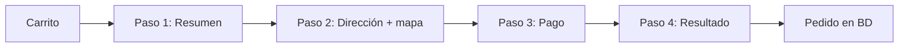

# 06. Checkout y métodos de pago

> **Componentes:** `Interface web client/src/app/components/CheckoutModal.tsx`,
> `Interface web client/src/app/components/CheckoutAddressMap.tsx`
> **Lógica del pedido:** `Interface web client/src/app/App.tsx` (`placeOrder`)
> **Ruta(s):** modal a pantalla completa sobre `/`, `/catalog`, `/account`
> **Estado:** ✅ Documentado

## Propósito

Permitir que el cliente (registrado o invitado) cierre la compra del carrito en
4 pasos: revisar el resumen, confirmar la dirección de entrega sobre el mapa,
elegir el medio de pago y confirmar el pedido. Al confirmar, el backend crea el
pedido y sus registros asociados en una transacción.

El estado del checkout vive en `App.tsx` y se pasa por props al modal:
`checkoutStep`, `checkoutAddress`, `checkoutShipping`, `checkoutPayment`,
`checkoutLoading`, `checkoutError`, `cardPayment`, `wompiAcceptance`,
`psePayment`, `nequiPayment`, `addressConfirmed`, `savedAddresses`,
`selectedAddressId`, `usingNewAddress` y la config de medios de pago.

## Funcionalidades implementadas

| Funcionalidad | Estado | Notas |
|---|---|---|
| Resumen + tipo de envío (estándar/express) | ✅ | Costos fijos 4.900 / 9.900 |
| Direcciones guardadas del cliente | ✅ | Solo si hay sesión (`GET /customer-auth/addresses`) |
| Dirección manual + validación | ✅ | Nombre, celular (`^3\d{9}$`), email, dirección, ciudad |
| Mapa con marcador + confirmación | ✅ | Geocodificación real (`/geocode/search`, `/geocode/reverse`) |
| Efectivo contra entrega | ✅ | Pedido directo `created` |
| Tarjeta (Wompi) | ✅ | Tokeniza contra Wompi y **sí cobra** |
| Nequi | ⬜ | Solo guarda el celular; **no** cobra ni abre la app |
| PSE | ⬜ | Solo guarda banco/tipo de persona; **no** crea transacción |
| Bre-B | 🟡 | Manual por diseño: muestra llave + QR; el admin verifica |
| Denominaciones / cupones / notas | ⬜ | No hay campo de cupón en el checkout |
| Reserva de inventario al crear pedido | ⬜ | El stock **no** se descuenta ni reserva aquí |

## Flujo general

---

## Mapeo botón por botón

### Encabezado y navegación del modal

| # | Control | Tipo | Propósito | Acción al activar | Endpoint / servicio | Efecto en BD |
|---|---|---|---|---|---|---|
| 1 | Flecha izquierda | Botón | Volver | En paso 1 cierra el checkout; en otros vuelve un paso | — (estado local) | — |
| 2 | Logo | Imagen | Marca | — | — | — |
| 3 | X | Botón | Cerrar checkout | `onClose` → `setCheckoutOpen(false)` | — (estado local) | — |
| 4 | Indicador "Resumen / Dirección / Pago" | Indicador (solo lectura) | Orientar | — | — | — |

### Paso 1 — Resumen

| # | Control | Tipo | Propósito | Acción al activar | Endpoint / servicio | Efecto en BD |
|---|---|---|---|---|---|---|
| 1 | Lista de ítems + subtotal | Display | Revisar el pedido | — | — | — |
| 2 | Radio "Envío estándar" | Radio | Envío 2-3 h (4.900) | `onSetCheckoutShipping("standard")` | — (estado local) | — |
| 3 | Radio "Envío express" | Radio | Envío 45-60 min (9.900) | `onSetCheckoutShipping("express")` | — (estado local) | — |
| 4 | Bloque de totales | Display | Subtotal + envío + total | — | — | — |
| 5 | "Continuar con la dirección →" | Botón | Ir a dirección | `onSetCheckoutStep(2)` | — (estado local) | — |

### Paso 2 — Dirección de entrega

| # | Control | Tipo | Propósito | Acción al activar | Endpoint / servicio | Efecto en BD |
|---|---|---|---|---|---|---|
| 1 | Tarjeta de dirección guardada | Botón | Reutilizar una dirección | `selectSavedAddress(id)` llena el formulario | — (`savedAddresses` ya cargadas) | — |
| 2 | "+ Usar otra dirección" | Botón | Escribir una nueva | `switchToNewAddress()` → `usingNewAddress = true` | — (estado local) | — |
| 3 | "← Volver a mis direcciones" | Botón | Regresar a las guardadas | Selecciona la predeterminada o la primera | — (estado local) | — |
| 4 | Input "Dirección" | Input texto | Dirección a entregar | `onSetCheckoutAddress`; **limpia `lat/lng` y la confirmación** | — (estado local) | — |
| 5 | Input "Ciudad" | Input texto | Ciudad | Igual que (4): invalida el punto del mapa | — (estado local) | — |
| 6 | Input "Nombre" | Input texto | Quién recibe | `onSetCheckoutAddress` | — (estado local) | — |
| 7 | Input "Celular" | Input tel | Contacto | Normaliza a 10 dígitos; valida `^3\d{9}$` | — (estado local) | — |
| 8 | Input "Email" | Input email | Confirmación | Valida formato de email | — (estado local) | — |
| 9 | Input "Indicaciones adicionales" | Input texto | Notas para el repartidor | `onSetCheckoutAddress` | — (estado local) | — |
| 10 | Enter en Dirección/Ciudad | Atajo de teclado | Ubicar en el mapa sin salir del campo | Hace `blur()` → dispara `handleLocateResult` | `GET /geocode/search` | — |
| 11 | "Continuar con el pago →" | Botón | Avanzar | `onSetCheckoutStep(3)` | — (estado local) | — |

> El botón (11) está **deshabilitado** hasta que: nombre, celular válido, email
> válido y dirección estén completos, `lat/lng` existan y `addressConfirmed` sea
> `true`.

### Mapa de dirección (`CheckoutAddressMap.tsx`)

| # | Control | Tipo | Propósito | Acción al activar | Endpoint / servicio | Efecto en BD |
|---|---|---|---|---|---|---|
| 1 | "Usar mi ubicación" | Botón | Ubicar el punto actual | Geolocalización del navegador → coloca/centra el marcador | `geocodingService.reverse` → `GET /geocode/reverse` | — |
| 2 | Marcador (arrastrar) | Arrastre | Ajustar el punto | `marker.on("dragend")` → `onCoordsChange`; **invalida la confirmación** | — (estado local) | — |
| 3 | Sugerencia del geocoder | Botón | Aplicar lo que resolvió el buscador | `applySuggestion` → setea `address`/`city` | — | — |
| 4 | "Confirmar que la dirección es correcta en el mapa" | Botón (toggle) | Aceptar el punto | `onConfirmedChange(!confirmed)` → `setAddressConfirmed(true)` | — (estado local) | — |

### Paso 3 — Pago

| # | Control | Tipo | Propósito | Acción al activar | Endpoint / servicio | Efecto en BD |
|---|---|---|---|---|---|---|
| 1 | Radio "Efectivo contra entrega" | Radio | Pagar al recibir | `onSetCheckoutPayment("efectivo")` | — (estado local + `localStorage.checkout_payment`) | — |
| 2 | Radio "Nequi" | Radio | Transferencia Nequi | `onSetCheckoutPayment("nequi")` | — | — |
| 3 | Radio "PSE" | Radio | Débito bancario | `onSetCheckoutPayment("pse")` | — | — |
| 4 | Radio "Tarjeta débito/crédito" | Radio | Pago con tarjeta | `onSetCheckoutPayment("tarjeta")` | — | — |
| 5 | Radio "Bre-B (transferencia entre bancos)" | Radio | Transferir a la llave | `onSetCheckoutPayment("breb")` | — | — |
| 6 | Inputs de tarjeta (nombre, número, MM/AA, CVC, cuotas) | Inputs | Datos de la tarjeta | `onSetCardPayment` | — (estado local) | — |
| 7 | Checks de aceptación (términos, datos personales) | Checkbox | Consentimiento | `onSetWompiAcceptance` | — (estado local) | — |
| 8 | Select banco / tipo de persona (PSE) | Select | Banco y persona | `onSetPsePayment` | — (estado local) | — |
| 9 | Input teléfono (Nequi) | Input tel | Número Nequi | `onSetNequiPayment`; valida `^3\d{9}$` | — (estado local) | — |
| 10 | Copiar llave (Bre-B) | Botón | Copiar la llave | `navigator.clipboard.writeText` | — | — |
| 11 | "Confirmar pedido →" | Botón | Crear el pedido | `onPlaceOrder` (`placeOrder`, ver abajo) | `POST /orders/checkout` o `/orders/guest-checkout` | **Writes** (ver resumen) |

#### Disponibilidad y config de los medios de pago

| Control / dato | Origen | Notas |
|---|---|---|
| Qué métodos se muestran | `GET /payments/methods` (`App.tsx:814`) | `efectivo.enabled`, `wompi.enabled` + `methods.{card,pse,nequi}`, `breb.enabled` |
| Tokens de aceptación (tarjeta) | `GET /payments/wompi/config` | `acceptanceToken`, `personalDataAuthToken`, `publicKey` |
| Persistencia de la elección | `localStorage.checkout_payment` | `App.tsx:244` |

#### Qué pasa al pulsar "Confirmar pedido →" (`placeOrder`)

| Paso | Detalle | Endpoint / servicio |
|---|---|---|
| 1 | (Solo tarjeta) tokeniza la tarjeta contra Wompi con la public key | `ordersService.tokenizeWompiCard` → `POST https://api.wompi.co/v1/tokens/cards` (o sandbox) |
| 2 | Arma `items` + `address` (con `lat/lng`) + `shippingType` + `paymentMethod` | — |
| 3 | Crea el pedido (autenticado o invitado) | `POST /orders/checkout` (auth) · `POST /orders/guest-checkout` (invitado) |
| 4 | (Solo tarjeta con `payment_pending`) sigue el estado del pago | `PaymentVerificationService` (poll a Wompi cada 3 s) |
| 5 | Actualiza el UI: guarda el pedido, limpia el carrito, va al paso 4 y se suscribe al WebSocket | `useOrderSocket` |

### Paso 4 — Resultado

| # | Control | Tipo | Propósito | Acción al activar | Endpoint / servicio | Efecto en BD |
|---|---|---|---|---|---|---|
| 1 | Estado del pago (pendiente / rechazado) | Display | Informar | (Bre-B muestra llave, referencia y monto; botón copiar) | — | — |
| 2 | "Ver mis pedidos" | Botón | Ir a los pedidos | `onViewOrders` → cierra checkout y abre `OrdersPanel` | — | — |
| 3 | "Seguir comprando" | Botón | Cerrar | `onClose` | — | — |

---

## Efectos en base de datos (resumen)

Al confirmar el pedido, `orders.service.ts` escribe en una **transacción**:

| Tabla | Cuándo | Columnas clave |
|---|---|---|
| `customer_addresses` | Checkout (solo cliente registrado) | `customerId`, `addressLine1`, `city`, `location` (POINT), `isDefault` (la 1ª queda predeterminada) |
| `orders` | Al crear | `referenceCode`, `customerId` (o invitado), `status`, `subtotal`, `shippingCost`, `total` |
| `order_items` | Al crear | `orderId`, `productVariantId`, `quantity`, `unitPrice`, `subtotal` |
| `shipments` | Al crear | `orderId`, `addressLine1`, `city`, `recipientName`, `recipientPhone`, `location` |
| `payment_intents` | Al crear | `paymentMethod`, `status`, `providerName`, `amount` |
| `payments` | Al crear | `orderId`, `paymentIntentId`, `paymentMethod`, `status` |
| `order_status_history` | Al crear | `orderId`, `status`, `note`, `createdBy` |
| `notifications` | Al crear / al confirmar pago | `targetCustomerId`, `type`, `title`, `message` |
| `orders.status` (update) | Cuando Wompi aprueba/rechaza (solo tarjeta) | `paid` / `cancelled` + `order_status_history` + notificación |

Estados resultantes según el método:

| Método | `orders.status` | `payments.status` | ¿Cobra? |
|---|---|---|---|
| `efectivo` | `created` | `PENDING` | No |
| `tarjeta` | `paid` si Wompi aprueba, si no `payment_pending` | `COMPLETED` / `PENDING` | **Sí** |
| `nequi`, `pse`, `breb` | `payment_pending` | `PENDING` | **No** |

## Pendientes / huecos

- **Nequi y PSE no cobran**: el backend solo crea transacción del proveedor para
  `tarjeta` (`orders.service.ts:257`). La pantalla de resultado dice *"procesado
  por Wompi"* para ambos, lo cual es engañoso.
- **Sin descuento de inventario**: crear el pedido no reserva ni descuenta stock.
- **Bre-B manual**: requiere verificación del admin; el cliente no recibe
  confirmación automática.
- **Sin cupones** en el checkout.
- **Dependencia de llaves Wompi**: si falta `WOMPI_PRIVATE_KEY`, tarjeta falla al
  cobrar aunque la config pública cargue (ver validación de medios de pago en el
  admin).
