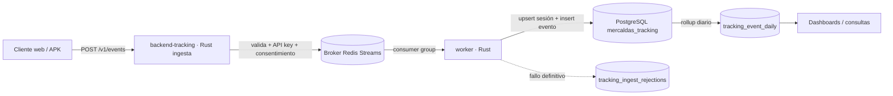

# Analítica propia (tracking) — diseño y cumplimiento

Sistema de analítica **first-party** para Mercaldas: sin cookies de terceros, sin
proveedores externos. Los eventos se capturan en el cliente web, se ingieren con
un servicio en Rust, se encolan en un broker y un worker los persiste en una base
de datos separada.

Artefactos de este directorio:

- [`onclick-map.md`](./onclick-map.md) — inventario generado de las **279**
  interacciones (`onClick`/`onSubmit`) del cliente web, con archivo, línea,
  componente y handler.
- [`../../db/tracking/schema.sql`](../../db/tracking/schema.sql) — esquema de la
  base de datos `mercaldas_tracking`.
- [`../../db/tracking/README.md`](../../db/tracking/README.md) — instalación,
  roles y mantenimiento.
- [`../../broker-tracking/README.md`](../../broker-tracking/README.md) — broker
  (Redis Streams) y operación.

---

## 1. ¿Aplica a nuestro caso?

**Sí.** El sitio registra interacciones (clics, búsquedas, carrito, checkout),
usa `localStorage` (carrito, sesión, preferencias) y, con este sistema, enviará
esos datos a un servidor. Aunque no se usen cookies de terceros, la normativa de
protección de datos aplica igual: se trata de información asociada a una persona
identificada o identificable (aunque sea por un identificador anónimo).

Marco de referencia (Colombia):

- **Ley 1581 de 2012** (protección de datos personales) y **Decreto 1377 de 2013**
  (reglamentario).
- Lineamientos de la **Superintendencia de Industria y Comercio (SIC)** sobre
  autorización, aviso de privacidad y derechos del titular.

> Este documento es una guía técnica, **no asesoría jurídica**. La política de
> tratamiento y el aviso de cookies deben redactarse/revisarse con el área legal
> antes de publicarse.

### Obligaciones y cómo las cubre el sistema

| Obligación | Aplicación concreta en el sistema |
| --- | --- |
| **Finalidad legítima e informada** | Catálogo cerrado de eventos y finalidades (analítica de uso y mejora del sitio). Cada evento documenta qué mide. Nada de perfilado publicitario. |
| **Autorización previa, expresa e informada** | Consentimiento en banner (analítica **apagada por defecto**). La ingesta **rechaza** eventos sin `consent.analytics = true`. Registro append-only en `tracking_consents`. |
| **Transparencia** | Aviso de cookies y política de tratamiento publicados; versión de política (`policy_version`) guardada con cada consentimiento. El payload declara qué se envía. |
| **Seguridad** | API key por cliente (hash en BD), `ip_hash` con sal (nunca IP en claro), sin valores de formularios, roles de BD de mínimo privilegio, TLS, retención acotada. |
| **Derechos del titular** | `tracking_deletion_requests` + `delete_tracking_subject()`; canal de consulta/corrección/supresión documentado en la política. |
| **Conservación y supresión** | Crudos 90 días, agregados 24 meses, consentimientos 5 años, rechazos 30 días. `purge_tracking_events()` programable. |

### Cookies / almacenamiento local

| Categoría | Ejemplos | ¿Requiere consentimiento? |
| --- | --- | --- |
| **Necesarias** | Sesión de autenticación, carrito (`mercaldas_cart_v1`), preferencia de tema, consentimiento | No (estrictamente necesarias) |
| **Analítica** | `anonymous_id`, eventos de uso, medición de conversión | **Sí** |
| **Marketing** | (no implementado) | **Sí** |

No se usan cookies de terceros ni balizas externas. La analítica es 100 %
first-party.

---

## 2. Decisiones de diseño

1. **Consentimiento primero**: el cliente no envía eventos de analítica hasta que
   el usuario acepte. El backend valida el consentimiento y, si falta, rechaza
   (no "corrige" ni guarda el evento).
2. **Sin PII**: no se capturan valores de inputs (nombre, teléfono, dirección,
   contraseña, correo). Solo identificadores de elemento y metadatos del evento.
   Las búsquedas se registran como evento, **no** como texto libre por defecto.
3. **Pseudonimización**: `anonymous_id` (UUID local) y `customer_id` opcional. La
   IP solo se guarda como hash con sal secreta.
4. **Idempotencia**: `event_id` (UUID) único; el worker hace `ON CONFLICT DO NOTHING`.
5. **Retención por capas**: crudo (90 d) → agregado diario (24 m). Los dashboards
   leen agregados, no el crudo.
6. **Kill switch**: variable de entorno `TRACKING_ENABLED=false` en ingesta y
   worker para detener la captura sin desplegar.
7. **Separación de bases**: `mercaldas_tracking` es independiente de `ecommerce`;
   si el tracking falla, la tienda sigue funcionando.

---

## 3. Arquitectura



Componentes:

1. **Ingesta (`backend-tracking`, Rust + axum)**
   - `POST /v1/events` (lote de hasta N eventos).
   - Valida esquema (serde), tamaño, `event_name`, `occurred_at`, consentimiento.
   - Autentica con `X-Api-Key` (hash en `tracking_api_keys`).
   - Rate limit por IP/anon id; rechaza payloads con campos prohibidos.
   - Publica en el stream `tracking:events` y responde `202 Accepted`.
2. **Broker (`broker-tracking`, Redis Streams)**
   - Stream `tracking:events`, consumer group `tracking-workers`.
   - Persistencia AOF `everysec`; `maxmemory-policy noeviction`.
   - Detalle y configuración en [`broker-tracking/README.md`](../../broker-tracking/README.md).
3. **Worker (Rust)**
   - Lee con `XREADGROUP`, procesa y escribe en PostgreSQL.
   - `XACK` solo tras commit en BD; reintentos con backoff; `XAUTOCLAIM` para
     mensajes pendientes de workers caídos.
   - Upsert de `tracking_sessions` y `tracking_consents`; `INSERT … ON CONFLICT`
     de eventos.
4. **Base de datos (`db/tracking`)**
   - Esquema en [`schema.sql`](../../db/tracking/schema.sql).

### Por qué Redis Streams

- Ya es liviano de operar (un contenedor), sin cluster ni zookeeper.
- Consumer groups + `XACK` + `XAUTOCLAIM` cubren el caso de reintentos y workers
  caídos.
- Volumen esperado (analítica de una tienda) no justifica Kafka.
- Alternativa si se necesita retención larga o replay masivo: **NATS JetStream**.

---

## 4. Modelo de eventos

### Convención de nombres

| Prefijo | Uso | Ejemplos |
| --- | --- | --- |
| `page.` | Navegación | `page.view`, `page.leave` |
| `ui.` | Interacción de interfaz | `ui.header.search_submit`, `ui.catalog.filter_open` |
| `ecom.` | Evento de negocio | `ecom.product.view`, `ecom.cart.add`, `ecom.checkout.address_confirm`, `ecom.order.placed` |

Formato: `dominio.objeto.accion` en `snake_case`, máximo 120 caracteres.

### Campos por evento

| Campo | Obligatorio | Descripción |
| --- | --- | --- |
| `event_id` | Sí | UUID v4 generado en el cliente (idempotencia). |
| `anonymous_id` | Sí | UUID local del navegador/dispositivo. |
| `customer_id` | No | Solo si hay sesión y consentimiento. |
| `kind` | Sí | `page_view`, `click`, `submit`, `search`, `navigation`, `order`, `custom`. |
| `event_name` | Sí | Nombre según la convención. |
| `occurred_at` | Sí | ISO-8601 con zona. |
| `page.path` | Sí | Ruta interna (`/catalog`). |
| `element` | No | `tag`, `label`, `id`, `component`, `handler`. |
| `properties` | No | Datos del evento **sin PII** (producto, categoría, importe, cantidad). |
| `context` | No | `viewport`, `device`, `app`, `version`, `locale`. |
| `consent` | Sí | `{ "analytics": true, "version": "2026-10" }`. |

### Ejemplo de payload

```json
{
  "event_id": "6f1c2a9e-2b1f-4d0a-9a3e-2f6c1d7b8e10",
  "anonymous_id": "0b9f1c2d-3e4f-4a5b-8c9d-0e1f2a3b4c5d",
  "kind": "click",
  "event_name": "ecom.cart.add",
  "occurred_at": "2026-10-06T15:42:11.312-05:00",
  "page": { "path": "/catalog", "url": "http://192.168.0.132:4173/catalog" },
  "element": {
    "tag": "button",
    "label": "Agregar 1",
    "id": "product-add-121477",
    "component": "ProductCard"
  },
  "properties": { "product_id": 121477, "category": "ACEITES", "price": 49800, "quantity": 1 },
  "context": { "viewport": "390x844", "device": "mobile", "app": "web" },
  "consent": { "analytics": true, "version": "2026-10" }
}
```

### Catálogo y prioridad

El inventario completo está en [`onclick-map.md`](./onclick-map.md). No todos los
clics deben instrumentarse: se prioriza el embudo de compra.

| Prioridad | Eventos |
| --- | --- |
| P0 (embudo) | `page.view`, `ecom.product.view`, `ecom.cart.add`, `ecom.cart.remove`, `ecom.checkout.start`, `ecom.checkout.address_confirm`, `ecom.checkout.payment_select`, `ecom.order.placed` |
| P1 (descubrimiento) | `ui.header.search_submit`, `ecom.catalog.filter_apply`, `ecom.catalog.category_select`, `ecom.catalog.sort_change`, `ecom.banner.click` |
| P2 (cuenta y soporte) | `ui.auth.login_submit`, `ui.auth.register_submit`, `ui.account.tab_change`, `ui.chat.open`, `ui.chat.message_send` |
| P3 (resto) | Interacciones secundarias del mapa |

> **Nota de instrumentación:** el mapa muestra varios botones icónicos sin
> `aria-label` ni texto (p. ej. flechas de carrusel, botones de cerrar). Para que
> el evento sea legible y accesible, añadir `aria-label` y un atributo
> `data-track="…"` estable; el cliente lo usará como `event_name`/`element.id`.

---

## 5. Consentimiento

Flujo:

1. Primer acceso → banner con dos opciones: **Solo necesarias** y **Aceptar
   analítica**. Sin elección, analítica = apagada.
2. La elección se guarda en `localStorage` (`tracking_consent_v1`) y se envía a
   `POST /v1/consents` (con `policy_version`).
3. El SDK de tracking comprueba el consentimiento antes de encolar eventos. Si es
   `false`, no se envía nada (ni `page.view`).
4. La ingesta vuelve a validar el consentimiento (defensa en profundidad).
5. Cambio de opinión → configuración de cookies; cada cambio deja fila nueva en
   `tracking_consents`.

Excepción legal: no se aplica a cookies **estrictamente necesarias** (carrito,
sesión, seguridad). Se documentan en el aviso de cookies pero no requieren
autorización.

---

## 6. Seguridad

- **Transporte**: TLS en producción; la ingesta no se expone sin proxy.
- **Autenticación**: `X-Api-Key` por cliente (web/admin/app). Hash `sha256` con sal
  en `tracking_api_keys`; rotación y revocación sin desplegar.
- **Autorización**: la ingesta solo puede insertar; el worker lee/escribe; los
  dashboards usan un rol de solo lectura (ver `db/tracking/roles.sql`).
- **Datos**: sin IP en claro, sin valores de formularios, sin contraseñas, sin
  headers sensibles. `properties`/`context` se validan contra una lista blanca.
- **Abuso**: rate limit, límite de tamaño de lote y de evento, rechazo de
  `event_name` no permitidos.
- **Operación**: backups cifrados, acceso restringido por red/VPN, logs sin PII.

---

## 7. Conservación y derechos

| Dato | Retención | Mecanismo |
| --- | --- | --- |
| Eventos crudos | 90 días | `purge_tracking_events(90)` (cron diario) |
| Agregados diarios | 24 meses | `tracking_event_daily` |
| Consentimientos | 5 años (prueba de autorización) | `tracking_consents` |
| Rechazos de ingesta | 30 días | purga programada |
| Sesiones | Se limpian al purgar eventos; `last_seen_at` para higiene | `delete_tracking_subject()` |

Derechos del titular: consulta, actualización, rectificación, supresión y
revocación de la autorización. La supresión se atiende con
`delete_tracking_subject(anonymous_id, customer_id)` y se registra en
`tracking_deletion_requests`.

---

## 8. Fases de implementación

1. **Esquema y documentación** (este entregable).
2. **Ingesta + broker + worker** (`backend-tracking`, `broker-tracking`).
3. **SDK del cliente**: `anonymous_id`, consentimiento, cola con `sendBeacon`,
   `data-track`.
4. **Banner de cookies y configuración** (necesarias/analítica).
5. **Páginas legales**: aviso de cookies + política de tratamiento + canal de
   derechos. **Publicarlas antes de capturar tráfico real.**
6. **Dashboards** sobre `tracking_event_daily`.

Recomendación: implementar 2–4 con `TRACKING_ENABLED=false` y consentimiento
apagado; publicar 5; luego activar.

---

## 9. Preguntas abiertas

- Identidad del responsable (razón social/NIT) y correo del canal de derechos.
- ¿Se registran términos de búsqueda? Si sí, documentarlo y permitir exclusión.
- ¿Se vincula `customer_id` (usuario logueado) a la sesión anónima? Hoy es opcional.
- Ventana de retención definitiva (propuesta: 90 días crudo / 24 meses agregado).
- ¿Se necesita integración con el panel admin para ver métricas o basta SQL/BI?
