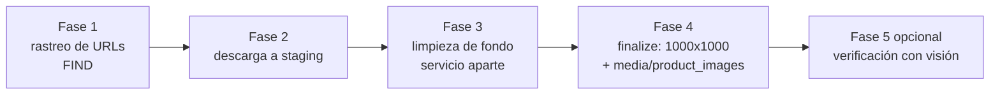

# Imágenes desde internet para productos sin foto

Pipeline para conseguir, limpiar el fondo y montar fotos de los **10.186
productos sin imagen** del catálogo (`db/products_without_image.json`),
reutilizando las convenciones que ya usa el resto del sistema.

## Lo que ya existe (verificado en este repo)

| Pieza | Dónde | Detalle |
|---|---|---|
| Fotos montadas | `db/images_static/products/` (gitignored) | se sirven en `/static/products/` |
| Nombre de archivo | p. ej. `7708177032222.JPEG` | `<código>.JPEG` (barcode; minúsc. `.jpeg` en algunos), 94.4 % son barcode |
| Enlace a producto | tabla `media` + `product_images` | `media.path='/static/products/<file>'`, `checksum='local:tid:<file>'`, `provider='local'`; portada = `product_images(is_cover=true, position=0)` |
| Asociación por código | `scripts-agent/import-tid-images.mjs` | cruza stem del archivo vs `barcode/sku/external_id/plu`, idempotente |
| Foto → alias TID | `scripts-agent/match-unlinked-images.mjs` | segunda pasada contra los aliases del ADT |
| Refresco de los JSON | `node scripts-agent/export-products.mjs` | regenera `db/products.json` y `db/products_without_image.json` desde Postgres |

Datos del catálogo faltante (2026-10-03):

- 10.186 faltantes · 5.294 activos · apenas 256 públicos.
- 8.317 con **EAN-13** y 8.803 con barcode usable (8–14 dígitos) → 86 % se
  puede atacar por **lookup de código de barras**.
- 980 con `barcode == plu` (código interno, no EAN real).
- ~1.383 sin barcode usable → solo búsqueda por nombre+marca o revisión manual.
- Cruce con las 7.675 fotos locales sin enlazar: **0 coincidencias** → internet
  es la vía real.

## Fases



### Fase 1 — Rastreo de URLs candidatas ✅ (implementada)

`find-image-candidates.mjs` — no descarga nada, solo decide **de dónde** saldría
cada imagen y lo deja auditado.

```bash
# prueba sin red: muestra consultas que haría
node scripts-agent/image-sourcing/find-image-candidates.mjs --dry-run --limit=20

# corrida real (reanudable; se puede parar y volver a lanzar)
node scripts-agent/image-sourcing/find-image-candidates.mjs --limit=500
node scripts-agent/image-sourcing/find-image-candidates.mjs --active-only
node scripts-agent/image-sourcing/find-image-candidates.mjs --only=7702175108460
node scripts-agent/image-sourcing/find-image-candidates.mjs --retry   # reintenta none/review/error
```

Salidas:

- `db/image-sourcing/candidates.ndjson` — una línea JSON por producto (la
  última gana): `candidate_url`, `confidence`, `provider`, `match_method`,
  `candidates[]` (top 5), `status`: `candidate | review | none | error`.
- `db/image-sourcing/summary.json` — conteos por estado, proveedor, confianza
  y motivo de los `none` (con vs sin barcode).

Proveedores (orden de ejecución por producto):

| Proveedor | Busca por | API key | Confianza |
|---|---|---|---|
| `openfacts` (default) | barcode 8–14 díg. en Open Food/Beauty/Products Facts | no | 0.90–1.00 (`barcode_exact`) |
| `google_cse` | nombre + marca (Image Search) | `GOOGLE_CSE_KEY`, `GOOGLE_CSE_CX` | 0.35–0.85 |
| `serpapi` | nombre + marca (Google Images) | `SERPAPI_KEY` | 0.35–0.85 |
| `wikimedia` | nombre (Commons) | no | ≤ 0.40 (genérico) |

Notas de diseño:

- Si `openfacts` acierta por barcode, se corta ahí (el EAN es autoritativo y no
  gasta cuota de buscadores).
- Heurística de host OFF: cosméticos/aseo → primero Open Beauty Facts;
  alimentos/bebidas → Open Food Facts; resto → Food, Products, Beauty.
- Scorer de búsqueda: solape de tokens del nombre (35 %) + marca (15 %) +
  allowlist de dominios de retail CO (15 %) + base 0.35. Las keys van en
  `backend/.env.development.local` (los scripts ya cargan ese archivo).
Ritmo: 700 ms/req a Open*Facts (límite documentado ≈100 req/min), 300 ms a
  buscadores. `--sleep=<factor>` para ser aún más conservador.

  **Paralelización**: el rastreo se puede repartir en shards disjuntos por
  `product_id`. Cada shard escribe su propio manifest:

  ```bash
  node scripts-agent/image-sourcing/find-image-candidates.mjs \
    --active-only --shard=0/4 --dir=db/image-sourcing/shards/0
  # … shards 1/4, 2/4, 3/4
  node scripts-agent/image-sourcing/merge-shards.mjs   # fusiona en candidates.ndjson
  ```

  4 shards ≈ 72 req/min, por debajo del límite de Open*Facts.
- Estimación de la corrida completa por barcode: ~13 k requests ≈ **2–3 h** en
  segundo plano. Con `--active-only` mucho menos.

Revisión: `status=review` (< 0.45) y `error` quedan en el manifest para
reintento/inspección; todo candidato guarda hasta 5 URLs alternas para
reemplazo manual sin volver a salir a internet.

**Muestra inicial (2026-10-14)**: 54 productos rastreados → 6 candidatos
(todos `barcode_exact`, confianza 1.0), 45 `none` (EAN sin ficha en
Open*Facts), 3 `error` (HTTP 500 de Open*Facts, reintentables con `--retry`).
Hit-rate sobre productos con barcode: ~14 %. Proyección: **~1.2 k imágenes
por esta vía gratuita**; el resto necesita buscadores (cuota) o revisión
manual — conviene activarlos por lotes, priorizando `--active-only`.

### Fase 2 — Descarga a staging ✅ (implementada)

`download-candidates.mjs` — lee el manifest, filtra `status=candidate` y
`confidence>=--min`, y descarga a `db/image-staging/raw/<code>.<ext>`
validando con `sharp` (≥ 600 px de lado, formato jpeg/png/webp), guardando
`sha256` en `downloads.ndjson`. **No toca `db/images_static/` ni la BD.**

Los candidatos de Open*Facts suelen venir como miniatura `.400.jpg`; el script
prueba automáticamente la variante `.full.jpg` (original) antes de aceptar.

```bash
node scripts-agent/image-sourcing/download-candidates.mjs --min-confidence=0.9
node scripts-agent/image-sourcing/download-candidates.mjs --include-review
node scripts-agent/image-sourcing/download-candidates.mjs --force --limit=50
```

### Fase 3 — Limpieza de fondo (servicio aparte del usuario)

Contrato propuesto para que el servicio sea enchufable sin cambiar el pipeline:

```
POST {BG_SERVICE_URL}            # p. ej. http://127.0.0.1:8011/remove
Content-Type: multipart/form-data  (campo "file")
→ 200 image/png con alfa, lado mayor ≥ 800 px, mismo encuadre
→ 4xx/5xx si falla (el pipeline reintenta y marca bg_pending)
```

Config vía `BG_SERVICE_URL` en `backend/.env.development.local`. Sin la
variable, la fase 2 se detiene con las imágenes en `raw/` y el manifest indica
`bg_pending=true` (nada se publica sin limpiar, según lo pedido).

### Fase 4 — Finalize + enlace a BD (pendiente, solo cuando Fase 3 exista)

Script `finalize-images.mjs`:

1. Normaliza a **1000×1000** (`fit: contain`, fondo blanco): JPEG calidad 88 si
   no hay alfa; PNG si el servicio entrega transparencia.
2. Escribe `db/images_static/products/<code>.JPEG|png` (`<code>` = barcode > plu >
   external_id > id, ya resuelto en el manifest).
3. Inserta en `media` siguiendo la convención exacta de `import-tid-images.mjs`:

   ```sql
   INSERT INTO media (status, media_type, provider, path, file_name, mime_type,
                      size_bytes, width, height, checksum, metadata, is_public)
   VALUES ('active','image','local','/static/products/<file>','<file>',
           'image/jpeg', …, 'local:web:<file>',
           '{"source":"web","url":"…","provider":"…","match_method":"…","confidence":0.95,"bg":true}', true);
   ```

4. `product_images` con guardia `NOT EXISTS (… is_cover = true)` — jamás pisa
   portadas existentes.
5. Marca `status=linked` + `linked_at` en el manifest (idempotente).

### Fase 5 (opcional) — Verificación con visión

Los candidatos de buscador (< 0.9) pueden pasar por un modelo de visión (el
bot ya usa DeepSeek; el CRM tiene ia-service) comparando foto vs
`name`+`brand`+`description` antes de publicar. Se implementaría como
`verify-candidates.mjs` en esta misma carpeta, alimentándose del manifest.

## Presupuesto y legal

- Open*Facts: gratuito, datos abiertos (ODbL); respetar 100 req/min y
  User-Agent identificable (ya configurado).
- Google CSE: 100 consultas gratis/día; SerpAPI: 100/mes gratis (resto pago).
- No hay scraping de retailers en esta fase: la allowlist de dominios solo
  puntúa resultados que devuelven las APIs de búsqueda.
- Registrar siempre `source_page`/`url` (ya en el manifest) para trazabilidad y
  poder retirar una imagen a pedido.

## Próximos pasos sugeridos

1. Correr Fase 1 completa en segundo plano sobre los **5.294 activos**
   (`--active-only`); revisar `summary.json`.
2. Activar `google_cse`/`serpapi` para los ~1.9 k sin barcode usable (requiere
   keys) y afinar el scorer con la muestra de `review`.
3. Cuando exista el servicio de BG: Fase 2 (descarga) → Fase 3 → Fase 4 con
   `--min-confidence=0.9` y revisión humana del resto.
